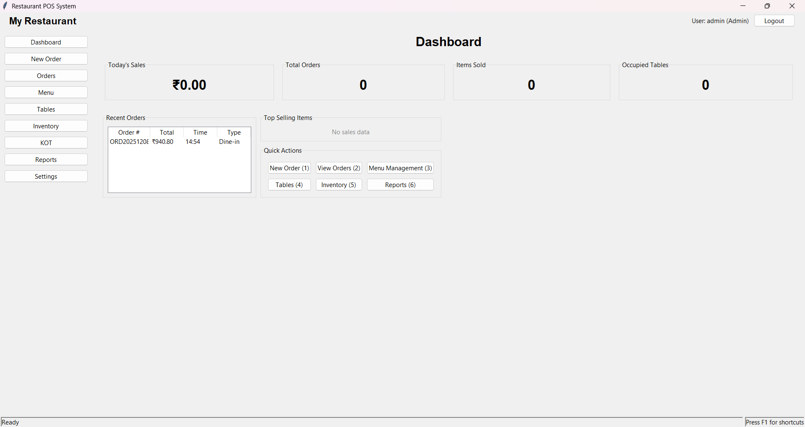

# Restaurant POS System

A comprehensive, feature-rich Point of Sale (POS) system designed specifically for restaurant management. Built with Python, Tkinter, and SQLite, this system provides a complete solution for order processing, menu management, inventory tracking, and business analytics.



## Table of Contents

- [Features](#features)
- [Technology Stack](#technology-stack)
- [Architecture](#architecture)
- [Installation](#installation)
- [Getting Started](#getting-started)
- [Usage Guide](#usage-guide)
- [Modules Overview](#modules-overview)
- [Dashboard Features](#dashboard-features)
- [Known Issues](#known-issues)
- [Contributing](#contributing)
- [License](#license)

## Features

### Core Functionality
- **User Authentication**: Secure login system with role-based access control
- **Order Management**: Complete order lifecycle from creation to payment
- **Menu Management**: Dynamic menu with categories and pricing
- **Table Management**: Restaurant table status and assignment
- **Inventory Tracking**: Stock monitoring and alerts
- **Billing System**: Automated bill generation with multiple payment options
- **Kitchen Operations**: Kitchen Order Ticket (KOT) system for efficient food preparation
- **Reporting & Analytics**: Comprehensive sales and performance reports
- **Settings Management**: Configurable system parameters

### Advanced Features
- **Real-time Dashboard**: Live statistics and business metrics
- **Keyboard Shortcuts**: Efficient navigation and quick actions
- **Data Export**: Export reports to CSV and Excel formats
- **Receipt Generation**: Printable bills and KOTs
- **Multi-user Support**: Different roles and permissions
- **Responsive UI**: Clean, intuitive interface designed for restaurant environments

## Technology Stack

### Frontend
- **Tkinter**: Python's standard GUI framework
- **ttkthemes**: Enhanced widget styling
- **Pillow (PIL)**: Image processing and handling
- **matplotlib**: Chart generation for analytics
- **tkinter-page**: Advanced page management

### Backend
- **Python 3.7+**: Core programming language
- **SQLite**: Lightweight, file-based database
- **pandas**: Data manipulation and analysis
- **openpyxl**: Excel file handling
- **reportlab**: PDF generation for reports
- **qrcode**: QR code generation
- **python-barcode**: Barcode generation

## Architecture

The system follows a modular architecture with clear separation of concerns:

```
src/
├── models/              # Data models and business logic
│   ├── database.py      # Database connection and utilities
│   ├── user.py          # User authentication and management
│   ├── menu_item.py     # Menu item operations
│   ├── category.py      # Category management
│   ├── table.py         # Table management
│   ├── order.py         # Order processing
│   ├── kot.py           # Kitchen Order Ticket operations
│   ├── report.py        # Report generation
│   └── settings.py      # System settings
├── ui/                  # User interface components
│   ├── base_ui.py       # Base UI class with common functionality
│   ├── login_screen.py  # User authentication interface
│   ├── dashboard_screen.py # Main dashboard
│   ├── order_screen.py  # Order creation and management
│   ├── menu_screen.py   # Menu management interface
│   ├── tables_screen.py # Table management interface
│   ├── inventory_screen.py # Inventory management
│   ├── kot_screen.py    # Kitchen Order Ticket interface
│   ├── reports_screen.py # Reports and analytics
│   └── settings_screen.py # System configuration
├── controllers/         # Business logic coordination
│   └── order_controller.py # Order processing logic
└── utils/               # Helper functions and utilities
    ├── constants.py     # Application constants
    ├── helpers.py       # Common utility functions
    └── keyboard_handler.py # Keyboard shortcut management
```

## Installation

### Prerequisites
- Python 3.7 or higher
- pip package manager
- Git (for cloning the repository)

### Setup Instructions

1. **Clone the repository**:
   ```bash
   git clone <repository-url>
   cd posmvp
   ```

2. **Create a virtual environment** (recommended):
   ```bash
   python -m venv venv
   
   # On Windows
   venv\Scripts\activate
   
   # On Unix/MacOS
   source venv/bin/activate
   ```

3. **Install dependencies**:
   ```bash
   pip install -r requirements.txt
   ```

4. **Initialize the database**:
   ```bash
   python database_setup.py
   ```
   This will create the `restaurant_pos.db` file with all necessary tables and default data.

## Getting Started

### Running the Application

You can start the application in two ways:

1. **Using the main entry point**:
   ```bash
   python main.py
   ```

2. **Directly from the source**:
   ```bash
   python src/app.py
   ```

### Default Login Credentials

The system comes with a default administrator account:

- **Username**: `admin`
- **Password**: `admin123`
- **Role**: Administrator (full system access)

> **Note**: It is recommended to change the default password after first login for security reasons.

## Usage Guide

### Main Navigation

After successful login, you'll see the main dashboard with a sidebar navigation:

1. **Dashboard**: Overview of restaurant performance and statistics
2. **New Order**: Create and process customer orders
3. **Orders**: View and manage order history
4. **Menu**: Add, edit, and manage menu items and categories
5. **Tables**: Manage restaurant table status and assignments
6. **Inventory**: Track stock levels and manage inventory
7. **KOT**: View and manage Kitchen Order Tickets
8. **Reports**: Generate various sales and performance reports
9. **Settings**: Configure system parameters (Admin only)

### Keyboard Shortcuts

The system includes keyboard shortcuts for efficient operation:

- **F1**: Show help and shortcuts
- **1-6**: Quick navigation from dashboard
- **Ctrl+N**: New order
- **Ctrl+S**: Save current form
- **Esc**: Cancel current operation

### Order Processing Workflow

1. **Create Order**: Click "New Order" or press Ctrl+N
2. **Select Table**: Choose the dining table
3. **Add Items**: Select menu items and quantities
4. **Review Order**: Check order details and total
5. **Generate KOT**: Send order to kitchen
6. **Process Payment**: Accept payment and generate bill
7. **Complete Order**: Mark order as completed

## Modules Overview

### Dashboard Module

The dashboard provides a real-time overview of restaurant operations:

- **Today's Sales**: Total revenue for the current day
- **Total Orders**: Number of orders processed
- **Items Sold**: Total quantity of items sold
- **Occupied Tables**: Current table occupancy
- **Recent Orders**: Latest order history
- **Top Selling Items**: Most popular menu items
- **Quick Actions**: Shortcut buttons for common tasks

### Order Management

Complete order lifecycle management:

- Order creation with table assignment
- Menu item selection and customization
- Real-time order tracking
- Payment processing with multiple methods
- Bill generation and printing
- Order history and status updates

### Menu Management

Dynamic menu system with:

- Category organization
- Item pricing and descriptions
- Availability status
- Image support for menu items
- Bulk import/export capabilities

### Inventory System

Stock management features:

- Real-time stock tracking
- Low stock alerts
- Automatic stock deduction on orders
- Supplier management
- Purchase order tracking

### Reporting & Analytics

Comprehensive business intelligence:

- Daily/weekly/monthly sales reports
- Item performance analysis
- Staff performance metrics
- Customer trends
- Export capabilities (CSV, Excel, PDF)

## Dashboard Features

The dashboard is the central hub of the POS system, providing at-a-glance insights into restaurant operations:

### Key Metrics
- **Real-time Sales**: Live updates of daily revenue
- **Order Statistics**: Total orders, average order value
- **Table Occupancy**: Visual representation of table status
- **Popular Items**: Top-selling menu items with quantities

### Visual Elements
- **Statistical Cards**: Large, easy-to-read metrics
- **Recent Orders Table**: Quick view of latest transactions
- **Top Items List**: Best-performing menu items
- **Quick Action Buttons**: One-click access to common tasks

### Interactive Features
- **Keyboard Navigation**: Number keys for quick access
- **Auto-refresh**: Real-time data updates
- **Drill-down Capability**: Click on metrics for detailed views
- **Responsive Layout**: Adapts to different screen sizes


## Known Issues

### Import Resolution Issues

The system currently has some import resolution issues that need to be addressed:

1. **Relative Import Paths**: Some modules may have inconsistent import paths
2. **Module Dependencies**: Circular dependency issues in some components
3. **Path Resolution**: File path handling may need adjustment for different operating systems

### Workarounds

- Run the application from the root directory
- Ensure all dependencies are properly installed
- Use the main.py entry point for consistent execution

### Future Improvements

- Implement absolute imports throughout the codebase
- Add comprehensive error handling for import failures
- Create a proper package structure with __init__.py files

## Contributing

We welcome contributions to improve the Restaurant POS System. Please follow these guidelines:

1. **Fork the repository** and create a feature branch
2. **Follow the existing code style** and architecture patterns
3. **Test your changes** thoroughly before submitting
4. **Update documentation** for any new features
5. **Submit a pull request** with a clear description of changes

### Development Guidelines

- Use meaningful variable and function names
- Add comments for complex logic
- Follow PEP 8 Python style guidelines
- Test all database operations
- Ensure UI consistency across screens

## License

This project is licensed under the MIT License. See the LICENSE file for details.

## Support

For support and questions:

1. **Check the documentation**: Review this README and other documentation files
2. **Review login credentials**: Ensure you're using the correct login information
3. **Run tests**: Execute test files to verify system components
4. **Check console output**: Look for error messages during execution
5. **Verify database**: Ensure the restaurant_pos.db file exists and is accessible

---

**Restaurant POS System** - A comprehensive solution for modern restaurant management.