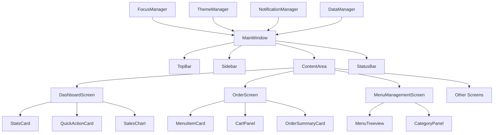

# POS System Component Architecture Diagram

## Overview

This document provides visual diagrams and implementation details for the enhanced POS system component architecture.

## 1. Component Hierarchy

```
RestaurantPOSApp
├── ThemeManager
├── FocusManager
├── NotificationManager
├── DataManager
└── UI Components
    ├── Layout Components
    │   ├── MainWindow
    │   │   ├── TopBar
    │   │   ├── Sidebar
    │   │   ├── ContentArea
    │   │   └── StatusBar
    │   ├── ResponsiveGrid
    │   └── Panel
    ├── Base Components
    │   ├── POSBaseComponent
    │   ├── POSButton
    │   ├── POSCard
    │   ├── POSForm
    │   ├── POSTreeview
    │   └── POSChart
    ├── Specialized Components
    │   ├── StatsCard
    │   ├── QuickActionCard
    │   ├── MenuItemCard
    │   ├── OrderSummaryCard
    │   ├── TableStatusCard
    │   └── NotificationToast
    └── Screen Components
        ├── DashboardScreen
        ├── OrderScreen
        ├── MenuManagementScreen
        ├── TableManagementScreen
        ├── InventoryScreen
        ├── KOTScreen
        ├── ReportsScreen
        └── SettingsScreen
```

## 2. Component Interaction Flow



## 3. Base Component Implementation

### 3.1 POSBaseComponent

```python
class POSBaseComponent:
    """Base class for all POS UI components"""
    
    def __init__(self, parent, style_class=None, **kwargs):
        self.parent = parent
        self.style_class = style_class
        self.kwargs = kwargs
        self.widget = None
        self.children = []
        self.event_handlers = {}
        
    def create_widget(self):
        """Override in subclasses to create specific widget"""
        raise NotImplementedError
        
    def apply_theme(self):
        """Apply consistent styling based on design system"""
        if self.style_class and hasattr(self.parent, 'theme_manager'):
            self.parent.theme_manager.apply_style(self.widget, self.style_class)
    
    def bind_events(self):
        """Bind common events"""
        if self.widget:
            self.widget.bind('<Enter>', self.on_enter)
            self.widget.bind('<Leave>', self.on_leave)
            self.widget.bind('<FocusIn>', self.on_focus_in)
            self.widget.bind('<FocusOut>', self.on_focus_out)
    
    def on_enter(self, event):
        """Handle mouse enter"""
        self.set_state('hover')
        
    def on_leave(self, event):
        """Handle mouse leave"""
        self.set_state('normal')
        
    def on_focus_in(self, event):
        """Handle focus gain"""
        self.set_state('focus')
        if hasattr(self.parent, 'focus_manager'):
            self.parent.focus_manager.set_focused_widget(self.widget)
        
    def on_focus_out(self, event):
        """Handle focus loss"""
        self.set_state('normal')
        
    def set_state(self, state):
        """Handle component states (normal, hover, active, disabled)"""
        if hasattr(self.parent, 'theme_manager'):
            self.parent.theme_manager.set_widget_state(self.widget, state)
    
    def add_child(self, child):
        """Add child component"""
        self.children.append(child)
        
    def show(self):
        """Show component"""
        if self.widget:
            self.widget.pack()
            
    def hide(self):
        """Hide component"""
        if self.widget:
            self.widget.pack_forget()
            
    def destroy(self):
        """Clean up component"""
        for child in self.children:
            child.destroy()
        if self.widget:
            self.widget.destroy()
```

### 3.2 POSButton Implementation

```python
class POSButton(POSBaseComponent):
    """Enhanced button component with consistent styling"""
    
    VARIANTS = {
        'primary': {
            'bg': '#3498DB',
            'fg': '#FFFFFF',
            'active_bg': '#2980B9',
            'border': 'none'
        },
        'secondary': {
            'bg': '#FFFFFF',
            'fg': '#3498DB',
            'active_bg': '#E5E7EB',
            'border': '#3498DB'
        },
        'danger': {
            'bg': '#E74C3C',
            'fg': '#FFFFFF',
            'active_bg': '#C0392B',
            'border': 'none'
        }
    }
    
    SIZES = {
        'small': {'padding': '4px 8px', 'font_size': 10},
        'medium': {'padding': '8px 16px', 'font_size': 12},
        'large': {'padding': '12px 24px', 'font_size': 14}
    }
    
    def __init__(self, parent, text, command=None, variant="primary", size="medium", 
                 shortcut_hint=None, icon=None, **kwargs):
        super().__init__(parent, f"btn-{variant}-{size}", **kwargs)
        self.text = text
        self.command = command
        self.variant = variant
        self.size = size
        self.shortcut_hint = shortcut_hint
        self.icon = icon
        self.create_widget()
        
    def create_widget(self):
        """Create styled button widget"""
        style_info = self.VARIANTS.get(self.variant, self.VARIANTS['primary'])
        size_info = self.SIZES.get(self.size, self.SIZES['medium'])
        
        # Create button frame for better control
        self.widget = ttk.Frame(self.parent)
        
        # Create button
        self.button = ttk.Button(
            self.widget,
            text=self.get_display_text(),
            command=self.on_click,
            style=f"{self.variant}.TButton"
        )
        self.button.pack(side=tk.LEFT, padx=5, pady=2)
        
        # Add shortcut hint if provided
        if self.shortcut_hint:
            hint_label = ttk.Label(
                self.widget,
                text=f"[{self.shortcut_hint}]",
                font=('Arial', 8),
                foreground='#7F8C8D'
            )
            hint_label.pack(side=tk.LEFT, padx=2)
        
        # Apply custom styling
        self.apply_custom_style(style_info, size_info)
        self.bind_events()
        
    def get_display_text(self):
        """Get text with optional icon"""
        if self.icon:
            return f"{self.icon} {self.text}"
        return self.text
        
    def apply_custom_style(self, style_info, size_info):
        """Apply custom styling to button"""
        # Configure ttk style
        style = ttk.Style()
        style.configure(
            f"{self.variant}.TButton",
            background=style_info['bg'],
            foreground=style_info['fg'],
            borderwidth=0,
            focuscolor='none',
            padding=size_info['padding'],
            font=('Arial', size_info['font_size'])
        )
        style.map(
            f"{self.variant}.TButton",
            background=[('active', style_info['active_bg'])]
        )
        
    def on_click(self):
        """Handle button click"""
        if self.command:
            self.command()
            
    def set_loading(self, loading=True):
        """Set loading state"""
        if loading:
            self.button.configure(text="Loading...", state='disabled')
        else:
            self.button.configure(text=self.get_display_text(), state='normal')
```

### 3.3 POSCard Implementation

```python
class POSCard(POSBaseComponent):
    """Card component for content grouping"""
    
    def __init__(self, parent, title=None, padding="medium", elevation="low", 
                 header_color=None, **kwargs):
        super().__init__(parent, "card", **kwargs)
        self.title = title
        self.padding = padding
        self.elevation = elevation
        self.header_color = header_color
        self.create_widget()
        
    def create_widget(self):
        """Create card with header and content area"""
        # Main card container
        self.widget = ttk.Frame(self.parent, style='Card.TFrame')
        
        # Card header (if title provided)
        if self.title:
            self.header = ttk.Frame(self.widget, style='CardHeader.TFrame')
            self.header.pack(fill=tk.X, padx=0, pady=0)
            
            self.title_label = ttk.Label(
                self.header,
                text=self.title,
                style='CardTitle.TLabel'
            )
            self.title_label.pack(side=tk.LEFT, padx=16, pady=12)
            
            # Separator
            separator = ttk.Separator(self.widget, orient='horizontal')
            separator.pack(fill=tk.X, padx=0, pady=0)
        
        # Content area
        self.content_frame = ttk.Frame(self.widget, style='CardContent.TFrame')
        self.content_frame.pack(fill=tk.BOTH, expand=True, padx=16, pady=16)
        
        # Apply styling
        self.apply_card_style()
        self.bind_events()
        
    def apply_card_style(self):
        """Apply card styling"""
        style = ttk.Style()
        
        # Card frame styling
        style.configure(
            'Card.TFrame',
            background='#FFFFFF',
            relief='solid',
            borderwidth=1
        )
        
        # Card header styling
        header_bg = self.header_color or '#F8F9FA'
        style.configure(
            'CardHeader.TFrame',
            background=header_bg
        )
        
        # Card title styling
        style.configure(
            'CardTitle.TLabel',
            background=header_bg,
            font=('Arial', 16, 'bold'),
            foreground='#2C3E50'
        )
        
        # Card content styling
        style.configure(
            'CardContent.TFrame',
            background='#FFFFFF'
        )
        
        # Add shadow effect
        if self.elevation == 'medium':
            self.widget.configure(relief='raised', borderwidth=2)
        elif self.elevation == 'high':
            self.widget.configure(relief='raised', borderwidth=3)
            
    def add_content(self, content_widget):
        """Add widget to card content"""
        content_widget.pack(in_=self.content_frame, fill=tk.BOTH, expand=True)
        
    def set_title(self, title):
        """Update card title"""
        self.title = title
        if hasattr(self, 'title_label'):
            self.title_label.configure(text=title)
```

## 4. Specialized Components

### 4.1 StatsCard Component

```python
class StatsCard(POSCard):
    """Dashboard statistics card with trend indicator"""
    
    def __init__(self, parent, title, value, trend=None, icon=None, 
                 color_scheme='blue', **kwargs):
        super().__init__(parent, title, **kwargs)
        self.value = value
        self.trend = trend
        self.icon = icon
        self.color_scheme = color_scheme
        self.create_stats_display()
        
    def create_stats_display(self):
        """Create statistics display"""
        # Main content frame
        stats_frame = ttk.Frame(self.content_frame)
        stats_frame.pack(fill=tk.BOTH, expand=True)
        
        # Top row with icon and value
        top_frame = ttk.Frame(stats_frame)
        top_frame.pack(fill=tk.X, pady=(0, 8))
        
        # Icon (if provided)
        if self.icon:
            icon_label = ttk.Label(
                top_frame,
                text=self.icon,
                font=('Arial', 24),
                foreground=self.get_color()
            )
            icon_label.pack(side=tk.LEFT, padx=(0, 12))
        
        # Value
        self.value_label = ttk.Label(
            top_frame,
            text=self.format_value(),
            font=('Arial', 24, 'bold'),
            foreground=self.get_color()
        )
        self.value_label.pack(side=tk.LEFT)
        
        # Trend indicator (if provided)
        if self.trend:
            trend_frame = ttk.Frame(stats_frame)
            trend_frame.pack(fill=tk.X)
            
            trend_icon = self.get_trend_icon()
            trend_color = self.get_trend_color()
            
            trend_label = ttk.Label(
                trend_frame,
                text=f"{trend_icon} {self.trend}%",
                font=('Arial', 12),
                foreground=trend_color
            )
            trend_label.pack(side=tk.LEFT)
            
    def format_value(self):
        """Format value for display"""
        if isinstance(self.value, (int, float)):
            if self.value >= 1000:
                return f"₹{self.value/1000:.1f}K"
            return f"₹{self.value:.0f}"
        return str(self.value)
        
    def get_color(self):
        """Get color based on scheme"""
        colors = {
            'blue': '#3498DB',
            'green': '#27AE60',
            'orange': '#F39C12',
            'red': '#E74C3C'
        }
        return colors.get(self.color_scheme, '#3498DB')
        
    def get_trend_icon(self):
        """Get trend icon"""
        if self.trend > 0:
            return "↑"
        elif self.trend < 0:
            return "↓"
        return "→"
        
    def get_trend_color(self):
        """Get trend color"""
        if self.trend > 0:
            return '#27AE60'
        elif self.trend < 0:
            return '#E74C3C'
        return '#7F8C8D'
        
    def update_value(self, new_value, new_trend=None):
        """Update statistics"""
        self.value = new_value
        if new_trend is not None:
            self.trend = new_trend
            
        self.value_label.configure(text=self.format_value())
        
        # Update trend if changed
        if new_trend is not None and hasattr(self, 'trend_label'):
            self.trend_label.configure(
                text=f"{self.get_trend_icon()} {self.trend}%",
                foreground=self.get_trend_color()
            )
```

### 4.2 QuickActionCard Component

```python
class QuickActionCard(POSCard):
    """Quick action card with keyboard shortcut hint"""
    
    def __init__(self, parent, title, action, shortcut_key, icon=None, 
                 description=None, **kwargs):
        super().__init__(parent, title, **kwargs)
        self.action = action
        self.shortcut_key = shortcut_key
        self.icon = icon
        self.description = description
        self.create_action_button()
        
    def create_action_button(self):
        """Create action button with shortcut hint"""
        # Main action button
        button_frame = ttk.Frame(self.content_frame)
        button_frame.pack(fill=tk.BOTH, expand=True)
        
        # Icon and text
        display_text = self.get_display_text()
        
        self.action_button = POSButton(
            button_frame,
            text=display_text,
            command=self.on_action_click,
            variant='secondary',
            size='large',
            shortcut_hint=self.shortcut_key
        )
        self.action_button.pack(fill=tk.BOTH, expand=True)
        
        # Description (if provided)
        if self.description:
            desc_label = ttk.Label(
                self.content_frame,
                text=self.description,
                font=('Arial', 10),
                foreground='#7F8C8D',
                wraplength=200
            )
            desc_label.pack(pady=(8, 0))
            
    def get_display_text(self):
        """Get button display text with icon"""
        if self.icon:
            return f"{self.icon} {self.title}"
        return self.title
        
    def on_action_click(self):
        """Handle action button click"""
        if self.action:
            self.action()
            
    def set_shortcut_highlight(self, highlight=True):
        """Highlight when shortcut is pressed"""
        if highlight:
            self.widget.configure(style='HighlightedCard.TFrame')
        else:
            self.widget.configure(style='Card.TFrame')
```

## 5. Layout Components

### 5.1 ResponsiveGrid Implementation

```python
class ResponsiveGrid(POSBaseComponent):
    """Responsive grid layout system"""
    
    BREAKPOINTS = {
        'mobile': 768,
        'tablet': 1024,
        'desktop': 1440
    }
    
    def __init__(self, parent, columns=12, gap="medium", **kwargs):
        super().__init__(parent, "grid", **kwargs)
        self.columns = columns
        self.gap = gap
        self.cells = {}
        self.current_breakpoint = None
        self.create_widget()
        
    def create_widget(self):
        """Create responsive grid container"""
        self.widget = ttk.Frame(self.parent)
        self.bind_events()
        
        # Monitor window resize
        self.widget.bind('<Configure>', self.on_resize)
        
    def on_resize(self, event):
        """Handle window resize"""
        width = event.width
        new_breakpoint = self.get_breakpoint(width)
        
        if new_breakpoint != self.current_breakpoint:
            self.current_breakpoint = new_breakpoint
            self.reorganize_grid()
            
    def get_breakpoint(self, width):
        """Determine current breakpoint"""
        if width < self.BREAKPOINTS['mobile']:
            return 'mobile'
        elif width < self.BREAKPOINTS['tablet']:
            return 'tablet'
        elif width < self.BREAKPOINTS['desktop']:
            return 'desktop'
        return 'large-desktop'
        
    def add_widget(self, widget, row=0, col=0, colspan=1, rowspan=1, 
                   responsive_config=None):
        """Add widget to grid with responsive configuration"""
        cell_key = f"{row}-{col}"
        
        # Create cell container
        cell = ttk.Frame(self.widget)
        cell.grid(row=row, column=col, columnspan=colspan, rowspan=rowspan,
                 sticky='nsew', padx=self.get_gap_size(), pady=self.get_gap_size())
        
        # Add widget to cell
        widget.pack(in_=cell, fill=tk.BOTH, expand=True)
        
        # Store cell information
        self.cells[cell_key] = {
            'widget': widget,
            'cell': cell,
            'row': row,
            'col': col,
            'colspan': colspan,
            'rowspan': rowspan,
            'responsive_config': responsive_config or {}
        }
        
        # Configure grid weights
        self.widget.grid_columnconfigure(col, weight=1)
        self.widget.grid_rowconfigure(row, weight=1)
        
    def reorganize_grid(self):
        """Reorganize grid based on current breakpoint"""
        for cell_key, cell_info in self.cells.items():
            config = cell_info['responsive_config']
            
            # Get configuration for current breakpoint
            bp_config = config.get(self.current_breakpoint, {})
            
            # Update grid configuration
            new_row = bp_config.get('row', cell_info['row'])
            new_col = bp_config.get('col', cell_info['col'])
            new_colspan = bp_config.get('colspan', cell_info['colspan'])
            new_rowspan = bp_config.get('rowspan', cell_info['rowspan'])
            
            # Re-grid the cell
            cell_info['cell'].grid(
                row=new_row, column=new_col,
                columnspan=new_colspan, rowspan=new_rowspan,
                sticky='nsew'
            )
            
    def get_gap_size(self):
        """Get gap size in pixels"""
        gaps = {
            'none': 0,
            'small': 4,
            'medium': 8,
            'large': 16
        }
        return gaps.get(self.gap, 8)
```

## 6. Theme Management System

### 6.1 ThemeManager Implementation

```python
class ThemeManager:
    """Centralized theme management system"""
    
    def __init__(self, root):
        self.root = root
        self.current_theme = 'light'
        self.themes = {
            'light': self.get_light_theme(),
            'dark': self.get_dark_theme()
        }
        self.style = ttk.Style()
        self.apply_theme(self.current_theme)
        
    def get_light_theme(self):
        """Define light theme colors"""
        return {
            'primary': '#3498DB',
            'secondary': '#2C3E50',
            'success': '#27AE60',
            'warning': '#F39C12',
            'error': '#E74C3C',
            'background': '#FFFFFF',
            'surface': '#F8F9FA',
            'border': '#E5E7EB',
            'text_primary': '#2C3E50',
            'text_secondary': '#7F8C8D',
            'text_disabled': '#BDC3C7'
        }
        
    def get_dark_theme(self):
        """Define dark theme colors"""
        return {
            'primary': '#3498DB',
            'secondary': '#ECF0F1',
            'success': '#27AE60',
            'warning': '#F39C12',
            'error': '#E74C3C',
            'background': '#1A1A1A',
            'surface': '#2D2D2D',
            'border': '#404040',
            'text_primary': '#ECF0F1',
            'text_secondary': '#BDC3C7',
            'text_disabled': '#7F8C8D'
        }
        
    def apply_theme(self, theme_name):
        """Apply theme to all widgets"""
        self.current_theme = theme_name
        colors = self.themes[theme_name]
        
        # Configure base styles
        self.configure_base_styles(colors)
        
        # Configure component styles
        self.configure_button_styles(colors)
        self.configure_card_styles(colors)
        self.configure_form_styles(colors)
        
    def configure_base_styles(self, colors):
        """Configure base widget styles"""
        # Root window
        self.style.configure('TFrame', background=colors['background'])
        
        # Labels
        self.style.configure('TLabel', 
                         background=colors['background'],
                         foreground=colors['text_primary'])
        
        # Entry fields
        self.style.configure('TEntry',
                         fieldbackground=colors['surface'],
                         bordercolor=colors['border'],
                         insertcolor=colors['primary'])
        
    def configure_button_styles(self, colors):
        """Configure button styles"""
        # Primary button
        self.style.configure('Primary.TButton',
                         background=colors['primary'],
                         foreground=colors['background'],
                         borderwidth=0,
                         focuscolor='none')
        
        # Secondary button
        self.style.configure('Secondary.TButton',
                         background=colors['surface'],
                         foreground=colors['primary'],
                         borderwidth=1,
                         focuscolor=colors['primary'])
        
    def configure_card_styles(self, colors):
        """Configure card styles"""
        self.style.configure('Card.TFrame',
                         background=colors['surface'],
                         relief='solid',
                         borderwidth=1)
        
        self.style.configure('CardHeader.TFrame',
                         background=colors['border'])
        
    def configure_form_styles(self, colors):
        """Configure form widget styles"""
        self.style.configure('Form.TEntry',
                         fieldbackground=colors['background'],
                         bordercolor=colors['border'],
                         insertcolor=colors['primary'])
        
    def apply_style(self, widget, style_class):
        """Apply style class to widget"""
        if style_class in self.style.element_names():
            widget.configure(style=style_class)
            
    def set_widget_state(self, widget, state):
        """Set widget visual state"""
        if state == 'hover':
            # Apply hover effect
            pass
        elif state == 'focus':
            # Apply focus effect
            pass
        elif state == 'disabled':
            # Apply disabled effect
            pass
```

## 7. Implementation Guidelines

### 7.1 Component Development Workflow

1. **Inherit from POSBaseComponent**
   - Always start with base component
   - Implement required methods
   - Follow naming conventions

2. **Apply Design System**
   - Use defined colors and typography
   - Follow spacing guidelines
   - Implement consistent states

3. **Handle Events Properly**
   - Bind standard events
   - Implement state management
   - Provide accessibility support

4. **Test Responsiveness**
   - Test at all breakpoints
   - Ensure touch-friendly targets
   - Verify keyboard navigation

### 7.2 Integration Steps

1. **Create Base Infrastructure**
   - ThemeManager
   - FocusManager
   - NotificationManager

2. **Implement Base Components**
   - POSBaseComponent
   - POSButton
   - POSCard

3. **Develop Specialized Components**
   - StatsCard
   - QuickActionCard
   - Chart components

4. **Build Screen Components**
   - Dashboard
   - Order screen
   - Other screens

5. **Integrate with Existing Code**
   - Gradual migration
   - Maintain compatibility
   - Test thoroughly

### 7.3 Testing Strategy

1. **Unit Testing**
   - Component functionality
   - State management
   - Event handling

2. **Integration Testing**
   - Component interaction
   - Theme application
   - Responsive behavior

3. **User Testing**
   - Usability testing
   - Performance testing
   - Accessibility testing

## 8. Conclusion

This component architecture provides a solid foundation for implementing the enhanced POS system UI. The modular design allows for:

- **Consistent styling** across all components
- **Reusable components** for rapid development
- **Responsive behavior** for different screen sizes
- **Maintainable code** with clear separation of concerns
- **Scalable architecture** for future enhancements

The architecture follows modern UI development practices while working within Tkinter's limitations, providing enterprise-grade functionality and professional appearance.