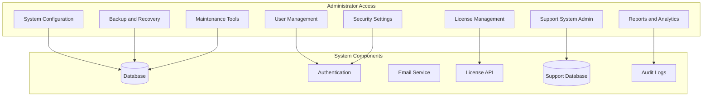

# Administrator Guide for Support and License Systems

## Overview

This guide provides comprehensive instructions for administrators managing both the support system and license validation system in the Restaurant POS MVP application. It covers system configuration, user management, reporting, and maintenance procedures.

## Table of Contents

1. [System Overview](#system-overview)
2. [Administrator Dashboard](#administrator-dashboard)
3. [Support System Administration](#support-system-administration)
4. [License System Administration](#license-system-administration)
5. [User Management](#user-management)
6. [System Configuration](#system-configuration)
7. [Security Management](#security-management)
8. [Reporting and Analytics](#reporting-and-analytics)
9. [Backup and Recovery](#backup-and-recovery)
10. [Maintenance Procedures](#maintenance-procedures)
11. [Troubleshooting](#troubleshooting)

## System Overview

### Administrator Role and Permissions

As an administrator, you have access to:



### Administrator Responsibilities

1. **System Configuration**: Set up and maintain system settings
2. **User Management**: Create and manage user accounts and permissions
3. **License Management**: Issue and manage customer licenses
4. **Support Oversight**: Monitor and manage support operations
5. **Security**: Ensure system security and compliance
6. **Reporting**: Generate and analyze system reports
7. **Maintenance**: Perform regular system maintenance
8. **Backup Management**: Manage system backups and recovery

## Administrator Dashboard

### Accessing the Dashboard

1. **Login as Administrator**:
   - Use your administrator credentials
   - Ensure you have administrator role assigned

2. **Navigate to Admin Panel**:
   - Click on "Admin" in main menu
   - Or use keyboard shortcut `Ctrl+Alt+A`

3. **Dashboard Overview**:
   - System status summary
   - Key metrics and alerts
   - Quick access to common tasks
   - Recent activity feed

### Dashboard Components

#### System Status Panel

```python
# dashboard_status.py
class SystemStatusPanel:
    """System status monitoring for administrators"""
    
    def get_system_status(self):
        """Get overall system health status"""
        return {
            'license_server': {
                'status': 'healthy',  # healthy, warning, critical
                'response_time': 125,  # milliseconds
                'last_check': datetime.now(),
                'uptime_percentage': 99.9
            },
            'support_system': {
                'status': 'healthy',
                'active_tickets': 47,
                'response_time_avg': 2.5,  # hours
                'satisfaction_rate': 4.6  # out of 5
            },
            'database': {
                'status': 'healthy',
                'connection_count': 125,
                'query_time_avg': 45,  # milliseconds
                'storage_used': 67.8,  # percentage
            },
            'email_service': {
                'status': 'warning',
                'queue_size': 1247,
                'delivery_rate': 98.2,  # percentage
                'last_error': 'SMTP timeout'
            }
        }
```

#### Quick Actions Panel

- **User Management**: Add/edit users, manage permissions
- **License Operations**: Issue/transfer/revoke licenses
- **Support Management**: View/assign/escalate tickets
- **System Configuration**: Access system settings
- **Reports**: Generate system reports
- **Maintenance**: Run maintenance tasks

#### Recent Activity Feed

Real-time updates of:
- New user registrations
- License activations/expirations
- High-priority support tickets
- System alerts and warnings
- Configuration changes

## Support System Administration

### Ticket Management

#### Viewing and Managing Tickets

1. **Access Ticket Management**:
   - From Admin Dashboard, click "Support System" → "Tickets"
   - View all tickets in the system

2. **Ticket List Features**:
   - **Filtering**: By status, priority, category, date range
   - **Sorting**: By date, priority, customer, status
   - **Search**: By ticket number, customer name, subject
   - **Bulk Operations**: Mass assign, update status, export

3. **Ticket Details View**:
   - Complete ticket information
   - Conversation history
   - Attachments and files
   - Audit trail of changes
   - Customer information

#### Ticket Assignment and Escalation

```python
# ticket_management.py
class TicketManagement:
    """Advanced ticket management for administrators"""
    
    def assign_ticket(self, ticket_id, staff_id, assignment_type='manual'):
        """Assign ticket to support staff"""
        ticket = self.get_ticket(ticket_id)
        
        # Check staff availability and workload
        staff = self.get_staff_member(staff_id)
        if not self.is_staff_available(staff):
            raise ValueError("Staff member is not available")
        
        # Check assignment rules
        if not self.validate_assignment(ticket, staff):
            raise ValueError("Assignment violates assignment rules")
        
        # Create assignment record
        assignment = {
            'ticket_id': ticket_id,
            'staff_id': staff_id,
            'assigned_by': self.current_user_id,
            'assignment_type': assignment_type,  # manual, auto, escalation
            'assigned_at': datetime.now()
        }
        
        # Update ticket
        self.update_ticket_status(ticket_id, 'In Progress')
        self.notify_assignment(ticket, staff)
        
        return assignment
    
    def escalate_ticket(self, ticket_id, new_priority, reason):
        """Escalate ticket priority"""
        ticket = self.get_ticket(ticket_id)
        
        # Validate escalation rules
        if not self.can_escalate(ticket, new_priority):
            raise ValueError("Escalation not permitted")
        
        # Update ticket
        old_priority = ticket.priority
        self.update_ticket_priority(ticket_id, new_priority)
        
        # Create escalation record
        escalation = {
            'ticket_id': ticket_id,
            'old_priority': old_priority,
            'new_priority': new_priority,
            'escalated_by': self.current_user_id,
            'reason': reason,
            'escalated_at': datetime.now()
        }
        
        # Notify appropriate staff
        self.notify_escalation(ticket, escalation)
        
        return escalation
```

#### Support Staff Management

1. **Staff Configuration**:
   - Add/edit support staff accounts
   - Set permissions and access levels
   - Configure working hours and availability
   - Set specialization areas

2. **Performance Monitoring**:
   - Track resolution times
   - Monitor customer satisfaction ratings
   - Analyze ticket handling patterns
   - Identify training needs

3. **Workload Management**:
   - View current staff workload
   - Balance ticket assignments
   - Set capacity limits
   - Manage availability schedules

### Support System Configuration

#### Response Templates

1. **Create Templates**:
   - From Admin Dashboard: Support System → Templates
   - Click "Create New Template"
   - Fill in template details

2. **Template Structure**:
   ```python
   response_template = {
       'name': 'Password Reset Response',
       'category': 'Account Management',
       'subject': 'Password Reset Request Received',
       'body': '''Dear {customer_name},
       
       We have received your password reset request.
       
       To reset your password, please click the link below:
       {reset_link}
       
       This link will expire in 24 hours.
       
       If you did not request this reset, please contact support immediately.
       
       Best regards,
       {support_team}''',
       'variables': ['customer_name', 'reset_link', 'support_team'],
       'is_active': True,
       'created_by': admin_user_id
   }
   ```

3. **Template Usage**:
   - Apply templates to ticket responses
   - Auto-populate with customer data
   - Customize before sending if needed

#### Automation Rules

1. **Ticket Routing Rules**:
   ```python
   routing_rules = [
       {
           'name': 'Critical Bug Routing',
           'conditions': {
               'category': 'Bug Report',
               'priority': 'Critical',
               'keywords': ['crash', 'down', 'emergency']
           },
           'actions': [
               'assign_to': 'senior_support_team',
               'notify_manager': True,
               'set_escalation': True
           ]
       },
       {
           'name': 'License Issues Routing',
           'conditions': {
               'category': 'Technical Support',
               'keywords': ['license', 'activation', 'expiry']
           },
           'actions': [
               'assign_to': 'license_specialist',
               'add_tag': 'license_issue',
               'set_priority': 'High'
           ]
       }
   ]
   ```

2. **Auto-Response Rules**:
   - Send automatic acknowledgments
   - Provide initial troubleshooting steps
   - Set customer expectations
   - Escalate if no response within specified time

## License System Administration

### License Management

#### Viewing and Managing Licenses

1. **Access License Management**:
   - From Admin Dashboard, click "License System" → "Licenses"
   - View all licenses in the system

2. **License List Features**:
   - **Search**: By license key, customer name, email
   - **Filter**: By license type, status, expiry date
   - **Sort**: By creation date, expiry date, customer name
   - **Bulk Operations**: Export, renew, deactivate

3. **License Details View**:
   - Complete license information
   - Hardware binding details
   - Activation history
   - Feature access log
   - Validation attempts log

#### License Operations

```python
# license_administration.py
class LicenseAdministration:
    """Advanced license management for administrators"""
    
    def issue_license(self, customer_data, license_type, duration=None):
        """Issue a new license to customer"""
        # Validate customer data
        if not self.validate_customer_data(customer_data):
            raise ValueError("Invalid customer data")
        
        # Generate license key
        license_key = self.generate_license_key(license_type)
        
        # Create license record
        license_record = {
            'license_key': license_key,
            'customer_id': customer_data['customer_id'],
            'license_type': license_type,
            'issued_date': datetime.now(),
            'expiry_date': self.calculate_expiry_date(license_type, duration),
            'features': self.get_features_for_type(license_type),
            'issued_by': self.current_user_id,
            'status': 'issued'
        }
        
        # Send license to customer
        self.send_license_email(customer_data, license_record)
        
        # Create audit record
        self.create_audit_record('license_issued', license_record)
        
        return license_record
    
    def transfer_license(self, license_key, new_customer_id, reason):
        """Transfer license to new customer"""
        license = self.get_license_by_key(license_key)
        
        # Validate transfer eligibility
        if not self.can_transfer_license(license):
            raise ValueError("License cannot be transferred")
        
        # Deactivate old binding
        self.deactivate_license_binding(license['id'])
        
        # Create new license record
        new_license = {
            'license_key': license_key,
            'customer_id': new_customer_id,
            'license_type': license['license_type'],
            'issued_date': datetime.now(),
            'original_issue_date': license['issued_date'],
            'features': license['features'],
            'transferred_from': license['customer_id'],
            'transfer_reason': reason,
            'transferred_by': self.current_user_id
        }
        
        # Notify parties
        self.notify_license_transfer(license, new_customer_id, reason)
        
        # Create audit record
        self.create_audit_record('license_transferred', new_license)
        
        return new_license
    
    def revoke_license(self, license_key, reason, notify_customer=True):
        """Revoke a license"""
        license = self.get_license_by_key(license_key)
        
        # Validate revocation authority
        if not self.can_revoke_license(license):
            raise ValueError("License cannot be revoked")
        
        # Update license status
        self.update_license_status(license['id'], 'revoked')
        
        # Add revocation record
        revocation = {
            'license_id': license['id'],
            'revoked_by': self.current_user_id,
            'revoked_at': datetime.now(),
            'reason': reason
        }
        
        # Invalidate all activations
        self.invalidate_all_activations(license['id'])
        
        # Notify customer if requested
        if notify_customer:
            self.notify_license_revocation(license, reason)
        
        # Create audit record
        self.create_audit_record('license_revoked', revocation)
        
        return revocation
```

#### License Types and Features

1. **License Type Management**:
   - Create custom license types
   - Define feature sets for each type
   - Set pricing and renewal terms
   - Configure upgrade paths

2. **Feature Management**:
   - Define available features
   - Set feature dependencies
   - Configure access rules
   - Create feature bundles

#### License Analytics

1. **Usage Statistics**:
   - Active licenses by type
   - Feature utilization rates
   - Geographic distribution
   - Renewal rates and patterns

2. **Performance Metrics**:
   - Validation success rates
   - Support requests by license type
   - Customer satisfaction by tier
   - Revenue and renewal projections

## User Management

### User Account Management

#### Creating and Managing Users

1. **Access User Management**:
   - From Admin Dashboard, click "User Management"
   - View all user accounts in the system

2. **User Creation**:
   ```python
   user_account = {
       'username': 'johndoe',
       'email': 'john.doe@restaurant.com',
       'full_name': 'John Doe',
       'role': 'cashier',  # admin, manager, cashier, support_staff
       'permissions': {
           'order_management': True,
           'reporting': True,
           'inventory_management': False
       },
       'location_access': ['location_1', 'location_2'],
       'is_active': True,
       'created_by': admin_user_id,
       'created_at': datetime.now()
   }
   ```

3. **Role-Based Access Control**:
   - **Administrator**: Full system access
   - **Manager**: Location-level management access
   - **Cashier**: Basic POS operations
   - **Support Staff**: Support system access only

#### Permission Management

```python
# permissions.py
class PermissionManager:
    """Role-based permission management"""
    
    PERMISSIONS = {
        # License System Permissions
        'license_view': ['admin', 'license_manager'],
        'license_issue': ['admin', 'license_manager'],
        'license_revoke': ['admin', 'license_manager'],
        'license_transfer': ['admin', 'license_manager'],
        
        # Support System Permissions
        'support_view_all': ['admin', 'support_manager'],
        'support_assign': ['admin', 'support_manager'],
        'support_escalate': ['admin', 'support_manager'],
        'support_delete': ['admin'],
        
        # System Permissions
        'user_manage': ['admin'],
        'system_configure': ['admin'],
        'reports_view': ['admin', 'manager'],
        'backup_create': ['admin'],
        'audit_view': ['admin']
    }
    
    def check_permission(self, user_role, permission):
        """Check if user role has specific permission"""
        return user_role in self.PERMISSIONS.get(permission, [])
    
    def get_user_permissions(self, user_role):
        """Get all permissions for a user role"""
        permissions = []
        for permission, roles in self.PERMISSIONS.items():
            if user_role in roles:
                permissions.append(permission)
        return permissions
```

### User Activity Monitoring

#### Activity Tracking

1. **Login Monitoring**:
   - Track successful and failed login attempts
   - Monitor unusual access patterns
   - Detect potential security breaches
   - Generate security alerts

2. **Feature Usage Tracking**:
   - Monitor which features users access
   - Track usage frequency and patterns
   - Identify training opportunities
   - Optimize user experience

3. **Performance Metrics**:
   - User productivity measures
   - Error rates by user
   - Support requests by user
   - Training effectiveness

## System Configuration

### Global Settings

#### System-Wide Configuration

1. **Access System Configuration**:
   - From Admin Dashboard, click "System Configuration"
   - Configure global system settings

2. **Configuration Categories**:
   - **General Settings**: System name, default language, timezone
   - **Email Configuration**: SMTP settings, notification preferences
   - **Security Settings**: Password policies, session timeout, 2FA
   - **License Settings**: Validation intervals, grace periods
   - **Support Settings**: Response time targets, escalation rules

3. **Configuration Example**:
   ```python
   system_config = {
       'general': {
           'system_name': 'Restaurant POS System',
           'default_language': 'en',
           'timezone': 'America/New_York',
           'date_format': 'MM/DD/YYYY',
           'currency': 'USD'
       },
       'email': {
           'smtp_server': 'smtp.restaurantpos.com',
           'smtp_port': 587,
           'use_tls': True,
           'from_address': 'noreply@restaurantpos.com',
           'from_name': 'Restaurant POS System'
       },
       'security': {
           'password_min_length': 8,
           'password_require_special': True,
           'password_require_numbers': True,
           'session_timeout_minutes': 60,
           'max_login_attempts': 5,
           'lockout_duration_minutes': 15
       },
       'license': {
           'validation_interval_hours': 24,
           'grace_period_days': 7,
           'offline_validation_days': 7,
           'max_activations_per_license': 3
       }
   }
   ```

### Integration Configuration

#### Third-Party Integrations

1. **Email Service Configuration**:
   - SMTP server settings
   - Email templates configuration
   - Delivery rate limits
   - Bounce handling rules

2. **Payment Gateway Configuration**:
   - Payment processor settings
   - API credentials
   - Transaction fees configuration
   - Refund policies

3. **Backup Service Configuration**:
   - Cloud storage settings
   - Backup schedules
   - Retention policies
   - Encryption settings

## Security Management

### Security Policies

#### Authentication Security

1. **Password Policies**:
   - Minimum length requirements
   - Complexity requirements
   - Expiration policies
   - History restrictions

2. **Multi-Factor Authentication**:
   - Configure 2FA options
   - Set up backup codes
   - Configure trusted devices
   - Recovery procedures

3. **Session Management**:
   - Session timeout settings
   - Concurrent session limits
   - Secure session handling
   - Logout procedures

#### Data Protection

1. **Encryption Settings**:
   - Database encryption configuration
   - File encryption policies
   - Transmission encryption
   - Key management procedures

2. **Access Control**:
   - IP address restrictions
   - Time-based access controls
   - Location-based restrictions
   - Device-based restrictions

### Security Monitoring

#### Threat Detection

```python
# security_monitoring.py
class SecurityMonitoring:
    """Security threat detection and response"""
    
    def detect_anomalies(self, user_activity):
        """Detect security anomalies in user activity"""
        anomalies = []
        
        # Check for unusual login patterns
        if self.detect_unusual_login_pattern(user_activity):
            anomalies.append({
                'type': 'unusual_login_pattern',
                'severity': 'medium',
                'description': 'Login from unusual location or time'
            })
        
        # Check for privilege escalation attempts
        if self.detect_privilege_escalation(user_activity):
            anomalies.append({
                'type': 'privilege_escalation',
                'severity': 'high',
                'description': 'Attempt to access unauthorized features'
            })
        
        # Check for data exfiltration patterns
        if self.detect_data_exfiltration(user_activity):
            anomalies.append({
                'type': 'data_exfiltration',
                'severity': 'critical',
                'description': 'Unusual data access patterns detected'
            })
        
        return anomalies
    
    def respond_to_threat(self, threat):
        """Automated response to security threats"""
        if threat['severity'] == 'critical':
            # Immediate account lockout
            self.lock_user_account(threat['user_id'])
            # Notify security team
            self.send_security_alert(threat)
            # Create audit record
            self.create_security_audit_record(threat)
        
        elif threat['severity'] == 'high':
            # Require re-authentication
            self.force_reauthentication(threat['user_id'])
            # Notify user
            self.send_security_notification(threat['user_id'], threat)
        
        elif threat['severity'] == 'medium':
            # Additional verification required
            self.require_additional_verification(threat['user_id'])
            # Log for review
            self.log_security_event(threat)
```

## Reporting and Analytics

### System Reports

#### Generating Reports

1. **Access Reports**:
   - From Admin Dashboard, click "Reports"
   - Select report type and parameters
   - Generate and export reports

2. **Report Categories**:
   - **User Reports**: Activity, performance, compliance
   - **License Reports**: Sales, renewals, usage, expirations
   - **Support Reports**: Volume, resolution times, satisfaction
   - **System Reports**: Performance, security, errors

3. **Report Configuration**:
   - Schedule automated reports
   - Set delivery preferences
   - Configure report templates
   - Set retention policies

#### Custom Reports

```python
# custom_reports.py
class CustomReportBuilder:
    """Custom report builder for administrators"""
    
    def create_custom_report(self, report_config):
        """Create custom report based on configuration"""
        # Validate report configuration
        if not self.validate_report_config(report_config):
            raise ValueError("Invalid report configuration")
        
        # Build query based on configuration
        query = self.build_query_from_config(report_config)
        
        # Execute query and get results
        results = self.execute_query(query)
        
        # Format results based on output type
        if report_config['output_format'] == 'excel':
            return self.export_to_excel(results, report_config)
        elif report_config['output_format'] == 'pdf':
            return self.export_to_pdf(results, report_config)
        else:
            return results
    
    def schedule_report(self, report_config, schedule):
        """Schedule automated report generation"""
        scheduled_report = {
            'report_config': report_config,
            'schedule': schedule,  # daily, weekly, monthly
            'recipients': schedule['recipients'],
            'created_by': self.current_user_id,
            'created_at': datetime.now()
        }
        
        # Add to scheduled reports
        self.add_scheduled_report(scheduled_report)
        
        return scheduled_report
```

### Analytics Dashboard

#### Real-Time Analytics

1. **Key Performance Indicators**:
   - System health metrics
   - User activity metrics
   - License performance indicators
   - Support efficiency measures

2. **Trend Analysis**:
   - Historical data comparison
   - Growth patterns
   - Usage trends
   - Performance trends

3. **Predictive Analytics**:
   - License renewal predictions
   - Support volume forecasting
   - Resource utilization projections
   - Capacity planning recommendations

## Backup and Recovery

### Backup Configuration

#### Automated Backup Setup

1. **Configure Backup Settings**:
   - From Admin Dashboard, click "System Configuration" → "Backup"
   - Set up automated backup schedules

2. **Backup Types**:
   - **Database Backups**: Complete database dumps
   - **File Backups**: Application files and configurations
   - **License Backups**: License data and activations
   - **Log Backups**: System and audit logs

3. **Backup Schedule Example**:
   ```python
   backup_schedule = {
       'database': {
           'frequency': 'daily',
           'time': '02:00',
           'retention_days': 30,
           'compression': True,
           'encryption': True
       },
       'files': {
           'frequency': 'weekly',
           'day': 'sunday',
           'time': '03:00',
           'retention_weeks': 12,
           'compression': True,
           'encryption': True
       },
       'logs': {
           'frequency': 'daily',
           'time': '01:00',
           'retention_days': 90,
           'compression': True,
           'encryption': True
       }
   }
   ```

#### Backup Verification

```python
# backup_verification.py
class BackupVerification:
    """Backup verification and integrity checking"""
    
    def verify_backup_integrity(self, backup_file):
        """Verify backup file integrity"""
        verification_results = {
            'file_exists': False,
            'file_readable': False,
            'checksum_valid': False,
            'encryption_valid': False,
            'data_integrity': False
        }
        
        # Check if file exists
        if os.path.exists(backup_file):
            verification_results['file_exists'] = True
        
        # Check if file is readable
        try:
            with open(backup_file, 'rb') as f:
                backup_data = f.read()
            verification_results['file_readable'] = True
        except Exception as e:
            verification_results['error'] = str(e)
            return verification_results
        
        # Verify checksum
        if self.verify_checksum(backup_data):
            verification_results['checksum_valid'] = True
        
        # Verify encryption
        if self.verify_encryption(backup_data):
            verification_results['encryption_valid'] = True
        
        # Verify data integrity
        if self.verify_data_integrity(backup_data):
            verification_results['data_integrity'] = True
        
        return verification_results
    
    def test_backup_recovery(self, backup_file):
        """Test recovery from backup file"""
        test_results = {
            'recoverable': False,
            'data_complete': False,
            'recovery_time': 0,
            'errors': []
        }
        
        try:
            start_time = time.time()
            
            # Attempt to recover backup
            recovered_data = self.recover_backup(backup_file)
            
            # Verify data completeness
            if self.verify_data_completeness(recovered_data):
                test_results['data_complete'] = True
            
            test_results['recoverable'] = True
            test_results['recovery_time'] = time.time() - start_time
            
        except Exception as e:
            test_results['errors'].append(str(e))
        
        return test_results
```

### Recovery Procedures

#### Disaster Recovery

1. **System Recovery Steps**:
   - Assess damage and determine recovery scope
   - Restore from most recent clean backup
   - Verify system integrity after recovery
   - Test all critical functionalities

2. **Data Recovery Options**:
   - **Full Restore**: Complete system restore from backup
   - **Partial Restore**: Restore specific components
   - **Point-in-Time Recovery**: Restore to specific time
   - **Selective Recovery**: Restore specific data types

## Maintenance Procedures

### Regular Maintenance

#### Scheduled Maintenance Tasks

1. **Daily Tasks**:
   - Review system logs for errors
   - Check backup completion status
   - Monitor system performance metrics
   - Review security alerts

2. **Weekly Tasks**:
   - Review user access logs
   - Analyze support ticket trends
   - Check license expiration reports
   - Update security patches

3. **Monthly Tasks**:
   - Comprehensive system performance review
   - User access audit and cleanup
   - License usage and renewal analysis
   - Backup system testing

#### Maintenance Mode

```python
# maintenance_mode.py
class MaintenanceMode:
    """System maintenance mode management"""
    
    def enable_maintenance_mode(self, reason, duration_minutes):
        """Enable system maintenance mode"""
        # Notify active users
        self.notify_upcoming_maintenance(reason, duration_minutes)
        
        # Wait for active sessions to complete
        self.wait_for_sessions_to_complete(duration_minutes)
        
        # Enable maintenance mode
        maintenance_config = {
            'enabled': True,
            'reason': reason,
            'started_at': datetime.now(),
            'estimated_duration': duration_minutes,
            'enabled_by': self.current_user_id
        }
        
        self.update_system_config('maintenance_mode', maintenance_config)
        
        # Log maintenance start
        self.create_maintenance_log('maintenance_started', maintenance_config)
        
        return maintenance_config
    
    def disable_maintenance_mode(self):
        """Disable system maintenance mode"""
        # Disable maintenance mode
        self.update_system_config('maintenance_mode', {
            'enabled': False,
            'ended_at': datetime.now(),
            'disabled_by': self.current_user_id
        })
        
        # Notify users of system availability
        self.notify_maintenance_complete()
        
        # Log maintenance end
        self.create_maintenance_log('maintenance_ended', {
            'ended_at': datetime.now(),
            'disabled_by': self.current_user_id
        })
```

## Troubleshooting

### Common Administrator Issues

#### System Performance Issues

**Issue**: Slow system performance
**Solutions**:
1. Check system resource utilization
2. Review database query performance
3. Analyze user activity patterns
4. Optimize system configuration
5. Consider hardware upgrades if needed

#### License System Issues

**Issue**: License validation failures
**Solutions**:
1. Check license server connectivity
2. Verify license server status
3. Review license validation logs
4. Check system time synchronization
5. Contact license server administrator

#### Support System Issues

**Issue**: Email notifications not sending
**Solutions**:
1. Verify SMTP configuration
2. Check email server connectivity
3. Review email queue status
4. Check email template validity
5. Verify recipient email addresses

### Getting Help

#### Administrator Support

For administrator-specific issues:

1. **Administrator Portal**: admin.restaurantpos.com
2. **Priority Support**: admin-support@restaurantpos.com
3. **Emergency Hotline**: +1-800-POS-ADMIN
4. **Documentation**: docs.restaurantpos.com/admin

#### Community Resources

1. **Administrator Forum**: forum.restaurantpos.com/admin
2. **Best Practices Guide**: guides.restaurantpos.com/admin
3. **Video Tutorials**: videos.restaurantpos.com/admin
4. **Knowledge Base**: kb.restaurantpos.com/admin

---

This guide provides comprehensive information for administrators managing both the support system and license validation system. For additional assistance, don't hesitate to contact our administrator support team.