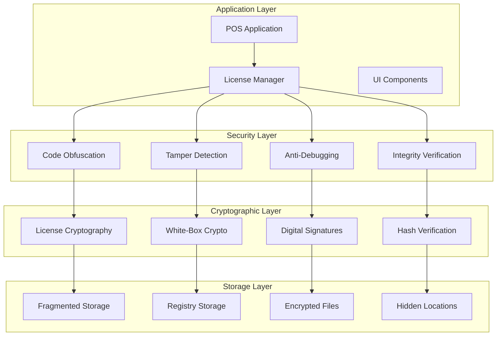

# Anti-Cracking Security Measures and Cryptographic Implementation

## Overview

This document outlines comprehensive anti-cracking security measures designed to make the license system extremely difficult to bypass while maintaining legitimate user experience. The implementation uses multiple layers of security including cryptography, obfuscation, tamper detection, and anti-reverse engineering techniques.

## Security Architecture



## 1. Cryptographic Implementation

### 1.1 White-Box Cryptography

```python
import hashlib
import hmac
import secrets
import base64
from cryptography.hazmat.primitives import hashes, serialization
from cryptography.hazmat.primitives.asymmetric import rsa, padding
from cryptography.hazmat.primitives.ciphers import Cipher, algorithms, modes
from cryptography.hazmat.backends import default_backend

class WhiteBoxCryptography:
    """White-box cryptography implementation for license protection"""
    
    def __init__(self):
        self.master_key = self._derive_master_key()
        self.license_key = self._derive_license_key()
        self.obfuscation_table = self._generate_obfuscation_table()
        
    def _derive_master_key(self) -> bytes:
        """Derive master key from multiple system sources"""
        sources = [
            self._get_system_uuid(),
            self._get_windows_product_id(),
            self._get_bios_info(),
            self._get_processor_info(),
            "POS_MVP_LICENSE_2024"  # Application-specific salt
        ]
        
        # Combine sources with HMAC
        combined = b"".join(source.encode() for source in sources)
        return hashlib.sha256(combined).digest()
    
    def _derive_license_key(self) -> bytes:
        """Derive license-specific encryption key"""
        # Use HKDF with master key
        hkdf = HKDF(
            algorithm=hashes.SHA256(),
            length=32,
            salt=b"POS_LICENSE_DERIVATION",
            info=b"license_encryption",
            backend=default_backend()
        )
        return hkdf.derive(self.master_key)
    
    def encrypt_license_data(self, data: dict) -> str:
        """Encrypt license data using white-box cryptography"""
        try:
            # Serialize data
            json_data = json.dumps(data, sort_keys=True).encode()
            
            # Generate random IV
            iv = secrets.token_bytes(16)
            
            # Encrypt using AES-256-GCM
            cipher = Cipher(
                algorithms.AES(self.license_key),
                modes.GCM(iv),
                backend=default_backend()
            )
            encryptor = cipher.encryptor()
            
            # Add additional authenticated data
            aad = b"POS_LICENSE_DATA_V2"
            encryptor.authenticate_additional_data(aad)
            
            # Encrypt data
            ciphertext = encryptor.update(json_data) + encryptor.finalize()
            
            # Combine components
            encrypted_package = {
                'iv': base64.b64encode(iv).decode(),
                'ciphertext': base64.b64encode(ciphertext[:-16]).decode(),  # Remove tag
                'tag': base64.b64encode(ciphertext[-16:]).decode(),
                'aad': base64.b64encode(aad).decode(),
                'version': '2.0',
                'timestamp': datetime.utcnow().isoformat()
            }
            
            # Obfuscate the result
            return self._obfuscate_data(encrypted_package)
            
        except Exception as e:
            logger.error(f"License encryption error: {e}")
            raise LicenseSecurityError("Failed to encrypt license data")
    
    def decrypt_license_data(self, encrypted_data: str) -> dict:
        """Decrypt license data using white-box cryptography"""
        try:
            # De-obfuscate data
            package = self._deobfuscate_data(encrypted_data)
            
            # Verify package integrity
            if not self._verify_package_integrity(package):
                raise LicenseSecurityError("License package integrity check failed")
            
            # Extract components
            iv = base64.b64decode(package['iv'])
            ciphertext = base64.b64decode(package['ciphertext'])
            tag = base64.b64decode(package['tag'])
            aad = base64.b64decode(package['aad'])
            
            # Decrypt using AES-256-GCM
            cipher = Cipher(
                algorithms.AES(self.license_key),
                modes.GCM(iv, tag),
                backend=default_backend()
            )
            decryptor = cipher.decryptor()
            decryptor.authenticate_additional_data(aad)
            
            # Decrypt data
            plaintext = decryptor.update(ciphertext) + decryptor.finalize()
            
            # Parse JSON
            return json.loads(plaintext.decode())
            
        except Exception as e:
            logger.error(f"License decryption error: {e}")
            raise LicenseSecurityError("Failed to decrypt license data")
    
    def _obfuscate_data(self, data: dict) -> str:
        """Obfuscate data to prevent static analysis"""
        # Convert to JSON
        json_str = json.dumps(data)
        
        # Apply multi-layer obfuscation
        obfuscated = self._apply_xor_obfuscation(json_str)
        obfuscated = self._apply_substitution_cipher(obfuscated)
        obfuscated = self._apply_base64_variation(obfuscated)
        
        return obfuscated
    
    def _deobfuscate_data(self, obfuscated_str: str) -> dict:
        """Reverse obfuscation process"""
        # Reverse obfuscation layers
        data = self._reverse_base64_variation(obfuscated_str)
        data = self._reverse_substitution_cipher(data)
        data = self._reverse_xor_obfuscation(data)
        
        return json.loads(data)
```

### 1.2 RSA-4096 Digital Signatures

```python
class LicenseSignature:
    """RSA-4096 digital signature implementation for license verification"""
    
    def __init__(self):
        self.private_key = self._load_or_generate_private_key()
        self.public_key = self._load_or_generate_public_key()
        
    def _load_or_generate_private_key(self) -> rsa.RSAPrivateKey:
        """Load or generate RSA-4096 private key"""
        try:
            # Try to load existing key
            key_path = os.path.join(os.environ['APPDATA'], 'RestaurantPOS', 'license_private.pem')
            if os.path.exists(key_path):
                with open(key_path, 'rb') as f:
                    return serialization.load_pem_private_key(
                        f.read(),
                        password=None,
                        backend=default_backend()
                    )
        except:
            pass
        
        # Generate new key
        private_key = rsa.generate_private_key(
            public_exponent=65537,
            key_size=4096,
            backend=default_backend()
        )
        
        # Save key securely
        key_path = os.path.join(os.environ['APPDATA'], 'RestaurantPOS')
        os.makedirs(key_path, exist_ok=True)
        
        with open(os.path.join(key_path, 'license_private.pem'), 'wb') as f:
            f.write(private_key.private_bytes(
                encoding=serialization.Encoding.PEM,
                format=serialization.PrivateFormat.PKCS8,
                encryption_algorithm=serialization.NoEncryption()
            ))
        
        return private_key
    
    def sign_license_data(self, license_data: dict) -> str:
        """Sign license data with RSA-4096"""
        try:
            # Create canonical representation
            canonical_data = self._create_canonical_representation(license_data)
            
            # Sign with PSS padding for maximum security
            signature = self.private_key.sign(
                canonical_data.encode(),
                padding.PSS(
                    mgf=padding.MGF1(hashes.SHA256()),
                    salt_length=padding.PSS.MAX_LENGTH
                ),
                hashes.SHA256()
            )
            
            return base64.b64encode(signature).decode()
            
        except Exception as e:
            logger.error(f"License signing error: {e}")
            raise LicenseSecurityError("Failed to sign license data")
    
    def verify_license_signature(self, license_data: dict, signature: str) -> bool:
        """Verify license signature"""
        try:
            # Get public key (in production, this would be embedded in the application)
            public_key = self._get_embedded_public_key()
            
            # Create canonical representation
            canonical_data = self._create_canonical_representation(license_data)
            
            # Verify signature
            signature_bytes = base64.b64decode(signature)
            
            public_key.verify(
                signature_bytes,
                canonical_data.encode(),
                padding.PSS(
                    mgf=padding.MGF1(hashes.SHA256()),
                    salt_length=padding.PSS.MAX_LENGTH
                ),
                hashes.SHA256()
            )
            
            return True
            
        except Exception as e:
            logger.error(f"License signature verification error: {e}")
            return False
    
    def _create_canonical_representation(self, data: dict) -> str:
        """Create canonical JSON representation for signing"""
        # Sort keys and remove whitespace for consistent representation
        return json.dumps(data, sort_keys=True, separators=(',', ':'))
```

## 2. Anti-Debugging and Anti-Reverse Engineering

### 2.1 Debugger Detection

```python
import ctypes
import sys
import psutil
import threading
import time

class AntiDebugging:
    """Anti-debugging protection mechanisms"""
    
    def __init__(self):
        self.check_interval = 5.0  # Check every 5 seconds
        self.is_debugging_detected = False
        self.debug_check_thread = None
        self.anti_debug_active = True
        
    def start_protection(self):
        """Start anti-debugging protection"""
        if not self.debug_check_thread:
            self.debug_check_thread = threading.Thread(
                target=self._continuous_debug_check,
                daemon=True
            )
            self.debug_check_thread.start()
    
    def _continuous_debug_check(self):
        """Continuously check for debugger presence"""
        while self.anti_debug_active:
            try:
                if self._is_debugger_present():
                    self._handle_debugger_detected()
                time.sleep(self.check_interval)
            except:
                pass
    
    def _is_debugger_present(self) -> bool:
        """Multiple methods to detect debugger"""
        try:
            # Method 1: Check for common debuggers
            if self._check_debugger_processes():
                return True
            
            # Method 2: Check Windows API
            if self._check_windows_debugger():
                return True
            
            # Method 3: Check timing attacks
            if self._check_timing_attack():
                return True
            
            # Method 4: Check exception handling
            if self._check_exception_debugger():
                return True
            
            return False
            
        except:
            return False
    
    def _check_debugger_processes(self) -> bool:
        """Check for common debugger processes"""
        debugger_processes = [
            'ollydbg.exe', 'x64dbg.exe', 'windbg.exe', 'ida.exe',
            'ida64.exe', 'immunitydebugger.exe', 'cheatengine.exe'
        ]
        
        for proc in psutil.process_iter(['name']):
            try:
                if proc.info['name'].lower() in debugger_processes:
                    return True
            except:
                pass
        
        return False
    
    def _check_windows_debugger(self) -> bool:
        """Check Windows API for debugger"""
        try:
            # Check IsDebuggerPresent
            kernel32 = ctypes.windll.kernel32
            if kernel32.IsDebuggerPresent():
                return True
            
            # Check CheckRemoteDebuggerPresent
            is_debugged = ctypes.c_bool(False)
            kernel32.CheckRemoteDebuggerPresent(
                ctypes.current_process_handle(),
                ctypes.byref(is_debugged)
            )
            if is_debugged.value:
                return True
            
            return False
            
        except:
            return False
    
    def _handle_debugger_detected(self):
        """Handle debugger detection"""
        if not self.is_debugging_detected:
            self.is_debugging_detected = True
            logger.warning("Debugger detected! Taking protective measures.")
            
            # Multiple response mechanisms
            self._corrupt_license_data()
            self._send_alert_to_server()
            self._graceful_shutdown()
    
    def _corrupt_license_data(self):
        """Corrupt license data to prevent analysis"""
        try:
            # Overwrite license files with random data
            license_files = [
                os.path.join(os.environ['APPDATA'], 'RestaurantPOS', 'license.dat'),
                os.path.join(os.environ['LOCALAPPDATA'], 'RestaurantPOS', 'license.enc')
            ]
            
            for file_path in license_files:
                if os.path.exists(file_path):
                    with open(file_path, 'wb') as f:
                        f.write(secrets.token_bytes(1024))
        except:
            pass
```

### 2.2 Code Obfuscation

```python
import marshal
import types
import inspect

class CodeObfuscator:
    """Code obfuscation for license protection"""
    
    def __init__(self):
        self.obfuscation_key = self._generate_obfuscation_key()
        self.obfuscated_functions = {}
        
    def obfuscate_function(self, func):
        """Obfuscate a function to prevent static analysis"""
        try:
            # Get function code
            source_code = inspect.getsource(func)
            
            # Apply obfuscation techniques
            obfuscated_code = self._apply_variable_renaming(source_code)
            obfuscated_code = self._apply_control_flow_obfuscation(obfuscated_code)
            obfuscated_code = self._apply_string_obfuscation(obfuscated_code)
            
            # Compile obfuscated code
            compiled_code = compile(obfuscated_code, '<string>', 'exec')
            
            # Create new function
            module = types.ModuleType('obfuscated_module')
            exec(compiled_code, module.__dict__)
            
            return getattr(module, func.__name__)
            
        except Exception as e:
            logger.error(f"Function obfuscation error: {e}")
            return func  # Return original if obfuscation fails
    
    def _apply_variable_renaming(self, code: str) -> str:
        """Apply variable renaming obfuscation"""
        # Simple variable renaming for demonstration
        import re
        
        # Generate random variable names
        var_map = {}
        counter = 0
        
        # Find variable names
        variables = re.findall(r'\b([a-zA-Z_][a-zA-Z0-9_]*)\b', code)
        
        for var in set(variables):
            if var not in ['def', 'return', 'if', 'else', 'for', 'while', 'import', 'from']:
                var_map[var] = f'v{counter:04x}'
                counter += 1
        
        # Replace variables
        for old_var, new_var in var_map.items():
            code = re.sub(r'\b' + re.escape(old_var) + r'\b', new_var, code)
        
        return code
    
    def _apply_string_obfuscation(self, code: str) -> str:
        """Apply string obfuscation"""
        # Replace string literals with encoded versions
        import re
        
        def replace_string(match):
            original = match.group(0)
            content = original[1:-1]  # Remove quotes
            
            # Encode with custom method
            encoded = self._encode_string(content)
            
            return f"decode_string('{encoded}')"
        
        # Find string literals
        pattern = r'["\']([^"\']*)["\']'
        return re.sub(pattern, replace_string, code)
    
    def _encode_string(self, string: str) -> str:
        """Custom string encoding"""
        encoded = []
        for char in string:
            encoded.append(hex(ord(char) ^ 0x55))
        return ','.join(encoded)
```

## 3. Tamper Detection

### 3.1 Integrity Verification

```python
class TamperDetection:
    """Tamper detection and integrity verification"""
    
    def __init__(self):
        self.original_hashes = self._load_original_hashes()
        self.critical_files = [
            'main.py',
            'src/app.py',
            'src/utils/license_manager.py',
            'src/utils/encryption.py'
        ]
        
    def verify_application_integrity(self) -> bool:
        """Verify application integrity"""
        try:
            for file_path in self.critical_files:
                if not self._verify_file_integrity(file_path):
                    logger.error(f"File integrity check failed: {file_path}")
                    return False
            
            # Verify memory integrity
            if not self._verify_memory_integrity():
                logger.error("Memory integrity check failed")
                return False
            
            # Verify code integrity
            if not self._verify_code_integrity():
                logger.error("Code integrity check failed")
                return False
            
            return True
            
        except Exception as e:
            logger.error(f"Integrity verification error: {e}")
            return False
    
    def _verify_file_integrity(self, file_path: str) -> bool:
        """Verify individual file integrity"""
        try:
            if not os.path.exists(file_path):
                return False
            
            # Calculate current hash
            current_hash = self._calculate_file_hash(file_path)
            
            # Compare with original
            original_hash = self.original_hashes.get(file_path)
            if not original_hash:
                # First run, store hash
                self.original_hashes[file_path] = current_hash
                self._save_original_hashes()
                return True
            
            # Verify hash matches
            return hmac.compare_digest(current_hash, original_hash)
            
        except Exception as e:
            logger.error(f"File integrity check error for {file_path}: {e}")
            return False
    
    def _verify_memory_integrity(self) -> bool:
        """Verify memory integrity of critical sections"""
        try:
            # Calculate hash of critical code sections
            critical_modules = [
                'src.utils.license_manager',
                'src.utils.encryption',
                'src.models.license'
            ]
            
            for module_name in critical_modules:
                try:
                    module = sys.modules.get(module_name)
                    if module:
                        # Get module file path
                        module_file = getattr(module, '__file__', None)
                        if module_file and os.path.exists(module_file):
                            current_hash = self._calculate_file_hash(module_file)
                            original_hash = self.original_hashes.get(module_file)
                            
                            if original_hash and not hmac.compare_digest(current_hash, original_hash):
                                return False
                except:
                    pass
            
            return True
            
        except Exception as e:
            logger.error(f"Memory integrity check error: {e}")
            return False
    
    def _calculate_file_hash(self, file_path: str) -> str:
        """Calculate SHA-256 hash of file"""
        sha256_hash = hashlib.sha256()
        
        with open(file_path, 'rb') as f:
            for chunk in iter(lambda: f.read(4096), b""):
                sha256_hash.update(chunk)
        
        return sha256_hash.hexdigest()
```

## 4. Fragmented Storage

### 4.1 License Fragmentation

```python
class FragmentedStorage:
    """Fragmented storage system for license data"""
    
    def __init__(self):
        self.fragment_locations = [
            os.path.join(os.environ['APPDATA'], 'RestaurantPOS', 'fragments'),
            os.path.join(os.environ['LOCALAPPDATA'], 'RestaurantPOS', 'cache'),
            os.path.join(os.environ['PROGRAMDATA'], 'RestaurantPOS', 'data'),
            os.path.join(os.environ['TEMP'], 'RestaurantPOS')
        ]
        self.fragment_names = ['license_1.dat', 'license_2.enc', 'license_3.key']
        
    def save_fragmented_license(self, license_data: dict) -> bool:
        """Save license data in fragmented form"""
        try:
            # Serialize license data
            json_data = json.dumps(license_data).encode()
            
            # Split data into fragments
            fragments = self._create_fragments(json_data)
            
            # Save fragments to different locations
            for i, fragment in enumerate(fragments):
                location = self.fragment_locations[i % len(self.fragment_locations)]
                fragment_name = self.fragment_names[i % len(self.fragment_names)]
                
                fragment_path = os.path.join(location, fragment_name)
                os.makedirs(os.path.dirname(fragment_path), exist_ok=True)
                
                with open(fragment_path, 'wb') as f:
                    f.write(fragment)
            
            # Create fragment map
            self._create_fragment_map(fragments)
            
            return True
            
        except Exception as e:
            logger.error(f"Fragmented save error: {e}")
            return False
    
    def load_fragmented_license(self) -> dict:
        """Load license data from fragments"""
        try:
            fragments = []
            
            # Load fragments from all locations
            for i, fragment_name in enumerate(self.fragment_names):
                fragment_path = None
                
                # Find fragment in any location
                for location in self.fragment_locations:
                    potential_path = os.path.join(location, fragment_name)
                    if os.path.exists(potential_path):
                        fragment_path = potential_path
                        break
                
                if fragment_path:
                    with open(fragment_path, 'rb') as f:
                        fragments.append(f.read())
                else:
                    # Missing fragment
                    return None
            
            # Reassemble fragments
            reassembled_data = self._reassemble_fragments(fragments)
            
            # Parse JSON
            return json.loads(reassembled_data.decode())
            
        except Exception as e:
            logger.error(f"Fragmented load error: {e}")
            return None
    
    def _create_fragments(self, data: bytes) -> list:
        """Create fragments from data"""
        fragments = []
        
        # Add redundancy and checksums
        data_with_checksum = data + hashlib.sha256(data).digest()
        
        # Split into 3 fragments with overlap
        fragment_size = len(data_with_checksum) // 3 + 1
        
        for i in range(3):
            start = i * fragment_size
            end = min(start + fragment_size + 64, len(data_with_checksum))  # Add overlap
            fragment = data_with_checksum[start:end]
            
            # Add fragment header
            header = {
                'fragment_id': i,
                'total_fragments': 3,
                'fragment_size': len(fragment),
                'checksum': hashlib.sha256(fragment).hexdigest()
            }
            
            fragment_with_header = json.dumps(header).encode() + b'|' + fragment
            fragments.append(fragment_with_header)
        
        return fragments
    
    def _reassemble_fragments(self, fragments: list) -> bytes:
        """Reassemble fragments into original data"""
        try:
            # Parse fragment headers
            parsed_fragments = []
            
            for fragment in fragments:
                header_end = fragment.find(b'|')
                if header_end == -1:
                    return None
                
                header = json.loads(fragment[:header_end].decode())
                data = fragment[header_end + 1:]
                
                # Verify fragment checksum
                calculated_checksum = hashlib.sha256(data).hexdigest()
                if not hmac.compare_digest(calculated_checksum, header['checksum']):
                    return None
                
                parsed_fragments.append((header['fragment_id'], data))
            
            # Sort by fragment ID
            parsed_fragments.sort(key=lambda x: x[0])
            
            # Reassemble data
            reassembled = b''.join(fragment_data for _, fragment_data in parsed_fragments)
            
            # Remove checksum
            return reassembled[:-32]  # Remove SHA-256 checksum
            
        except Exception as e:
            logger.error(f"Fragment reassembly error: {e}")
            return None
```

## 5. Security Constants

```python
# Security Configuration
ANTI_DEBUG_ENABLED = True
TAMPER_DETECTION_ENABLED = True
FRAGMENTED_STORAGE_ENABLED = True
WHITEBOX_CRYPTO_ENABLED = True

# Cryptographic Parameters
RSA_KEY_SIZE = 4096
AES_KEY_SIZE = 256
HASH_ALGORITHM = 'SHA256'
SIGNATURE_ALGORITHM = 'RSA-PSS-SHA256'

# Obfuscation Parameters
OBFUSCATION_ROUNDS = 3
VARIABLE_NAME_LENGTH = 8
STRING_ENCODING_KEY = 0x55

# Fragmentation Parameters
FRAGMENT_COUNT = 3
FRAGMENT_OVERLAP_BYTES = 64
FRAGMENT_REDUNDANCY = 1.2

# Tamper Detection
INTEGRITY_CHECK_INTERVAL = 300  # 5 minutes
MAX_INTEGRITY_FAILURES = 3
CRITICAL_FILES_HASH_FILE = 'integrity_hashes.json'
```

This comprehensive security implementation provides multiple layers of protection against cracking attempts while maintaining functionality for legitimate users.