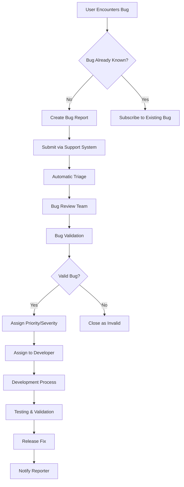
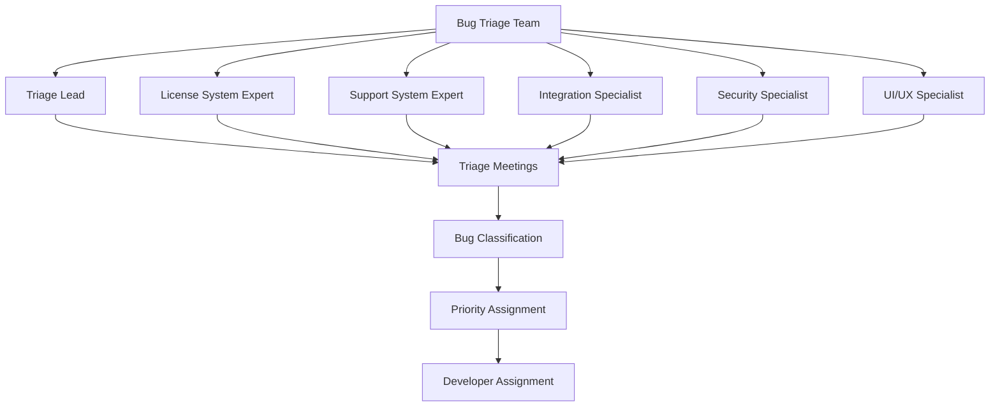
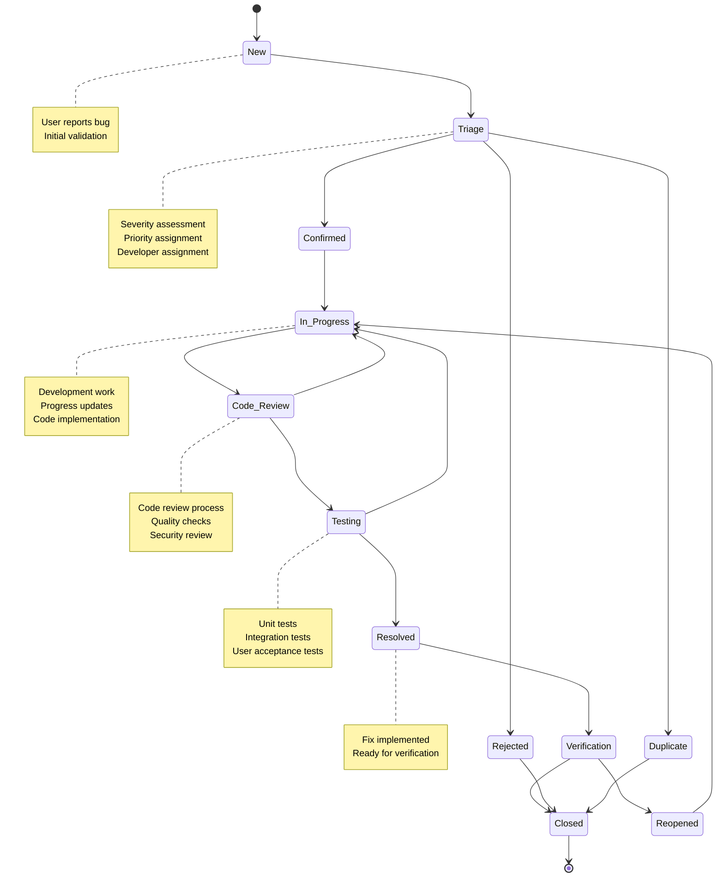

# Bug Reporting and Tracking Procedures

## Overview

This document outlines comprehensive procedures for bug reporting and tracking in the support system and license validation system. It includes standardized bug reporting templates, triage processes, tracking workflows, and resolution procedures to ensure efficient bug management.

## Table of Contents

1. [Bug Classification System](#bug-classification-system)
2. [Bug Reporting Procedures](#bug-reporting-procedures)
3. [Bug Triage Process](#bug-triage-process)
4. [Bug Tracking Workflow](#bug-tracking-workflow)
5. [Bug Resolution Procedures](#bug-resolution-procedures)
6. [Bug Reporting Templates](#bug-reporting-templates)
7. [Integration with Development Tools](#integration-with-development-tools)
8. [Bug Metrics and Reporting](#bug-metrics-and-reporting)
9. [Bug Prevention Strategies](#bug-prevention-strategies)
10. [Communication Procedures](#communication-procedures)

## Bug Classification System

### Severity Levels

| Severity | Description | Response Time | Resolution Time |
|-----------|-------------|----------------|-----------------|
| **Critical** | System crash, data loss, security breach, complete feature failure | 1 hour | 24 hours |
| **High** | Major functionality broken, significant performance degradation | 4 hours | 3 days |
| **Medium** | Workaround available, minor functionality broken | 24 hours | 1 week |
| **Low** | Cosmetic issue, minor inconvenience | 72 hours | 2 weeks |
| **Trivial** | Typos, formatting issues, documentation errors | 1 week | 1 month |

### Priority Levels

| Priority | Description | Assignment Criteria |
|-----------|-------------|-------------------|
| **P0 - Blocker** | Blocks release or critical functionality | Critical severity, affects all users |
| **P1 - Urgent** | Must be fixed in current release | High severity, affects many users |
| **P2 - High** | Should be fixed in current release if possible | Medium severity, affects significant users |
| **P3 - Normal** | Normal queue, fix in next release | Low severity, limited user impact |
| **P4 - Low** | Backlog, fix when time permits | Trivial severity, minimal impact |

### Bug Categories

| Category | Subcategories | Examples |
|----------|---------------|----------|
| **License System** | Validation, Activation, Management, Security | License validation failures, activation errors |
| **Support System** | Ticket Creation, Management, Notifications, UI | Ticket creation failures, notification issues |
| **Integration** | Database, External Services, API | Database connection errors, API failures |
| **Performance** | Response Time, Memory, Throughput, Scalability | Slow response times, memory leaks |
| **Security** | Authentication, Authorization, Data Protection | Login failures, unauthorized access |
| **UI/UX** | Interface, Usability, Accessibility | Display issues, navigation problems |
| **Documentation** | User Guides, API Docs, Help System | Incorrect documentation, missing information |

## Bug Reporting Procedures

### User Bug Reporting Workflow



### Bug Reporting Channels

1. **In-Application Bug Reporter**
   - Built-in bug reporting dialog
   - Automatic error log collection
   - Screenshot capture capability

2. **Support Ticket System**
   - Dedicated bug report category
   - Structured bug report form
   - File attachment support

3. **Email Reporting**
   - bugs@company.com
   - Standardized email template
   - Auto-creation of bug tickets

4. **Developer Portal**
   - Direct bug submission for technical users
   - API access for automated reporting
   - Integration with development tools

### Bug Report Requirements

#### Minimum Required Information

- **Bug Title**: Clear, concise description of the issue
- **Description**: Detailed explanation of the problem
- **Steps to Reproduce**: Step-by-step reproduction instructions
- **Expected Behavior**: What should happen
- **Actual Behavior**: What actually happened
- **Environment**: System information and configuration

#### Optional but Recommended Information

- **Screenshots/Videos**: Visual evidence of the bug
- **Error Logs**: System logs and error messages
- **System Information**: OS, browser, version details
- **User Impact**: How the bug affects user workflow
- **Workaround**: Any known workarounds
- **Frequency**: How often the bug occurs

## Bug Triage Process

### Triage Team Structure



### Daily Triage Process

1. **Morning Triage Meeting** (9:00 AM - 9:30 AM)
   - Review new bug reports from previous 24 hours
   - Validate bug reports for completeness
   - Classify bugs by severity and category
   - Assign initial priority

2. **Afternoon Triage Review** (3:00 PM - 3:15 PM)
   - Review escalated bugs
   - Re-evaluate priorities based on new information
   - Update bug statuses and assignments

3. **Weekly Triage Summary** (Friday 4:00 PM - 5:00 PM)
   - Review weekly bug trends
   - Identify recurring issues
   - Assess team workload and capacity
   - Plan next week's priorities

### Triage Decision Tree

```python
# scripts/bug_triage_classifier.py
"""Bug triage classification system"""

class BugTriageClassifier:
    """Automated bug triage classification"""
    
    def __init__(self):
        self.severity_keywords = {
            'critical': ['crash', 'system unavailable', 'data loss', 'security breach', 'corruption'],
            'high': ['major functionality broken', 'performance degradation', 'security vulnerability', 'timeout'],
            'medium': ['workaround available', 'minor functionality broken', 'performance impact', 'inconvenience'],
            'low': ['cosmetic issue', 'minor inconvenience', 'documentation error', 'typo'],
            'trivial': ['formatting', 'spelling', 'grammar', 'cosmetic only']
        }
        
        self.category_keywords = {
            'license_system': ['license', 'activation', 'validation', 'registration', 'key'],
            'support_system': ['ticket', 'support', 'help', 'contact', 'notification'],
            'integration': ['database', 'api', 'external service', 'connection', 'integration'],
            'performance': ['slow', 'performance', 'timeout', 'memory', 'response time'],
            'security': ['security', 'authentication', 'authorization', 'access', 'permission'],
            'ui_ux': ['interface', 'ui', 'ux', 'display', 'navigation', 'usability'],
            'documentation': ['documentation', 'help', 'guide', 'manual', 'instructions']
        }
    
    def classify_severity(self, bug_report: dict) -> str:
        """Classify bug severity"""
        title = bug_report.get('title', '').lower()
        description = bug_report.get('description', '').lower()
        combined_text = f"{title} {description}"
        
        # Check for severity keywords
        for severity, keywords in self.severity_keywords.items():
            for keyword in keywords:
                if keyword in combined_text:
                    return severity
        
        # Default to medium if no keywords match
        return 'medium'
    
    def classify_category(self, bug_report: dict) -> str:
        """Classify bug category"""
        title = bug_report.get('title', '').lower()
        description = bug_report.get('description', '').lower()
        combined_text = f"{title} {description}"
        
        # Check for category keywords
        for category, keywords in self.category_keywords.items():
            for keyword in keywords:
                if keyword in combined_text:
                    return category
        
        # Default to integration if no keywords match
        return 'integration'
    
    def assign_priority(self, severity: str, category: str, user_impact: str) -> str:
        """Assign bug priority based on severity, category, and user impact"""
        # Priority matrix
        priority_matrix = {
            ('critical', 'license_system'): 'P0',
            ('critical', 'support_system'): 'P0',
            ('critical', 'security'): 'P0',
            ('high', 'license_system'): 'P1',
            ('high', 'support_system'): 'P1',
            ('high', 'security'): 'P0',
            ('high', 'performance'): 'P1',
            ('medium', 'license_system'): 'P2',
            ('medium', 'support_system'): 'P2',
            ('medium', 'performance'): 'P2',
            ('low', 'license_system'): 'P3',
            ('low', 'support_system'): 'P3',
            ('low', 'ui_ux'): 'P3',
            ('trivial', 'documentation'): 'P4'
        }
        
        # Get priority from matrix
        priority = priority_matrix.get((severity, category), 'P3')
        
        # Adjust based on user impact
        if user_impact == 'affects_all_users':
            priority = min(priority, 'P0')  # Higher priority
        elif user_impact == 'affects_many_users':
            priority = min(priority, 'P1')
        elif user_impact == 'affects_few_users':
            priority = max(priority, 'P3')  # Lower priority
        
        return priority
    
    def suggest_assignment(self, category: str, severity: str) -> dict:
        """Suggest developer assignment based on category and severity"""
        assignment_matrix = {
            'license_system': {
                'critical': ['senior_license_dev', 'tech_lead'],
                'high': ['senior_license_dev', 'mid_license_dev'],
                'medium': ['mid_license_dev', 'junior_license_dev'],
                'low': ['junior_license_dev', 'mid_license_dev'],
                'trivial': ['junior_license_dev']
            },
            'support_system': {
                'critical': ['senior_support_dev', 'tech_lead'],
                'high': ['senior_support_dev', 'mid_support_dev'],
                'medium': ['mid_support_dev', 'junior_support_dev'],
                'low': ['junior_support_dev', 'mid_support_dev'],
                'trivial': ['junior_support_dev']
            },
            'integration': {
                'critical': ['senior_backend_dev', 'tech_lead'],
                'high': ['senior_backend_dev', 'mid_backend_dev'],
                'medium': ['mid_backend_dev', 'junior_backend_dev'],
                'low': ['junior_backend_dev', 'mid_backend_dev'],
                'trivial': ['junior_backend_dev']
            },
            'security': {
                'critical': ['security_specialist', 'tech_lead'],
                'high': ['security_specialist', 'senior_backend_dev'],
                'medium': ['security_specialist', 'mid_backend_dev'],
                'low': ['security_specialist', 'junior_backend_dev'],
                'trivial': ['security_specialist']
            }
        }
        
        # Default to backend developers for unknown categories
        default_assignment = {
            'critical': ['senior_backend_dev', 'tech_lead'],
            'high': ['senior_backend_dev', 'mid_backend_dev'],
            'medium': ['mid_backend_dev', 'junior_backend_dev'],
            'low': ['junior_backend_dev', 'mid_backend_dev'],
            'trivial': ['junior_backend_dev']
        }
        
        return assignment_matrix.get(category, default_assignment).get(severity, ['junior_backend_dev'])
```

## Bug Tracking Workflow

### Bug Lifecycle States



### Bug Status Definitions

| Status | Description | Criteria |
|---------|-------------|-----------|
| **New** | Bug reported but not yet reviewed | Initial submission |
| **Triage** | Bug under review by triage team | Under evaluation |
| **Confirmed** | Bug validated and accepted | Reproducible issue confirmed |
| **Rejected** | Bug not valid or not reproducible | Cannot reproduce or not a bug |
| **Duplicate** | Bug already reported | References existing bug |
| **In Progress** | Developer working on fix | Assigned and in development |
| **Code Review** | Fix implemented, under review | Pull request submitted |
| **Testing** | Fix ready for testing | Code review passed |
| **Resolved** | Fix implemented and tested | Ready for deployment |
| **Verification** | Fix deployed, awaiting user verification | In staging/production |
| **Reopened** | Fix didn't resolve the issue | Bug still exists |
| **Closed** | Bug fully resolved and verified | No further action needed |

### Bug Assignment Workflow

```python
# scripts/bug_assignment_workflow.py
"""Bug assignment and workflow management"""

class BugAssignmentWorkflow:
    """Manages bug assignment and workflow transitions"""
    
    def __init__(self, bug_tracker_api):
        self.bug_tracker = bug_tracker_api
        self.developers = self.load_developers()
        self.workload_tracker = WorkloadTracker()
    
    def load_developers(self) -> dict:
        """Load developer information and capabilities"""
        return {
            'senior_license_dev': {
                'name': 'John Smith',
                'expertise': ['license_system', 'security'],
                'capacity': 8,
                'current_workload': 5
            },
            'mid_license_dev': {
                'name': 'Jane Doe',
                'expertise': ['license_system'],
                'capacity': 8,
                'current_workload': 6
            },
            'senior_support_dev': {
                'name': 'Mike Johnson',
                'expertise': ['support_system', 'ui_ux'],
                'capacity': 8,
                'current_workload': 4
            },
            'junior_support_dev': {
                'name': 'Sarah Wilson',
                'expertise': ['support_system'],
                'capacity': 8,
                'current_workload': 3
            }
        }
    
    def assign_bug(self, bug_id: int, suggested_assignments: list) -> str:
        """Assign bug to appropriate developer"""
        # Filter available developers
        available_developers = []
        
        for dev_id in suggested_assignments:
            dev = self.developers.get(dev_id)
            if dev and dev['current_workload'] < dev['capacity']:
                available_developers.append((dev_id, dev))
        
        if not available_developers:
            # No available developers, escalate to team lead
            return self.escalate_bug(bug_id)
        
        # Select developer with lowest workload
        selected_dev = min(available_developers, key=lambda x: x[1]['current_workload'])
        dev_id, dev_info = selected_dev
        
        # Update bug assignment
        self.bug_tracker.update_bug(bug_id, {
            'assigned_to': dev_id,
            'status': 'In_Progress',
            'assigned_date': datetime.now().isoformat()
        })
        
        # Update developer workload
        dev_info['current_workload'] += 1
        
        # Notify developer
        self.notify_developer(dev_id, bug_id)
        
        return dev_id
    
    def escalate_bug(self, bug_id: int) -> str:
        """Escalate bug to team lead"""
        team_lead_id = 'tech_lead'
        
        self.bug_tracker.update_bug(bug_id, {
            'assigned_to': team_lead_id,
            'status': 'In_Progress',
            'priority': 'P0',  # Escalated bugs get highest priority
            'escalated': True,
            'escalation_date': datetime.now().isoformat()
        })
        
        # Notify team lead
        self.notify_team_lead(bug_id)
        
        return team_lead_id
    
    def update_bug_status(self, bug_id: int, new_status: str, comment: str = ""):
        """Update bug status with workflow validation"""
        bug = self.bug_tracker.get_bug(bug_id)
        current_status = bug['status']
        
        # Validate status transition
        if not self.is_valid_transition(current_status, new_status):
            raise ValueError(f"Invalid status transition from {current_status} to {new_status}")
        
        # Update bug
        update_data = {
            'status': new_status,
            'updated_date': datetime.now().isoformat()
        }
        
        if comment:
            update_data['comment'] = comment
        
        self.bug_tracker.update_bug(bug_id, update_data)
        
        # Handle special status transitions
        if new_status == 'In_Progress':
            self.handle_assignment(bug_id)
        elif new_status == 'Resolved':
            self.handle_resolution(bug_id)
        elif new_status == 'Closed':
            self.handle_closure(bug_id)
    
    def is_valid_transition(self, from_status: str, to_status: str) -> bool:
        """Validate bug status transition"""
        valid_transitions = {
            'New': ['Triage', 'Rejected'],
            'Triage': ['Confirmed', 'Rejected', 'Duplicate'],
            'Confirmed': ['In_Progress', 'Rejected'],
            'In_Progress': ['Code_Review', 'Testing'],
            'Code_Review': ['Testing', 'In_Progress'],
            'Testing': ['Resolved', 'In_Progress'],
            'Resolved': ['Verification', 'Reopened'],
            'Verification': ['Closed', 'Reopened'],
            'Reopened': ['In_Progress'],
            'Rejected': ['Closed'],
            'Duplicate': ['Closed']
        }
        
        return to_status in valid_transitions.get(from_status, [])
    
    def handle_assignment(self, bug_id: int):
        """Handle bug assignment"""
        bug = self.bug_tracker.get_bug(bug_id)
        
        if not bug.get('assigned_to'):
            # Auto-assign bug
            suggested_assignments = self.get_suggested_assignments(bug)
            self.assign_bug(bug_id, suggested_assignments)
    
    def handle_resolution(self, bug_id: int):
        """Handle bug resolution"""
        bug = self.bug_tracker.get_bug(bug_id)
        developer_id = bug.get('assigned_to')
        
        if developer_id:
            # Update developer workload
            dev = self.developers.get(developer_id)
            if dev:
                dev['current_workload'] = max(0, dev['current_workload'] - 1)
        
        # Schedule testing
        self.schedule_testing(bug_id)
    
    def handle_closure(self, bug_id: int):
        """Handle bug closure"""
        bug = self.bug_tracker.get_bug(bug_id)
        reporter_id = bug.get('reporter_id')
        
        # Notify reporter
        if reporter_id:
            self.notify_reporter(reporter_id, bug_id, 'closed')
        
        # Update metrics
        self.update_bug_metrics(bug)
```

## Bug Resolution Procedures

### Resolution Types

| Resolution Type | Description | When to Use |
|-----------------|-------------|--------------|
| **Fixed** | Bug has been resolved and tested | Standard bug fixes |
| **Won't Fix** | Bug won't be addressed | Low priority, design limitation |
| **Duplicate** | Bug already exists elsewhere | Duplicate reports |
| **Invalid** | Not actually a bug | User error, misunderstanding |
| **Works as Designed** | Behavior is intentional | Feature working as specified |
| **Cannot Reproduce** | Unable to reproduce the issue | Insufficient information |
| **Deferred** | Fix postponed to future release | Low priority, resource constraints |
| **Need More Info** | Additional information required | Incomplete bug report |

### Fix Implementation Process

1. **Analysis Phase**
   - Understand the root cause
   - Identify affected components
   - Assess impact of changes
   - Plan implementation approach

2. **Development Phase**
   - Create feature branch
   - Implement fix with tests
   - Follow coding standards
   - Document changes

3. **Testing Phase**
   - Unit tests for new code
   - Integration tests for affected areas
   - Regression tests for related functionality
   - Performance tests if applicable

4. **Review Phase**
   - Code review by peers
   - Security review for sensitive changes
   - Documentation review
   - Approval process

5. **Deployment Phase**
   - Merge to release branch
   - Deploy to staging environment
   - Final verification
   - Production deployment

### Bug Fix Verification Checklist

```python
# scripts/bug_fix_verification.py
"""Bug fix verification checklist"""

class BugFixVerification:
    """Comprehensive bug fix verification"""
    
    def __init__(self, bug_id: int):
        self.bug_id = bug_id
        self.bug_tracker = BugTrackerAPI()
        self.test_runner = TestRunner()
        self.verification_results = []
    
    def verify_fix(self) -> dict:
        """Perform comprehensive bug fix verification"""
        bug = self.bug_tracker.get_bug(self.bug_id)
        
        # Run verification checks
        checks = [
            self.verify_reproduction,
            self.verify_fix_implementation,
            self.verify_unit_tests,
            self.verify_integration_tests,
            self.verify_regression_tests,
            self.verify_documentation,
            self.verify_performance,
            self.verify_security
        ]
        
        for check in checks:
            result = check(bug)
            self.verification_results.append(result)
        
        # Generate verification report
        return self.generate_verification_report()
    
    def verify_reproduction(self, bug: dict) -> dict:
        """Verify bug can be reproduced before fix"""
        try:
            # Get reproduction steps
            reproduction_steps = bug.get('reproduction_steps', [])
            
            if not reproduction_steps:
                return {
                    'check': 'Reproduction',
                    'status': 'SKIP',
                    'message': 'No reproduction steps provided'
                }
            
            # Attempt to reproduce bug in test environment
            test_result = self.test_runner.run_reproduction_test(reproduction_steps)
            
            if test_result['reproduced']:
                return {
                    'check': 'Reproduction',
                    'status': 'PASS',
                    'message': 'Bug successfully reproduced'
                }
            else:
                return {
                    'check': 'Reproduction',
                    'status': 'FAIL',
                    'message': 'Could not reproduce bug'
                }
                
        except Exception as e:
            return {
                'check': 'Reproduction',
                'status': 'ERROR',
                'message': f'Error during reproduction: {str(e)}'
            }
    
    def verify_fix_implementation(self, bug: dict) -> dict:
        """Verify fix is properly implemented"""
        try:
            # Check if fix is implemented in code
            fix_commits = self.bug_tracker.get_fix_commits(self.bug_id)
            
            if not fix_commits:
                return {
                    'check': 'Fix Implementation',
                    'status': 'FAIL',
                    'message': 'No fix commits found'
                }
            
            # Review fix implementation
            for commit in fix_commits:
                review_result = self.review_commit(commit)
                if not review_result['approved']:
                    return {
                        'check': 'Fix Implementation',
                        'status': 'FAIL',
                        'message': f'Commit {commit["id"]} not approved: {review_result["reason"]}'
                    }
            
            return {
                'check': 'Fix Implementation',
                'status': 'PASS',
                'message': 'Fix implementation approved'
            }
            
        except Exception as e:
            return {
                'check': 'Fix Implementation',
                'status': 'ERROR',
                'message': f'Error reviewing fix: {str(e)}'
            }
    
    def verify_unit_tests(self, bug: dict) -> dict:
        """Verify unit tests are added/updated"""
        try:
            # Get test files related to bug
            test_files = self.get_related_test_files(bug)
            
            # Run unit tests
            test_results = self.test_runner.run_unit_tests(test_files)
            
            if test_results['all_passed']:
                return {
                    'check': 'Unit Tests',
                    'status': 'PASS',
                    'message': f'All {test_results["total"]} unit tests passed'
                }
            else:
                return {
                    'check': 'Unit Tests',
                    'status': 'FAIL',
                    'message': f'{test_results["failed"]} of {test_results["total"]} unit tests failed'
                }
                
        except Exception as e:
            return {
                'check': 'Unit Tests',
                'status': 'ERROR',
                'message': f'Error running unit tests: {str(e)}'
            }
    
    def verify_integration_tests(self, bug: dict) -> dict:
        """Verify integration tests pass"""
        try:
            # Run integration tests for affected components
            affected_components = self.get_affected_components(bug)
            test_results = self.test_runner.run_integration_tests(affected_components)
            
            if test_results['all_passed']:
                return {
                    'check': 'Integration Tests',
                    'status': 'PASS',
                    'message': f'All {test_results["total"]} integration tests passed'
                }
            else:
                return {
                    'check': 'Integration Tests',
                    'status': 'FAIL',
                    'message': f'{test_results["failed"]} of {test_results["total"]} integration tests failed'
                }
                
        except Exception as e:
            return {
                'check': 'Integration Tests',
                'status': 'ERROR',
                'message': f'Error running integration tests: {str(e)}'
            }
    
    def verify_regression_tests(self, bug: dict) -> dict:
        """Verify no regression in existing functionality"""
        try:
            # Run regression test suite
            test_results = self.test_runner.run_regression_tests()
            
            if test_results['all_passed']:
                return {
                    'check': 'Regression Tests',
                    'status': 'PASS',
                    'message': f'All {test_results["total"]} regression tests passed'
                }
            else:
                return {
                    'check': 'Regression Tests',
                    'status': 'FAIL',
                    'message': f'{test_results["failed"]} of {test_results["total"]} regression tests failed'
                }
                
        except Exception as e:
            return {
                'check': 'Regression Tests',
                'status': 'ERROR',
                'message': f'Error running regression tests: {str(e)}'
            }
    
    def verify_documentation(self, bug: dict) -> dict:
        """Verify documentation is updated if needed"""
        try:
            # Check if documentation update is needed
            doc_update_required = self.is_documentation_update_required(bug)
            
            if not doc_update_required:
                return {
                    'check': 'Documentation',
                    'status': 'PASS',
                    'message': 'No documentation update required'
                }
            
            # Check if documentation was updated
            doc_updates = self.bug_tracker.get_documentation_updates(self.bug_id)
            
            if doc_updates:
                return {
                    'check': 'Documentation',
                    'status': 'PASS',
                    'message': 'Documentation updated successfully'
                }
            else:
                return {
                    'check': 'Documentation',
                    'status': 'FAIL',
                    'message': 'Documentation update required but not found'
                }
                
        except Exception as e:
            return {
                'check': 'Documentation',
                'status': 'ERROR',
                'message': f'Error checking documentation: {str(e)}'
            }
    
    def verify_performance(self, bug: dict) -> dict:
        """Verify performance is not degraded"""
        try:
            # Check if performance testing is needed
            perf_test_required = self.is_performance_test_required(bug)
            
            if not perf_test_required:
                return {
                    'check': 'Performance',
                    'status': 'PASS',
                    'message': 'No performance testing required'
                }
            
            # Run performance tests
            perf_results = self.test_runner.run_performance_tests()
            
            # Compare with baseline
            baseline = self.get_performance_baseline()
            performance_degraded = self.compare_performance(perf_results, baseline)
            
            if not performance_degraded:
                return {
                    'check': 'Performance',
                    'status': 'PASS',
                    'message': 'Performance within acceptable limits'
                }
            else:
                return {
                    'check': 'Performance',
                    'status': 'FAIL',
                    'message': 'Performance degradation detected'
                }
                
        except Exception as e:
            return {
                'check': 'Performance',
                'status': 'ERROR',
                'message': f'Error running performance tests: {str(e)}'
            }
    
    def verify_security(self, bug: dict) -> dict:
        """Verify security implications are addressed"""
        try:
            # Check if security review is needed
            security_review_required = self.is_security_review_required(bug)
            
            if not security_review_required:
                return {
                    'check': 'Security',
                    'status': 'PASS',
                    'message': 'No security review required'
                }
            
            # Run security tests
            security_results = self.test_runner.run_security_tests()
            
            if security_results['all_passed']:
                return {
                    'check': 'Security',
                    'status': 'PASS',
                    'message': 'Security tests passed'
                }
            else:
                return {
                    'check': 'Security',
                    'status': 'FAIL',
                    'message': f'{security_results["vulnerabilities"]} security issues found'
                }
                
        except Exception as e:
            return {
                'check': 'Security',
                'status': 'ERROR',
                'message': f'Error running security tests: {str(e)}'
            }
    
    def generate_verification_report(self) -> dict:
        """Generate comprehensive verification report"""
        passed_checks = len([r for r in self.verification_results if r['status'] == 'PASS'])
        failed_checks = len([r for r in self.verification_results if r['status'] == 'FAIL'])
        error_checks = len([r for r in self.verification_results if r['status'] == 'ERROR'])
        total_checks = len(self.verification_results)
        
        overall_status = 'PASS' if failed_checks == 0 and error_checks == 0 else 'FAIL'
        
        return {
            'bug_id': self.bug_id,
            'verification_date': datetime.now().isoformat(),
            'overall_status': overall_status,
            'summary': {
                'total_checks': total_checks,
                'passed_checks': passed_checks,
                'failed_checks': failed_checks,
                'error_checks': error_checks
            },
            'results': self.verification_results
        }
```

## Bug Reporting Templates

### Standard Bug Report Template

```markdown
# Bug Report Template

## Bug Information
- **Bug ID**: [Auto-generated]
- **Reported By**: [Your name]
- **Date**: [Current date]
- **Version**: [Application version]
- **Environment**: [Development/Staging/Production]

## Bug Classification
- **Severity**: [Critical/High/Medium/Low/Trivial]
- **Priority**: [P0/P1/P2/P3/P4]
- **Category**: [License System/Support System/Integration/Performance/Security/UI-UX/Documentation]
- **Component**: [Specific component affected]

## Bug Description
### Summary
[Brief, one-sentence description of the bug]

### Detailed Description
[Detailed explanation of the bug, including context and impact]

### Steps to Reproduce
1. [Step 1]
2. [Step 2]
3. [Step 3]
4. [Observe bug]

### Expected Behavior
[What should happen when following the steps]

### Actual Behavior
[What actually happens when following the steps]

### Error Messages
[Any error messages, stack traces, or logs]

## Environment Information
- **Operating System**: [Windows/macOS/Linux version]
- **Browser**: [Chrome/Firefox/Safari/Edge version]
- **Database**: [PostgreSQL/SQLite version]
- **Python Version**: [Python version]
- **License Type**: [Trial/Standard/Professional/Enterprise]

## Attachments
- [Screenshots]
- [Error logs]
- [System information]
- [Video recording]

## Additional Information
- **Workaround**: [Any known workarounds]
- **Frequency**: [How often does this occur?]
- **User Impact**: [How does this affect users?]
- **Related Issues**: [Links to related bugs or issues]

## Reporter Information
- **Name**: [Your name]
- **Email**: [Your email]
- **Role**: [Developer/Tester/User/Admin]
- **Contact Preference**: [Email/Phone/Slack]
```

### Security Bug Report Template

```markdown
# Security Bug Report Template

## Security Information
- **Security Level**: [Confidential/Internal/Public]
- **Reported By**: [Your name or anonymous]
- **Date**: [Current date]
- **CVE ID**: [If applicable]

## Vulnerability Description
### Summary
[Brief description of the security vulnerability]

### Detailed Description
[Detailed explanation of the vulnerability]

### Vulnerability Type
- [ ] Authentication Bypass
- [ ] Authorization Issue
- [ ] SQL Injection
- [ ] XSS (Cross-Site Scripting)
- [ ] CSRF (Cross-Site Request Forgery)
- [ ] Information Disclosure
- [ ] Denial of Service
- [ ] Remote Code Execution
- [ ] Other: [Specify]

### Impact Assessment
- **Confidentiality**: [None/Low/Medium/High/Critical]
- **Integrity**: [None/Low/Medium/High/Critical]
- **Availability**: [None/Low/Medium/High/Critical]
- **Overall Risk**: [Low/Medium/High/Critical]

## Reproduction Steps
### Target Information
- **URL**: [Target URL or endpoint]
- **Parameters**: [Affected parameters]
- **Authentication**: [Authentication required?]

### Proof of Concept
[Detailed steps to reproduce the vulnerability]

### Payload Examples
```[language]
[Example payloads or exploit code]
```

## Remediation
### Suggested Fix
[Suggested approach to fix the vulnerability]

### Affected Versions
[List of affected versions]

### Fixed Versions
[List of versions where this is fixed]

## Additional Information
- **Discovery Method**: [Manual/Automated/Scanner]
- **Tools Used**: [Tools used to discover]
- **References**: [CWE, CVE, or other references]
- **Contact**: [Preferred contact method]

## Confidentiality Notice
This report contains confidential security information. Do not disclose publicly without proper coordination.
```

## Integration with Development Tools

### GitHub Integration

```yaml
# .github/bug_report_template.yml
name: Bug Report
description: File a bug report
title: "[BUG]: "
labels: ["bug"]
body:
  - type: markdown
    attributes:
      value: |
        Thanks for taking the time to fill out this bug report!
  
  - type: textarea
    id: description
    attributes:
      label: Bug Description
      description: A clear and concise description of what the bug is
      placeholder: Describe the bug...
    validations:
      required: true
  
  - type: textarea
    id: reproduction
    attributes:
      label: Steps to Reproduce
      description: Steps to reproduce the behavior
      placeholder: |
        1. Go to '...'
        2. Click on '....'
        3. Scroll down to '....'
        4. See error
    validations:
      required: true
  
  - type: textarea
    id: expected
    attributes:
      label: Expected Behavior
      description: What you expected to happen
      placeholder: Describe expected behavior...
    validations:
      required: true
  
  - type: textarea
    id: actual
    attributes:
      label: Actual Behavior
      description: What actually happened
      placeholder: Describe actual behavior...
    validations:
      required: true
  
  - type: dropdown
    id: severity
    attributes:
      label: Severity
      description: How severe is this bug?
      options:
        - Critical
        - High
        - Medium
        - Low
        - Trivial
    validations:
      required: true
  
  - type: dropdown
    id: category
    attributes:
      label: Category
      description: What area is affected?
      options:
        - License System
        - Support System
        - Integration
        - Performance
        - Security
        - UI/UX
        - Documentation
    validations:
      required: true
  
  - type: dropdown
    id: version
    attributes:
      label: Version
      description: What version are you using?
      options:
        - Development
        - Staging
        - Production v1.0
        - Production v1.1
        - Production v2.0
    validations:
      required: true
  
  - type: textarea
    id: environment
    attributes:
      label: Environment Information
      description: Operating system, browser, database, etc.
      placeholder: OS: Windows 10, Browser: Chrome 90, Database: PostgreSQL 13...
    validations:
      required: false
  
  - type: textarea
    id: attachments
    attributes:
      label: Attachments
      description: Screenshots, logs, or other files
      placeholder: Drag and drop files here or click to attach
```

### Jira Integration

```python
# scripts/jira_integration.py
"""Jira integration for bug tracking"""

from jira import JIRA
import json
from datetime import datetime

class JiraBugTracker:
    """Jira integration for bug tracking"""
    
    def __init__(self, config):
        self.jira = JIRA(
            server=config['jira_server'],
            basic_auth=(config['username'], config['api_token'])
        )
        self.project_key = config['project_key']
    
    def create_bug(self, bug_report: dict) -> str:
        """Create bug in Jira"""
        issue_dict = {
            'project': {'key': self.project_key},
            'summary': bug_report['title'],
            'description': self.format_description(bug_report),
            'issuetype': {'name': 'Bug'},
            'priority': {'name': self.map_priority(bug_report['priority'])},
            'customfield_10010': bug_report['severity'],  # Custom field for severity
            'labels': [bug_report['category'], 'bug'],
            'versions': [{'name': bug_report['version']}]
        }
        
        # Add custom fields based on category
        if bug_report['category'] == 'License System':
            issue_dict['customfield_10020'] = bug_report.get('license_type', '')
        elif bug_report['category'] == 'Support System':
            issue_dict['customfield_10021'] = bug_report.get('support_ticket_id', '')
        
        issue = self.jira.create_issue(fields=issue_dict)
        
        # Add attachments if provided
        if bug_report.get('attachments'):
            for attachment in bug_report['attachments']:
                self.jira.add_attachment(issue.key, attachment)
        
        return issue.key
    
    def format_description(self, bug_report: dict) -> str:
        """Format bug description for Jira"""
        template = """
        h2. Bug Description
        {description}
        
        h2. Steps to Reproduce
        {reproduction}
        
        h2. Expected Behavior
        {expected}
        
        h2. Actual Behavior
        {actual}
        
        h2. Environment Information
        * Operating System: {os}
        * Browser: {browser}
        * Version: {version}
        * License Type: {license_type}
        
        h2. Additional Information
        * Reporter: {reporter}
        * Date: {date}
        * User Impact: {user_impact}
        * Workaround: {workaround}
        """
        
        return template.format(**bug_report)
    
    def map_priority(self, priority: str) -> str:
        """Map priority levels to Jira priorities"""
        priority_map = {
            'P0': 'Highest',
            'P1': 'High',
            'P2': 'Medium',
            'P3': 'Low',
            'P4': 'Lowest'
        }
        return priority_map.get(priority, 'Medium')
    
    def update_bug_status(self, bug_id: str, status: str, comment: str = ""):
        """Update bug status in Jira"""
        # Map status to Jira workflow transitions
        transitions = self.jira.transitions(bug_id)
        
        for transition in transitions:
            if transition['name'].lower() == status.lower():
                self.jira.transition_issue(
                    bug_id,
                    transition['id'],
                    comment=comment
                )
                return True
        
        return False
    
    def assign_bug(self, bug_id: str, assignee: str):
        """Assign bug to developer"""
        self.jira.assign_issue(bug_id, assignee)
    
    def add_comment(self, bug_id: str, comment: str):
        """Add comment to bug"""
        self.jira.add_comment(bug_id, comment)
    
    def search_bugs(self, query: str) -> list:
        """Search for bugs"""
        jql_query = f'project = {self.project_key} AND {query} ORDER BY created DESC'
        return self.jira.search_issues(jql_query)
```

## Bug Metrics and Reporting

### Bug Metrics Dashboard

```python
# scripts/bug_metrics.py
"""Bug metrics and reporting"""

class BugMetrics:
    """Generate bug metrics and reports"""
    
    def __init__(self, bug_tracker_api):
        self.bug_tracker = bug_tracker_api
    
    def generate_weekly_report(self) -> dict:
        """Generate weekly bug report"""
        end_date = datetime.now()
        start_date = end_date - timedelta(days=7)
        
        # Get bugs from the week
        bugs = self.bug_tracker.get_bugs_by_date_range(start_date, end_date)
        
        # Calculate metrics
        metrics = {
            'period': {
                'start_date': start_date.isoformat(),
                'end_date': end_date.isoformat(),
                'days': 7
            },
            'summary': {
                'total_bugs': len(bugs),
                'new_bugs': len([b for b in bugs if b['status'] == 'New']),
                'resolved_bugs': len([b for b in bugs if b['status'] == 'Resolved']),
                'closed_bugs': len([b for b in bugs if b['status'] == 'Closed'])
            },
            'severity_breakdown': self.calculate_severity_breakdown(bugs),
            'category_breakdown': self.calculate_category_breakdown(bugs),
            'priority_breakdown': self.calculate_priority_breakdown(bugs),
            'resolution_time': self.calculate_resolution_times(bugs),
            'developer_workload': self.calculate_developer_workload(bugs),
            'trending_issues': self.identify_trending_issues(bugs)
        }
        
        return metrics
    
    def calculate_severity_breakdown(self, bugs: list) -> dict:
        """Calculate bug breakdown by severity"""
        severity_counts = {}
        
        for bug in bugs:
            severity = bug.get('severity', 'Unknown')
            severity_counts[severity] = severity_counts.get(severity, 0) + 1
        
        return severity_counts
    
    def calculate_category_breakdown(self, bugs: list) -> dict:
        """Calculate bug breakdown by category"""
        category_counts = {}
        
        for bug in bugs:
            category = bug.get('category', 'Unknown')
            category_counts[category] = category_counts.get(category, 0) + 1
        
        return category_counts
    
    def calculate_priority_breakdown(self, bugs: list) -> dict:
        """Calculate bug breakdown by priority"""
        priority_counts = {}
        
        for bug in bugs:
            priority = bug.get('priority', 'Unknown')
            priority_counts[priority] = priority_counts.get(priority, 0) + 1
        
        return priority_counts
    
    def calculate_resolution_times(self, bugs: list) -> dict:
        """Calculate bug resolution times"""
        resolved_bugs = [b for b in bugs if b['status'] in ['Resolved', 'Closed']]
        
        if not resolved_bugs:
            return {'average_resolution_time': 0, 'median_resolution_time': 0}
        
        resolution_times = []
        
        for bug in resolved_bugs:
            created_date = datetime.fromisoformat(bug['created_date'])
            resolved_date = datetime.fromisoformat(bug['resolved_date'])
            resolution_time = (resolved_date - created_date).days
            resolution_times.append(resolution_time)
        
        resolution_times.sort()
        
        return {
            'average_resolution_time': sum(resolution_times) / len(resolution_times),
            'median_resolution_time': resolution_times[len(resolution_times) // 2],
            'min_resolution_time': min(resolution_times),
            'max_resolution_time': max(resolution_times)
        }
    
    def calculate_developer_workload(self, bugs: list) -> dict:
        """Calculate developer workload"""
        workload = {}
        
        for bug in bugs:
            assignee = bug.get('assigned_to', 'Unassigned')
            
            if assignee not in workload:
                workload[assignee] = {
                    'total_bugs': 0,
                    'critical_bugs': 0,
                    'high_bugs': 0,
                    'resolved_bugs': 0
                }
            
            workload[assignee]['total_bugs'] += 1
            
            if bug.get('severity') == 'Critical':
                workload[assignee]['critical_bugs'] += 1
            elif bug.get('severity') == 'High':
                workload[assignee]['high_bugs'] += 1
            
            if bug['status'] in ['Resolved', 'Closed']:
                workload[assignee]['resolved_bugs'] += 1
        
        return workload
    
    def identify_trending_issues(self, bugs: list) -> list:
        """Identify trending bug issues"""
        # Group bugs by similar titles/descriptions
        bug_groups = {}
        
        for bug in bugs:
            # Simple keyword-based grouping
            keywords = self.extract_keywords(bug['title'] + ' ' + bug['description'])
            
            for keyword in keywords:
                if keyword not in bug_groups:
                    bug_groups[keyword] = []
                bug_groups[keyword].append(bug)
        
        # Find groups with multiple bugs
        trending = []
        for keyword, group_bugs in bug_groups.items():
            if len(group_bugs) >= 3:  # At least 3 similar bugs
                trending.append({
                    'keyword': keyword,
                    'count': len(group_bugs),
                    'bugs': group_bugs
                })
        
        # Sort by count
        trending.sort(key=lambda x: x['count'], reverse=True)
        
        return trending[:5]  # Top 5 trending issues
    
    def extract_keywords(self, text: str) -> list:
        """Extract keywords from bug text"""
        # Simple keyword extraction
        common_words = {'the', 'a', 'an', 'and', 'or', 'but', 'in', 'on', 'at', 'to', 'for', 'of', 'with', 'by', 'is', 'are', 'was', 'were', 'be', 'been', 'being', 'have', 'has', 'had', 'do', 'does', 'did', 'will', 'would', 'could', 'should', 'may', 'might', 'must', 'can', 'this', 'that', 'these', 'those', 'i', 'you', 'he', 'she', 'it', 'we', 'they', 'me', 'him', 'her', 'us', 'them', 'my', 'your', 'his', 'her', 'its', 'our', 'their'}
        
        words = text.lower().split()
        keywords = []
        
        for word in words:
            # Remove punctuation
            word = ''.join(c for c in word if c.isalnum())
            
            # Skip common words and short words
            if len(word) > 3 and word not in common_words:
                keywords.append(word)
        
        return list(set(keywords))
```

---

This comprehensive bug reporting and tracking procedures guide provides a structured approach to managing bugs throughout their lifecycle, from initial reporting through resolution and analysis. The procedures include standardized templates, automated triage, workflow management, and metrics tracking to ensure efficient bug handling and continuous improvement.