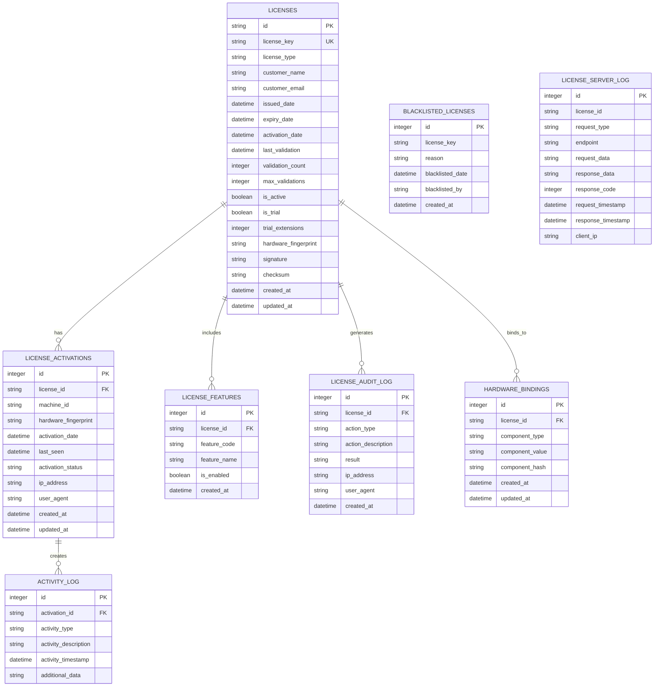

# License Management Database Schema

## Overview

This document outlines the database schema for the license management system, designed to integrate seamlessly with the existing POS application database while providing secure storage for license-related data.

## Database Schema Diagram



## Table Definitions

### 1. licenses Table

```sql
CREATE TABLE licenses (
    id TEXT PRIMARY KEY,
    license_key TEXT UNIQUE NOT NULL,
    license_type TEXT NOT NULL CHECK (license_type IN ('trial', 'standard', 'professional', 'enterprise')),
    customer_name TEXT,
    customer_email TEXT,
    issued_date DATETIME NOT NULL,
    expiry_date DATETIME,
    activation_date DATETIME,
    last_validation DATETIME,
    validation_count INTEGER DEFAULT 0,
    max_validations INTEGER DEFAULT 1000,
    is_active BOOLEAN DEFAULT 0,
    is_trial BOOLEAN DEFAULT 0,
    trial_extensions INTEGER DEFAULT 0,
    hardware_fingerprint TEXT,
    signature TEXT NOT NULL,
    checksum TEXT NOT NULL,
    created_at DATETIME DEFAULT CURRENT_TIMESTAMP,
    updated_at DATETIME DEFAULT CURRENT_TIMESTAMP
);

-- Indexes for performance
CREATE INDEX idx_licenses_key ON licenses(license_key);
CREATE INDEX idx_licenses_type ON licenses(license_type);
CREATE INDEX idx_licenses_active ON licenses(is_active);
CREATE INDEX idx_licenses_expiry ON licences(expiry_date);
CREATE INDEX idx_licenses_validation ON licenses(last_validation);
```

### 2. license_activations Table

```sql
CREATE TABLE license_activations (
    id INTEGER PRIMARY KEY AUTOINCREMENT,
    license_id TEXT NOT NULL,
    machine_id TEXT NOT NULL,
    hardware_fingerprint TEXT NOT NULL,
    activation_date DATETIME NOT NULL,
    last_seen DATETIME,
    activation_status TEXT NOT NULL CHECK (activation_status IN ('active', 'inactive', 'suspended', 'revoked')),
    ip_address TEXT,
    user_agent TEXT,
    created_at DATETIME DEFAULT CURRENT_TIMESTAMP,
    updated_at DATETIME DEFAULT CURRENT_TIMESTAMP,
    FOREIGN KEY (license_id) REFERENCES licenses(id) ON DELETE CASCADE
);

-- Indexes for performance
CREATE INDEX idx_activations_license ON license_activations(license_id);
CREATE INDEX idx_activations_machine ON license_activations(machine_id);
CREATE INDEX idx_activations_status ON license_activations(activation_status);
CREATE INDEX idx_activations_date ON license_activations(activation_date);
```

### 3. license_features Table

```sql
CREATE TABLE license_features (
    id INTEGER PRIMARY KEY AUTOINCREMENT,
    license_id TEXT NOT NULL,
    feature_code TEXT NOT NULL,
    feature_name TEXT NOT NULL,
    is_enabled BOOLEAN DEFAULT 1,
    created_at DATETIME DEFAULT CURRENT_TIMESTAMP,
    FOREIGN KEY (license_id) REFERENCES licenses(id) ON DELETE CASCADE,
    UNIQUE(license_id, feature_code)
);

-- Indexes for performance
CREATE INDEX idx_features_license ON license_features(license_id);
CREATE INDEX idx_features_code ON license_features(feature_code);
CREATE INDEX idx_features_enabled ON license_features(is_enabled);
```

### 4. hardware_bindings Table

```sql
CREATE TABLE hardware_bindings (
    id INTEGER PRIMARY KEY AUTOINCREMENT,
    license_id TEXT NOT NULL,
    component_type TEXT NOT NULL CHECK (component_type IN ('cpu', 'motherboard', 'disk', 'mac', 'bios', 'memory')),
    component_value TEXT NOT NULL,
    component_hash TEXT NOT NULL,
    created_at DATETIME DEFAULT CURRENT_TIMESTAMP,
    updated_at DATETIME DEFAULT CURRENT_TIMESTAMP,
    FOREIGN KEY (license_id) REFERENCES licenses(id) ON DELETE CASCADE
);

-- Indexes for performance
CREATE INDEX idx_hardware_license ON hardware_bindings(license_id);
CREATE INDEX idx_hardware_type ON hardware_bindings(component_type);
CREATE INDEX idx_hardware_hash ON hardware_bindings(component_hash);
```

### 5. license_audit_log Table

```sql
CREATE TABLE license_audit_log (
    id INTEGER PRIMARY KEY AUTOINCREMENT,
    license_id TEXT NOT NULL,
    action_type TEXT NOT NULL CHECK (action_type IN ('activation', 'validation', 'deactivation', 'modification', 'feature_access', 'security_violation')),
    action_description TEXT NOT NULL,
    result TEXT NOT NULL CHECK (result IN ('success', 'failure', 'warning', 'error')),
    ip_address TEXT,
    user_agent TEXT,
    created_at DATETIME DEFAULT CURRENT_TIMESTAMP,
    FOREIGN KEY (license_id) REFERENCES licenses(id) ON DELETE CASCADE
);

-- Indexes for performance
CREATE INDEX idx_audit_license ON license_audit_log(license_id);
CREATE INDEX idx_audit_action ON license_audit_log(action_type);
CREATE INDEX idx_audit_result ON license_audit_log(result);
CREATE INDEX idx_audit_date ON license_audit_log(created_at);
```

### 6. activity_log Table

```sql
CREATE TABLE activity_log (
    id INTEGER PRIMARY KEY AUTOINCREMENT,
    activation_id INTEGER NOT NULL,
    activity_type TEXT NOT NULL CHECK (activity_type IN ('login', 'feature_access', 'validation', 'error', 'security_event')),
    activity_description TEXT NOT NULL,
    activity_timestamp DATETIME NOT NULL,
    additional_data TEXT,
    FOREIGN KEY (activation_id) REFERENCES license_activations(id) ON DELETE CASCADE
);

-- Indexes for performance
CREATE INDEX idx_activity_activation ON activity_log(activation_id);
CREATE INDEX idx_activity_type ON activity_log(activity_type);
CREATE INDEX idx_activity_timestamp ON activity_log(activity_timestamp);
```

### 7. blacklisted_licenses Table

```sql
CREATE TABLE blacklisted_licenses (
    id INTEGER PRIMARY KEY AUTOINCREMENT,
    license_key TEXT UNIQUE NOT NULL,
    reason TEXT NOT NULL,
    blacklisted_date DATETIME NOT NULL,
    blacklisted_by TEXT,
    created_at DATETIME DEFAULT CURRENT_TIMESTAMP
);

-- Indexes for performance
CREATE INDEX idx_blacklisted_key ON blacklisted_licenses(license_key);
CREATE INDEX idx_blacklisted_date ON blacklisted_licenses(blacklisted_date);
```

### 8. license_server_log Table

```sql
CREATE TABLE license_server_log (
    id INTEGER PRIMARY KEY AUTOINCREMENT,
    license_id TEXT,
    request_type TEXT NOT NULL CHECK (request_type IN ('activation', 'validation', 'deactivation', 'feature_check')),
    endpoint TEXT NOT NULL,
    request_data TEXT,
    response_data TEXT,
    response_code INTEGER,
    request_timestamp DATETIME NOT NULL,
    response_timestamp DATETIME,
    client_ip TEXT
);

-- Indexes for performance
CREATE INDEX idx_server_license ON license_server_log(license_id);
CREATE INDEX idx_server_type ON license_server_log(request_type);
CREATE INDEX idx_server_date ON license_server_log(request_timestamp);
CREATE INDEX idx_server_code ON license_server_log(response_code);
```

## Database Migration Scripts

### Migration 1: Add License Tables

```sql
-- Migration: Add license management tables
-- Version: 1.0
-- Date: 2024-01-01

-- Create licenses table
CREATE TABLE IF NOT EXISTS licenses (
    id TEXT PRIMARY KEY,
    license_key TEXT UNIQUE NOT NULL,
    license_type TEXT NOT NULL CHECK (license_type IN ('trial', 'standard', 'professional', 'enterprise')),
    customer_name TEXT,
    customer_email TEXT,
    issued_date DATETIME NOT NULL,
    expiry_date DATETIME,
    activation_date DATETIME,
    last_validation DATETIME,
    validation_count INTEGER DEFAULT 0,
    max_validations INTEGER DEFAULT 1000,
    is_active BOOLEAN DEFAULT 0,
    is_trial BOOLEAN DEFAULT 0,
    trial_extensions INTEGER DEFAULT 0,
    hardware_fingerprint TEXT,
    signature TEXT NOT NULL,
    checksum TEXT NOT NULL,
    created_at DATETIME DEFAULT CURRENT_TIMESTAMP,
    updated_at DATETIME DEFAULT CURRENT_TIMESTAMP
);

-- Create other tables...
-- (Similar CREATE TABLE IF NOT EXISTS statements for all other tables)
```

### Migration 2: Add License Validation State

```sql
-- Migration: Add license validation state to settings table
-- Version: 1.1
-- Date: 2024-01-15

INSERT OR IGNORE INTO settings (key, value) VALUES 
('license_validation_state', '{}'),
('license_last_online_validation', ''),
('license_offline_validation_count', '0'),
('license_grace_period_start', ''),
('license_next_validation_due', '');
```

### Migration 3: Add License Configuration

```sql
-- Migration: Add license configuration settings
-- Version: 1.2
-- Date: 2024-02-01

INSERT OR IGNORE INTO settings (key, value) VALUES 
('license_server_url', 'https://license.restaurantpos.com/api'),
('license_validation_interval_hours', '24'),
('license_offline_grace_period_days', '7'),
('license_max_trial_extensions', '2'),
('license_trial_extension_days', '15'),
('license_max_offline_validations', '7');
```

## Database Views

### 1. Active Licenses View

```sql
CREATE VIEW active_licenses AS
SELECT 
    l.id,
    l.license_key,
    l.license_type,
    l.customer_name,
    l.customer_email,
    l.issued_date,
    l.expiry_date,
    l.activation_date,
    l.last_validation,
    l.validation_count,
    l.is_active,
    l.is_trial,
    la.machine_id,
    la.activation_status,
    la.last_seen,
    GROUP_CONCAT(lf.feature_code) as features
FROM licenses l
LEFT JOIN license_activations la ON l.id = la.license_id
LEFT JOIN license_features lf ON l.id = lf.license_id AND lf.is_enabled = 1
WHERE l.is_active = 1
GROUP BY l.id;
```

### 2. License Usage Statistics View

```sql
CREATE VIEW license_usage_stats AS
SELECT 
    l.id,
    l.license_type,
    l.issued_date,
    l.activation_date,
    l.last_validation,
    l.validation_count,
    COUNT(al.id) as activity_count,
    MAX(al.activity_timestamp) as last_activity,
    COUNT(DISTINCT la.machine_id) as machine_count
FROM licenses l
LEFT JOIN license_activations la ON l.id = la.license_id
LEFT JOIN activity_log al ON la.id = al.activation_id
GROUP BY l.id;
```

### 3. License Audit Summary View

```sql
CREATE VIEW license_audit_summary AS
SELECT 
    l.id,
    l.license_key,
    l.license_type,
    COUNT(CASE WHEN al.action_type = 'validation' AND al.result = 'success' THEN 1 END) as successful_validations,
    COUNT(CASE WHEN al.action_type = 'validation' AND al.result = 'failure' THEN 1 END) as failed_validations,
    COUNT(CASE WHEN al.action_type = 'security_violation' THEN 1 END) as security_violations,
    MAX(CASE WHEN al.action_type = 'validation' THEN al.created_at END) as last_validation_audit,
    COUNT(CASE WHEN al.action_type = 'feature_access' THEN 1 END) as feature_access_count
FROM licenses l
LEFT JOIN license_audit_log al ON l.id = al.license_id
GROUP BY l.id;
```

## Database Triggers

### 1. License Update Trigger

```sql
CREATE TRIGGER update_license_timestamp
AFTER UPDATE ON licenses
BEGIN
    UPDATE licenses SET updated_at = CURRENT_TIMESTAMP WHERE id = NEW.id;
END;
```

### 2. Activation Update Trigger

```sql
CREATE TRIGGER update_activation_timestamp
AFTER UPDATE ON license_activations
BEGIN
    UPDATE license_activations SET updated_at = CURRENT_TIMESTAMP WHERE id = NEW.id;
END;
```

### 3. Audit Log Trigger

```sql
CREATE TRIGGER log_license_changes
AFTER UPDATE ON licenses
BEGIN
    INSERT INTO license_audit_log (license_id, action_type, action_description, result)
    VALUES (NEW.id, 'modification', 'License updated', 'success');
END;
```

## Stored Procedures

### 1. Validate License Procedure

```sql
CREATE PROCEDURE validate_license(
    IN p_license_key TEXT,
    IN p_machine_id TEXT,
    IN p_hardware_fingerprint TEXT
)
BEGIN
    DECLARE v_license_id TEXT;
    DECLARE v_is_active BOOLEAN;
    DECLARE v_expiry_date DATETIME;
    DECLARE v_validation_count INTEGER;
    DECLARE v_max_validations INTEGER;
    
    -- Get license details
    SELECT id, is_active, expiry_date, validation_count, max_validations
    INTO v_license_id, v_is_active, v_expiry_date, v_validation_count, v_max_validations
    FROM licenses
    WHERE license_key = p_license_key;
    
    -- Perform validation checks
    IF v_license_id IS NULL THEN
        SELECT 'INVALID' as status, 'License not found' as message;
    ELSEIF NOT v_is_active THEN
        SELECT 'INACTIVE' as status, 'License is not active' as message;
    ELSEIF v_expiry_date IS NOT NULL AND v_expiry_date < CURRENT_TIMESTAMP THEN
        SELECT 'EXPIRED' as status, 'License has expired' as message;
    ELSEIF v_validation_count >= v_max_validations THEN
        SELECT 'LIMIT_EXCEEDED' as status, 'Validation limit exceeded' as message;
    ELSE
        -- Update validation count and timestamp
        UPDATE licenses 
        SET validation_count = validation_count + 1,
            last_validation = CURRENT_TIMESTAMP
        WHERE id = v_license_id;
        
        SELECT 'VALID' as status, 'License is valid' as message;
    END IF;
END;
```

### 2. Get License Features Procedure

```sql
CREATE PROCEDURE get_license_features(
    IN p_license_key TEXT
)
BEGIN
    SELECT lf.feature_code, lf.feature_name, lf.is_enabled
    FROM license_features lf
    JOIN licenses l ON lf.license_id = l.id
    WHERE l.license_key = p_license_key AND lf.is_enabled = 1;
END;
```

## Database Indexes for Performance

```sql
-- Composite indexes for common queries
CREATE INDEX idx_licenses_active_type ON licenses(is_active, license_type);
CREATE INDEX idx_licenses_key_active ON licenses(license_key, is_active);
CREATE INDEX idx_activations_license_status ON license_activations(license_id, activation_status);
CREATE INDEX idx_audit_license_action_date ON license_audit_log(license_id, action_type, created_at);
CREATE INDEX idx_activity_activation_type_timestamp ON activity_log(activation_id, activity_type, activity_timestamp);

-- Full-text search indexes
CREATE VIRTUAL TABLE license_fts USING fts5(
    license_key, customer_name, customer_email
);

-- Populate full-text search
INSERT INTO license_fts(license_fts)
SELECT id, license_key, customer_name, customer_email FROM licenses;
```

## Data Integrity Constraints

```sql
-- Check constraints for data integrity
ALTER TABLE licenses ADD CONSTRAINT chk_validation_count 
CHECK (validation_count >= 0 AND validation_count <= max_validations);

ALTER TABLE licenses ADD CONSTRAINT chk_trial_extensions 
CHECK (trial_extensions >= 0 AND trial_extensions <= 5);

ALTER TABLE license_activations ADD CONSTRAINT chk_activation_dates 
CHECK (activation_date <= COALESCE(last_seen, activation_date));

ALTER TABLE license_audit_log ADD CONSTRAINT chk_audit_result 
CHECK (result IN ('success', 'failure', 'warning', 'error'));
```

This comprehensive database schema provides secure, efficient storage for all license-related data while maintaining performance and data integrity.