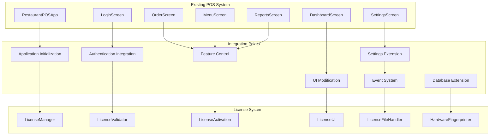

# License System Integration with Existing POS System

## Overview

This document outlines the integration points between the license system and the existing POS application, ensuring seamless operation while maintaining security and user experience.

## Integration Architecture



## 1. Application Initialization Integration

### 1.1 Modified RestaurantPOSApp Class

```python
# src/app.py (modifications)

class RestaurantPOSApp:
    """Main Restaurant POS Application Class with License Integration"""
    
    def __init__(self, root):
        self.root = root
        self.root.title("Restaurant POS System")
        self.root.geometry(f"{DEFAULT_WINDOW_WIDTH}x{DEFAULT_WINDOW_HEIGHT}")
        self.root.state('zoomed')  # Maximize window
        
        # Set window icon
        self.set_window_icon()
        
        # Initialize license system FIRST (before anything else)
        self.license_manager = None
        self.initialize_license_system()
        
        # Initialize database connection
        self.db = DatabaseManager()
        
        # Initialize models
        self.user_model = User(self.db)
        self.category_model = Category(self.db)
        # ... other model initializations
        
        # Initialize UI components (only if license is valid)
        if self.license_manager.is_license_valid():
            self.initialize_ui_components()
        else:
            self.initialize_license_only_mode()
        
        # Initialize event dispatcher
        event_dispatcher.set_tk_root(self.root)
        
        # Load settings
        self.load_settings()
        
        # Initialize data manager
        init_data_manager(self)
        
        # Check if database exists, if not create it
        if not os.path.exists('restaurant_pos.db'):
            import database_setup
            database_setup.setup_database()
        
        # Show appropriate screen based on license status
        self.show_appropriate_screen()
    
    def initialize_license_system(self):
        """Initialize license system before other components"""
        try:
            from src.utils.license_manager import LicenseManager
            from src.utils.license_validator import LicenseValidator
            
            # Initialize license manager
            self.license_manager = LicenseManager(self)
            
            # Perform initial license validation
            validation_result = self.license_manager.validate_on_startup()
            
            if not validation_result.is_valid:
                self.handle_license_failure(validation_result)
                return False
            
            # Schedule periodic validation
            self.license_manager.schedule_periodic_validation()
            
            return True
            
        except Exception as e:
            logger.error(f"License system initialization failed: {e}")
            self.show_critical_license_error()
            return False
    
    def initialize_ui_components(self):
        """Initialize UI components when license is valid"""
        # Initialize UI components
        self.login_screen = LoginScreen(root, self)
        self.dashboard_screen = DashboardScreen(root, self)
        
        # Initialize keyboard handler
        self.keyboard_handler = KeyboardHandler(root, self)
        
        # Track current OrderScreen instance
        self.current_order_screen = None
        
        # Initialize variables
        self.current_user = None
        self.settings = {}
        self.content_frame = None
        self.status_bar = None
    
    def initialize_license_only_mode(self):
        """Initialize limited UI for license activation only"""
        # Create license activation screen
        from src.ui.license_activation_screen import LicenseActivationScreen
        self.license_activation_screen = LicenseActivationScreen(root, self)
        
        # Disable other functionality
        self.current_user = None
        self.settings = {}
    
    def handle_license_failure(self, validation_result):
        """Handle license validation failure"""
        if validation_result.error_code == "NO_LICENSE":
            # Show license activation dialog
            self.show_license_activation_dialog()
        elif validation_result.error_code == "LICENSE_EXPIRED":
            self.show_license_expired_dialog(validation_result)
        elif validation_result.error_code == "HARDWARE_MISMATCH":
            self.show_hardware_mismatch_dialog()
        else:
            self.show_license_error_dialog(validation_result)
    
    def show_appropriate_screen(self):
        """Show appropriate screen based on license status"""
        if self.license_manager and self.license_manager.is_license_valid():
            # Check if user is already logged in
            if hasattr(self, 'current_user') and self.current_user:
                self.show_main_app()
            else:
                self.show_login_screen()
        else:
            # Show license activation screen
            if hasattr(self, 'license_activation_screen'):
                self.license_activation_screen.show()
            else:
                self.show_critical_license_error()
```

### 1.2 License Event Integration

```python
# src/utils/license_event_integration.py

class LicenseEventIntegration:
    """Integrate license events with POS application"""
    
    def __init__(self, app):
        self.app = app
        self.setup_event_handlers()
        
    def setup_event_handlers(self):
        """Setup event handlers for license events"""
        # License validation events
        event_dispatcher.subscribe(EventType.LICENSE_VALIDATED, self.on_license_validated)
        event_dispatcher.subscribe(EventType.LICENSE_EXPIRED, self.on_license_expired)
        event_dispatcher.subscribe(EventType.LICENSE_SUSPENDED, self.on_license_suspended)
        
        # Feature access events
        event_dispatcher.subscribe(EventType.FEATURE_BLOCKED, self.on_feature_blocked)
        event_dispatcher.subscribe(EventType.FEATURE_GRANTED, self.on_feature_granted)
        
        # Trial events
        event_dispatcher.subscribe(EventType.TRIAL_EXPIRING, self.on_trial_expiring)
        event_dispatcher.subscribe(EventType.GRACE_PERIOD_STARTING, self.on_grace_period_starting)
        
        # Security events
        event_dispatcher.subscribe(EventType.SECURITY_VIOLATION, self.on_security_violation)
    
    def on_license_validated(self, data):
        """Handle successful license validation"""
        # Update status bar
        if hasattr(self.app, 'status_bar'):
            self.app.status_bar.config(text="License validated successfully")
        
        # Update UI if needed
        if hasattr(self.app, 'current_screen'):
            self.app.current_screen.on_license_validated(data)
        
        # Log validation
        logger.info(f"License validated: {data['result'].license_type}")
    
    def on_license_expired(self, data):
        """Handle license expiration"""
        # Show expiration dialog
        from src.ui.license_expired_dialog import LicenseExpiredDialog
        expired_dialog = LicenseExpiredDialog(self.app.root, self.app, data)
        expired_dialog.show()
        
        # Limit application functionality
        self.limit_application_functionality()
    
    def on_feature_blocked(self, data):
        """Handle blocked feature access"""
        feature = data['feature']
        
        # Show feature blocked dialog
        from src.ui.feature_blocked_dialog import FeatureBlockedDialog
        blocked_dialog = FeatureBlockedDialog(self.app.root, self.app, feature)
        blocked_dialog.show()
        
        # Log feature block attempt
        logger.warning(f"Feature access blocked: {feature}")
    
    def limit_application_functionality(self):
        """Limit application functionality when license is invalid"""
        # Disable menu items that require license
        if hasattr(self.app, 'sidebar_buttons'):
            for button in self.app.sidebar_buttons:
                button.config(state='disabled')
        
        # Show license required message
        if hasattr(self.app, 'content_frame'):
            for widget in self.app.content_frame.winfo_children():
                widget.destroy()
            
            from tkinter import ttk
            message_frame = ttk.Frame(self.app.content_frame)
            message_frame.pack(expand=True)
            
            ttk.Label(
                message_frame,
                text="⚠️ Valid license required to use this application",
                font=('Arial', 16, 'bold'),
                foreground='red'
            ).pack(expand=True)
            
            ttk.Button(
                message_frame,
                text="Activate License",
                command=self.app.show_license_activation_dialog
            ).pack(pady=20)
```

## 2. Authentication Integration

### 2.1 Modified LoginScreen

```python
# src/ui/login_screen.py (modifications)

class LoginScreen(BaseUI):
    """Login screen with license integration"""
    
    def __init__(self, root, app):
        super().__init__(root, app)
        self.login_frame = None
        self.username_entry = None
        self.password_entry = None
        self.status_bar = None
        self.license_status_widget = None
        
        # Add license status indicator
        self.create_license_status_indicator()
    
    def create_license_status_indicator(self):
        """Create license status indicator in login screen"""
        # Create license status frame
        license_frame = ttk.Frame(self.root)
        license_frame.pack(side=tk.BOTTOM, fill=tk.X, padx=10, pady=5)
        
        # License status label
        self.license_status_label = ttk.Label(
            license_frame,
            text="",
            font=('Arial', 10),
            foreground='gray'
        )
        self.license_status_label.pack(side=tk.LEFT)
        
        # Update license status
        self.update_license_status()
        
        # Schedule periodic updates
        self.root.after(5000, self.update_license_status)
    
    def update_license_status(self):
        """Update license status display"""
        if hasattr(self.app, 'license_manager') and self.app.license_manager:
            status = self.app.license_manager.get_license_status()
            
            if status['is_valid']:
                status_text = f"✅ {status['license_type'].title()} License"
                status_color = 'green'
            elif status['is_trial']:
                remaining_days = status.get('remaining_days', 0)
                status_text = f"⏰ Trial: {remaining_days} days left"
                status_color = 'orange'
            else:
                status_text = "❌ No valid license"
                status_color = 'red'
            
            self.license_status_label.config(text=status_text, foreground=status_color)
        
        # Schedule next update
        self.root.after(5000, self.update_license_status)
    
    def login(self):
        """Authenticate user and show main application with license check"""
        username = self.username_entry.get()
        password = self.password_entry.get()
        
        if not username or not password:
            self.show_message("Error", "Please enter username and password", "error")
            return
        
        # Check license before allowing login
        if hasattr(self.app, 'license_manager'):
            if not self.app.license_manager.is_license_valid():
                self.show_message("License Error", "Valid license required to login", "error")
                self.app.show_license_activation_dialog()
                return
        
        # Authenticate using User model
        user = self.app.user_model.authenticate(username, password)
        
        if user:
            # Clean up key bindings before transitioning
            self.cleanup_key_bindings()
            
            self.app.current_user = {
                'id': user[0],
                'username': user[1],
                'role': user[2]
            }
            
            # Log license access event
            event_dispatcher.dispatch(EventType.FEATURE_GRANTED, {
                'feature': 'user_login',
                'user_id': user[0],
                'license_type': self.app.license_manager.get_license_type()
            })
            
            self.app.show_main_app()
        else:
            self.show_message("Error", "Invalid username or password", "error")
```

## 3. UI Component Integration

### 3.1 Modified BaseUI

```python
# src/ui/base_ui.py (modifications)

class BaseUI:
    """Base class for UI components with license integration"""
    
    def __init__(self, root, app):
        self.root = root
        self.app = app
        self.db = app.db
        
    def create_license_aware_button(self, parent, text, command, required_feature, **kwargs):
        """Create button that checks license before executing"""
        def wrapped_command():
            # Check license before executing command
            if hasattr(self.app, 'license_manager'):
                if self.app.license_manager.check_feature_access(required_feature):
                    command()
                else:
                    self.show_license_required_dialog(required_feature)
            else:
                # Fallback to original command if no license manager
                command()
        
        return ttk.Button(parent, text=text, command=wrapped_command, **kwargs)
    
    def create_license_aware_menu_item(self, menu, text, command, required_feature):
        """Create menu item that checks license"""
        def wrapped_command():
            if hasattr(self.app, 'license_manager'):
                if self.app.license_manager.check_feature_access(required_feature):
                    command()
                else:
                    self.show_license_required_dialog(required_feature)
            else:
                command()
        
        menu.add_command(label=text, command=wrapped_command)
    
    def show_license_required_dialog(self, feature):
        """Show license required dialog"""
        from tkinter import messagebox
        
        # Get license type
        license_type = "Unknown"
        if hasattr(self.app, 'license_manager'):
            status = self.app.license_manager.get_license_status()
            license_type = status.get('license_type', 'Unknown')
        
        messagebox.showwarning(
            "License Required",
            f"The '{feature}' feature requires a {license_type} license.\n\n"
            f"Please upgrade your license to access this feature.",
            parent=self.root
        )
    
    def check_feature_access(self, feature):
        """Check if feature is accessible with current license"""
        if hasattr(self.app, 'license_manager'):
            return self.app.license_manager.check_feature_access(feature)
        return True  # Allow access if no license manager
```

### 3.2 Modified SettingsScreen

```python
# src/ui/settings_screen.py (modifications)

class SettingsScreen(BaseUI):
    """Settings screen with license integration"""
    
    def setup_ui(self):
        """Setup modern settings UI with license integration"""
        # Check if user has admin privileges
        if self.app.current_user['role'] != 'Admin':
            self.show_message("Access Denied", "You don't have permission to access settings", "error")
            return
        
        # Check license for settings access
        if not self.check_feature_access('settings_management'):
            self.show_license_required_dialog('Settings Management')
            return
        
        # Configure styles
        self.configure_styles()
        
        # Set background color for entire content frame
        bg_frame = tk.Frame(self.app.content_frame, bg=COLOR_BACKGROUND_LIGHT)
        bg_frame.pack(fill=tk.BOTH, expand=True)
        
        # Create main container with proper spacing and shadow effect
        shadow_container = tk.Frame(bg_frame, bg=COLOR_SHADOW)
        shadow_container.pack(fill=tk.BOTH, expand=True, padx=SPACING_XL, pady=SPACING_XL)
        
        main_container = self.create_modern_frame(
            shadow_container,
            style="Card.TFrame",
            padding=SPACING_XL
        )
        main_container.pack(fill=tk.BOTH, expand=True, padx=1, pady=1)
        
        # Header section with title and description
        header_frame = self.create_modern_frame(main_container, style="Card.TFrame", padding=SPACING_M)
        header_frame.pack(fill=tk.X, pady=(0, SPACING_L))
        
        title_label = self.create_modern_label(
            header_frame, 
            text="Settings", 
            style="Title.TLabel"
        )
        title_label.pack(anchor=tk.W)
        
        subtitle_label = self.create_modern_label(
            header_frame, 
            text="Manage your restaurant settings, tax configuration, user accounts, and license", 
            style="Subtitle.TLabel"
        )
        subtitle_label.pack(anchor=tk.W, pady=(SPACING_S, 0))
        
        # Create modern notebook for tabs with enhanced styling
        notebook = ttk.Notebook(main_container)
        notebook.pack(fill=tk.BOTH, expand=True)
        
        # Add license tab
        self.create_license_management_tab(notebook)
        
        # Create other tabs
        self.create_general_settings_tab(notebook)
        self.create_tax_settings_tab(notebook)
        self.create_printer_settings_tab(notebook)
        self.create_export_settings_tab(notebook)
        self.create_user_management_tab(notebook)
        
        # Save button container with modern styling
        save_container = self.create_modern_frame(main_container, style="Card.TFrame", padding=SPACING_L)
        save_container.pack(fill=tk.X, pady=(SPACING_L, 0))
        
        # Add separator
        self.create_separator(save_container, orient=tk.HORIZONTAL, padding=SPACING_M)
        
        # Button container for save action
        button_container = ttk.Frame(save_container, style="Card.TFrame")
        button_container.pack(fill=tk.X, pady=SPACING_M)
        
        # Modern save button with enhanced styling
        save_button = self.create_modern_button(
            button_container,
            text="Save All Settings",
            command=self.save_settings,
            style="Success.TButton"
        )
        save_button.pack(side=tk.RIGHT, padx=SPACING_S)
        
        # Status label for feedback
        self.status_label = self.create_modern_label(
            button_container,
            text="",
            style="Small.TLabel"
        )
        self.status_label.pack(side=tk.LEFT, padx=SPACING_S)
        
        # Load users
        self.load_users()
    
    def create_license_management_tab(self, notebook):
        """Create license management tab"""
        # License management tab with modern card design
        license_frame = self.create_modern_frame(notebook, style="Card.TFrame", padding=SPACING_XL)
        notebook.add(license_frame, text="License Management")
        
        # Tab description
        desc_label = self.create_modern_label(
            license_frame, 
            text="View and manage your license information", 
            style="Subtitle.TLabel"
        )
        desc_label.pack(anchor=tk.W, pady=(0, SPACING_L))
        
        # License status card
        self.create_license_status_card(license_frame)
        
        # License actions
        self.create_license_actions_card(license_frame)
```

## 4. Feature Control Integration

### 4.1 Feature Access Control

```python
# src/utils/feature_control.py

class FeatureControl:
    """Control access to features based on license"""
    
    def __init__(self, license_manager):
        self.license_manager = license_manager
        self.feature_permissions = {
            'order_management': ['trial', 'standard', 'professional', 'enterprise'],
            'table_management': ['trial', 'standard', 'professional', 'enterprise'],
            'menu_management': ['trial', 'standard', 'professional', 'enterprise'],
            'user_management': ['professional', 'enterprise'],
            'inventory_management': ['professional', 'enterprise'],
            'reporting_basic': ['standard', 'professional', 'enterprise'],
            'reporting_advanced': ['professional', 'enterprise'],
            'gst_reporting': ['professional', 'enterprise'],
            'data_export': ['professional', 'enterprise'],
            'data_import': ['professional', 'enterprise'],
            'email_notifications': ['professional', 'enterprise'],
            'multi_location': ['enterprise'],
            'api_access': ['enterprise'],
            'custom_branding': ['enterprise'],
            'priority_support': ['enterprise']
        }
    
    def check_feature_access(self, feature: str) -> bool:
        """Check if feature is accessible with current license"""
        if not self.license_manager:
            return True  # Allow access if no license manager
        
        # Get current license type
        license_type = self.license_manager.get_license_type()
        if not license_type:
            return False
        
        # Check if feature is allowed for this license type
        allowed_licenses = self.feature_permissions.get(feature, [])
        return license_type in allowed_licenses
    
    def get_available_features(self) -> list:
        """Get list of available features for current license"""
        if not self.license_manager:
            return list(self.feature_permissions.keys())
        
        license_type = self.license_manager.get_license_type()
        if not license_type:
            return []
        
        available_features = []
        for feature, allowed_licenses in self.feature_permissions.items():
            if license_type in allowed_licenses:
                available_features.append(feature)
        
        return available_features
    
    def decorate_function(self, feature: str):
        """Decorator to check feature access before function execution"""
        def decorator(func):
            def wrapper(*args, **kwargs):
                if self.check_feature_access(feature):
                    return func(*args, **kwargs)
                else:
                    # Raise exception or return error
                    raise FeatureNotAvailableError(f"Feature '{feature}' not available with current license")
            return wrapper
        return decorator
```

### 4.2 Feature Control in UI Components

```python
# src/ui/order_screen.py (modifications)

class OrderScreen(BaseUI):
    """Order screen with license integration"""
    
    def __init__(self, root, app):
        super().__init__(root, app)
        self.setup_ui()
    
    def setup_ui(self):
        """Setup order screen with license checks"""
        # Check if order management is available
        if not self.check_feature_access('order_management'):
            self.show_feature_not_available_screen('Order Management')
            return
        
        # Continue with normal setup
        self.create_order_ui()
    
    def create_advanced_reports_button(self, parent):
        """Create advanced reports button with license check"""
        if self.check_feature_access('reporting_advanced'):
            return self.create_modern_button(
                parent,
                text="📊 Advanced Reports",
                command=self.show_advanced_reports,
                style="Primary.TButton"
            )
        else:
            # Create disabled button with tooltip
            button = self.create_modern_button(
                parent,
                text="📊 Advanced Reports",
                command=self.show_upgrade_prompt,
                style="Secondary.TButton",
                state='disabled'
            )
            
            # Add tooltip
            from tkinter import Tooltip
            Tooltip(button, "Advanced reports require Professional or Enterprise license")
            
            return button
    
    def show_upgrade_prompt(self):
        """Show upgrade prompt for locked features"""
        from tkinter import messagebox
        
        result = messagebox.askyesno(
            "Feature Upgrade Required",
            "This feature requires a Professional or Enterprise license.\n\n"
            "Would you like to upgrade your license now?",
            parent=self.root
        )
        
        if result:
            self.app.show_license_upgrade_dialog()
```

## 5. Database Integration

### 5.1 Database Migration for License

```python
# src/migrations/add_license_tables.py

def add_license_tables():
    """Add license-related tables to existing database"""
    try:
        # Get database manager
        from src.models.database import DatabaseManager
        db = DatabaseManager()
        
        # Create license tables
        license_tables = [
            # licenses table
            """
            CREATE TABLE IF NOT EXISTS licenses (
                id TEXT PRIMARY KEY,
                license_key TEXT UNIQUE NOT NULL,
                license_type TEXT NOT NULL CHECK (license_type IN ('trial', 'standard', 'professional', 'enterprise')),
                customer_name TEXT,
                customer_email TEXT,
                issued_date DATETIME NOT NULL,
                expiry_date DATETIME,
                activation_date DATETIME,
                last_validation DATETIME,
                validation_count INTEGER DEFAULT 0,
                max_validations INTEGER DEFAULT 1000,
                is_active BOOLEAN DEFAULT 0,
                is_trial BOOLEAN DEFAULT 0,
                trial_extensions INTEGER DEFAULT 0,
                hardware_fingerprint TEXT,
                signature TEXT NOT NULL,
                checksum TEXT NOT NULL,
                created_at DATETIME DEFAULT CURRENT_TIMESTAMP,
                updated_at DATETIME DEFAULT CURRENT_TIMESTAMP
            )
            """,
            
            # license_activations table
            """
            CREATE TABLE IF NOT EXISTS license_activations (
                id INTEGER PRIMARY KEY AUTOINCREMENT,
                license_id TEXT NOT NULL,
                machine_id TEXT NOT NULL,
                hardware_fingerprint TEXT NOT NULL,
                activation_date DATETIME NOT NULL,
                last_seen DATETIME,
                activation_status TEXT NOT NULL CHECK (activation_status IN ('active', 'inactive', 'suspended', 'revoked')),
                ip_address TEXT,
                user_agent TEXT,
                created_at DATETIME DEFAULT CURRENT_TIMESTAMP,
                updated_at DATETIME DEFAULT CURRENT_TIMESTAMP,
                FOREIGN KEY (license_id) REFERENCES licenses(id) ON DELETE CASCADE
            )
            """,
            
            # license_features table
            """
            CREATE TABLE IF NOT EXISTS license_features (
                id INTEGER PRIMARY KEY AUTOINCREMENT,
                license_id TEXT NOT NULL,
                feature_code TEXT NOT NULL,
                feature_name TEXT NOT NULL,
                is_enabled BOOLEAN DEFAULT 1,
                created_at DATETIME DEFAULT CURRENT_TIMESTAMP,
                FOREIGN KEY (license_id) REFERENCES licenses(id) ON DELETE CASCADE,
                UNIQUE(license_id, feature_code)
            )
            """,
            
            # license_audit_log table
            """
            CREATE TABLE IF NOT EXISTS license_audit_log (
                id INTEGER PRIMARY KEY AUTOINCREMENT,
                license_id TEXT NOT NULL,
                action_type TEXT NOT NULL CHECK (action_type IN ('activation', 'validation', 'deactivation', 'modification', 'feature_access', 'security_violation')),
                action_description TEXT NOT NULL,
                result TEXT NOT NULL CHECK (result IN ('success', 'failure', 'warning', 'error')),
                ip_address TEXT,
                user_agent TEXT,
                created_at DATETIME DEFAULT CURRENT_TIMESTAMP,
                FOREIGN KEY (license_id) REFERENCES licenses(id) ON DELETE CASCADE
            )
            """
        ]
        
        # Execute table creation
        for table_sql in license_tables:
            db.execute_query(table_sql)
        
        db.commit()
        
        # Add license-related settings
        license_settings = [
            ('license_server_url', 'https://license.restaurantpos.com/api'),
            ('license_validation_interval_hours', '24'),
            ('license_offline_grace_period_days', '7'),
            ('license_max_trial_extensions', '2'),
            ('license_trial_extension_days', '15'),
            ('license_max_offline_validations', '7')
        ]
        
        for key, value in license_settings:
            db.execute_query(
                "INSERT OR IGNORE INTO settings (key, value) VALUES (?, ?)",
                (key, value)
            )
        
        db.commit()
        
        print("License tables added successfully")
        return True
        
    except Exception as e:
        print(f"Error adding license tables: {e}")
        return False

if __name__ == "__main__":
    add_license_tables()
```

## 6. Settings Integration

### 6.1 License Settings Extension

```python
# src/utils/license_settings.py

class LicenseSettings:
    """License settings management"""
    
    def __init__(self, app):
        self.app = app
        
    def get_license_settings(self) -> dict:
        """Get all license-related settings"""
        license_settings_keys = [
            'license_server_url',
            'license_validation_interval_hours',
            'license_offline_grace_period_days',
            'license_max_trial_extensions',
            'license_trial_extension_days',
            'license_max_offline_validations',
            'license_last_online_validation',
            'license_offline_validation_count',
            'license_grace_period_start',
            'license_next_validation_due'
        ]
        
        settings = {}
        for key in license_settings_keys:
            value = self.app.settings_model.get(key)
            if value is not None:
                settings[key] = value
        
        return settings
    
    def update_license_setting(self, key: str, value):
        """Update a license setting"""
        self.app.update_setting(key, value)
        
        # Trigger settings change event
        event_dispatcher.dispatch(EventType.LICENSE_SETTING_CHANGED, {
            'key': key,
            'value': value
        })
    
    def reset_license_settings(self):
        """Reset all license settings to defaults"""
        defaults = {
            'license_server_url': 'https://license.restaurantpos.com/api',
            'license_validation_interval_hours': '24',
            'license_offline_grace_period_days': '7',
            'license_max_trial_extensions': '2',
            'license_trial_extension_days': '15',
            'license_max_offline_validations': '7'
        }
        
        for key, value in defaults.items():
            self.update_license_setting(key, value)
```

## 7. Event System Integration

### 7.1 Extended Event Types

```python
# src/utils/event_dispatcher.py (extensions)

class EventType(Enum):
    """Event types for the POS system with license events"""
    # Original events
    ORDER_CREATED = "order_created"
    ORDER_UPDATED = "order_updated"
    KOT_STATUS_CHANGED = "kot_status_changed"
    INVENTORY_UPDATED = "inventory_updated"
    TABLE_STATUS_CHANGED = "table_status_changed"
    MENU_UPDATED = "menu_updated"
    PAYMENT_PROCESSED = "payment_processed"
    
    # License events
    LICENSE_VALIDATED = "license_validated"
    LICENSE_EXPIRED = "license_expired"
    LICENSE_SUSPENDED = "license_suspended"
    LICENSE_ACTIVATED = "license_activated"
    LICENSE_DEACTIVATED = "license_deactivated"
    FEATURE_BLOCKED = "feature_blocked"
    FEATURE_GRANTED = "feature_granted"
    TRIAL_EXPIRING = "trial_expiring"
    GRACE_PERIOD_STARTING = "grace_period_starting"
    OFFLINE_MODE_ENTERED = "offline_mode_entered"
    ONLINE_MODE_RESUMED = "online_mode_resumed"
    LICENSE_SETTING_CHANGED = "license_setting_changed"
    SECURITY_VIOLATION = "security_violation"
```

This comprehensive integration design ensures that the license system works seamlessly with the existing POS application while maintaining security and providing excellent user experience.