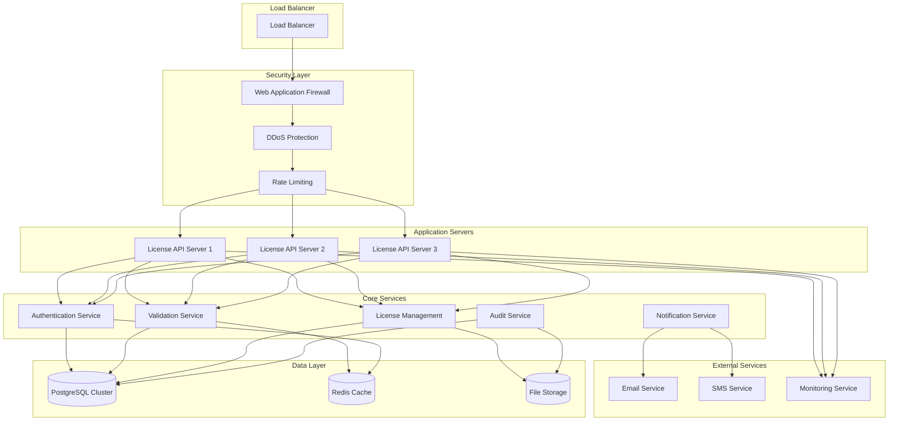

# License Server Architecture and API Endpoints

## Overview

This document outlines the license server architecture designed to provide secure, scalable license validation and management services for the POS application. The server implements RESTful APIs with comprehensive security measures and high availability.

## Server Architecture



## Technology Stack

### Backend Framework
- **Framework**: FastAPI (Python 3.9+)
- **Database**: PostgreSQL 14+ with replication
- **Cache**: Redis 6+ with clustering
- **Message Queue**: RabbitMQ or Apache Kafka
- **Storage**: AWS S3 or equivalent

### Security
- **TLS**: TLS 1.3 with perfect forward secrecy
- **Authentication**: JWT with RS256 signatures
- **Authorization**: OAuth 2.0 with role-based access
- **Encryption**: AES-256-GCM for data at rest
- **API Security**: API keys, rate limiting, input validation

### Infrastructure
- **Containerization**: Docker with Kubernetes orchestration
- **Load Balancing**: NGINX or AWS ALB
- **Monitoring**: Prometheus + Grafana
- **Logging**: ELK Stack (Elasticsearch, Logstash, Kibana)
- **CI/CD**: GitLab CI/CD with automated testing

## API Endpoints

### 1. Authentication Endpoints

#### POST /api/v1/auth/login
Authenticate admin users and generate JWT tokens.

**Request:**
```json
{
    "username": "admin@restaurantpos.com",
    "password": "secure_password",
    "mfa_code": "123456"
}
```

**Response:**
```json
{
    "access_token": "eyJhbGciOiJSUzI1NiIsInR5cCI6IkpXVCJ9...",
    "refresh_token": "eyJhbGciOiJSUzI1NiIsInR5cCI6IkpXVCJ9...",
    "token_type": "Bearer",
    "expires_in": 3600,
    "user": {
        "id": "user_123",
        "username": "admin@restaurantpos.com",
        "role": "super_admin",
        "permissions": ["license_manage", "license_view", "system_admin"]
    }
}
```

#### POST /api/v1/auth/refresh
Refresh JWT access token.

**Request:**
```json
{
    "refresh_token": "eyJhbGciOiJSUzI1NiIsInR5cCI6IkpXVCJ9..."
}
```

#### POST /api/v1/auth/logout
Invalidate JWT tokens.

### 2. License Validation Endpoints

#### POST /api/v1/licenses/validate
Validate license key and return status.

**Request:**
```json
{
    "license_key": "POS-STD-2024-ABC123-XYZ789",
    "hardware_fingerprint": "a1b2c3d4e5f6...",
    "machine_id": "machine_abc123",
    "app_version": "2.1.0",
    "validation_count": 15,
    "last_validation": "2024-01-15T10:30:00Z",
    "request_timestamp": "2024-01-16T10:30:00Z",
    "signature": "RSA_SIGNATURE_HERE"
}
```

**Response:**
```json
{
    "valid": true,
    "license_id": "license_123",
    "license_type": "standard",
    "customer_name": "Restaurant ABC",
    "customer_email": "contact@restaurantabc.com",
    "issued_date": "2024-01-01T00:00:00Z",
    "expiry_date": null,
    "remaining_days": -1,
    "features": [
        "order_management",
        "table_management",
        "menu_management",
        "user_management",
        "reporting_basic"
    ],
    "user_limit": 3,
    "location_limit": 1,
    "next_validation_due": "2024-01-17T10:30:00Z",
    "server_timestamp": "2024-01-16T10:30:05Z",
    "validation_id": "validation_abc123"
}
```

#### POST /api/v1/licenses/validate-batch
Batch validate multiple licenses.

**Request:**
```json
{
    "licenses": [
        {
            "license_key": "POS-STD-2024-ABC123-XYZ789",
            "hardware_fingerprint": "a1b2c3d4e5f6...",
            "machine_id": "machine_abc123"
        }
    ]
}
```

### 3. License Activation Endpoints

#### POST /api/v1/licenses/activate
Activate a new license.

**Request:**
```json
{
    "license_key": "POS-STD-2024-ABC123-XYZ789",
    "hardware_fingerprint": "a1b2c3d4e5f6...",
    "machine_id": "machine_abc123",
    "customer_name": "Restaurant ABC",
    "customer_email": "contact@restaurantabc.com",
    "app_version": "2.1.0",
    "installation_details": {
        "os": "Windows 10 Pro",
        "architecture": "x64",
        "cpu_cores": 8,
        "memory_gb": 16,
        "disk_space_gb": 500
    }
}
```

**Response:**
```json
{
    "success": true,
    "license_id": "license_123",
    "activation_id": "activation_abc123",
    "license_type": "standard",
    "features": [
        "order_management",
        "table_management",
        "menu_management",
        "user_management",
        "reporting_basic"
    ],
    "user_limit": 3,
    "location_limit": 1,
    "issued_date": "2024-01-01T00:00:00Z",
    "expiry_date": null,
    "activation_date": "2024-01-16T10:30:00Z",
    "next_validation_due": "2024-01-17T10:30:00Z"
}
```

#### POST /api/v1/licenses/deactivate
Deactivate a license.

**Request:**
```json
{
    "license_key": "POS-STD-2024-ABC123-XYZ789",
    "machine_id": "machine_abc123",
    "reason": "Hardware upgrade"
}
```

### 4. License Management Endpoints

#### GET /api/v1/licenses
List all licenses (admin only).

**Query Parameters:**
- `page`: Page number (default: 1)
- `limit`: Items per page (default: 50)
- `status`: Filter by status (active, inactive, expired, trial)
- `type`: Filter by license type
- `search`: Search term

**Response:**
```json
{
    "licenses": [
        {
            "id": "license_123",
            "license_key": "POS-STD-2024-ABC123-XYZ789",
            "license_type": "standard",
            "customer_name": "Restaurant ABC",
            "customer_email": "contact@restaurantabc.com",
            "status": "active",
            "issued_date": "2024-01-01T00:00:00Z",
            "expiry_date": null,
            "activation_date": "2024-01-16T10:30:00Z",
            "last_validation": "2024-01-16T10:30:00Z",
            "validation_count": 15,
            "activations": 1
        }
    ],
    "pagination": {
        "page": 1,
        "limit": 50,
        "total": 1250,
        "pages": 25
    }
}
```

#### POST /api/v1/licenses
Create a new license (admin only).

**Request:**
```json
{
    "license_type": "professional",
    "customer_name": "Restaurant XYZ",
    "customer_email": "contact@restaurantxyz.com",
    "expiry_date": "2025-01-01T00:00:00Z",
    "features": [
        "order_management",
        "table_management",
        "menu_management",
        "user_management",
        "reporting_advanced",
        "inventory_management",
        "gst_reporting",
        "data_export",
        "data_import",
        "email_notifications"
    ],
    "user_limit": 10,
    "location_limit": 1,
    "notes": "Annual subscription"
}
```

#### PUT /api/v1/licenses/{license_id}
Update license details (admin only).

#### DELETE /api/v1/licenses/{license_id}
Delete license (admin only).

### 5. Trial Management Endpoints

#### POST /api/v1/trials/start
Start a new trial.

**Request:**
```json
{
    "customer_name": "Test Restaurant",
    "customer_email": "test@restaurant.com",
    "hardware_fingerprint": "a1b2c3d4e5f6...",
    "machine_id": "machine_abc123",
    "app_version": "2.1.0"
}
```

**Response:**
```json
{
    "success": true,
    "trial_id": "trial_abc123",
    "license_key": "POS-TRIAL-2024-TRIAL123-TEST456",
    "trial_type": "full_features",
    "duration_days": 30,
    "expiry_date": "2024-02-15T10:30:00Z",
    "features": [
        "order_management",
        "table_management",
        "menu_management",
        "user_management",
        "reporting_advanced",
        "inventory_management",
        "gst_reporting",
        "data_export",
        "data_import",
        "email_notifications",
        "multi_location",
        "api_access"
    ],
    "user_limit": 10,
    "location_limit": 3
}
```

#### POST /api/v1/trials/extend
Extend an existing trial.

**Request:**
```json
{
    "trial_id": "trial_abc123",
    "extension_days": 15,
    "reason": "Customer requested extension"
}
```

### 6. Feature Management Endpoints

#### GET /api/v1/licenses/{license_id}/features
Get features for a specific license.

#### POST /api/v1/licenses/{license_id}/features
Add features to a license.

#### DELETE /api/v1/licenses/{license_id}/features/{feature_code}
Remove features from a license.

### 7. Audit and Monitoring Endpoints

#### GET /api/v1/audit/logs
Get audit logs (admin only).

**Query Parameters:**
- `license_id`: Filter by license
- `action_type`: Filter by action type
- `start_date`: Start date filter
- `end_date`: End date filter
- `page`: Page number
- `limit`: Items per page

#### GET /api/v1/monitoring/stats
Get system statistics (admin only).

**Response:**
```json
{
    "statistics": {
        "total_licenses": 1250,
        "active_licenses": 1180,
        "trial_licenses": 45,
        "expired_licenses": 25,
        "validations_today": 5420,
        "activations_today": 12,
        "server_uptime": "99.9%",
        "average_response_time": "120ms"
    },
    "license_types": {
        "trial": 45,
        "standard": 680,
        "professional": 420,
        "enterprise": 105
    }
}
```

## Security Implementation

### 1. API Authentication

```python
from fastapi import FastAPI, Depends, HTTPException, status
from fastapi.security import HTTPBearer, HTTPAuthorizationCredentials
import jwt
from datetime import datetime, timedelta

class SecurityManager:
    def __init__(self):
        self.secret_key = os.environ.get('JWT_SECRET_KEY')
        self.algorithm = 'RS256'
        self.access_token_expire_minutes = 60
        self.refresh_token_expire_days = 30
        
    def create_access_token(self, user_data: dict) -> str:
        """Create JWT access token"""
        to_encode = {
            'sub': user_data['id'],
            'username': user_data['username'],
            'role': user_data['role'],
            'permissions': user_data['permissions'],
            'exp': datetime.utcnow() + timedelta(minutes=self.access_token_expire_minutes),
            'iat': datetime.utcnow(),
            'type': 'access'
        }
        
        return jwt.encode(to_encode, self.secret_key, algorithm=self.algorithm)
    
    def verify_token(self, token: str) -> dict:
        """Verify JWT token"""
        try:
            payload = jwt.decode(token, self.secret_key, algorithms=[self.algorithm])
            return payload
        except jwt.ExpiredSignatureError:
            raise HTTPException(
                status_code=status.HTTP_401_UNAUTHORIZED,
                detail="Token expired"
            )
        except jwt.InvalidTokenError:
            raise HTTPException(
                status_code=status.HTTP_401_UNAUTHORIZED,
                detail="Invalid token"
            )

security = HTTPBearer()

async def get_current_user(credentials: HTTPAuthorizationCredentials = Depends(security)):
    """Get current user from JWT token"""
    token = credentials.credentials
    security_manager = SecurityManager()
    payload = security_manager.verify_token(token)
    return payload
```

### 2. Rate Limiting

```python
from slowapi import Limiter, _rate_limit_exceeded_handler
from slowapi.util import get_remote_address
from slowapi.errors import RateLimitExceeded

limiter = Limiter(key_func=get_remote_address)

@app.exception_handler(RateLimitExceeded)
async def rate_limit_exceeded_handler(request: Request, exc: RateLimitExceeded):
    return JSONResponse(
        status_code=status.HTTP_429_TOO_MANY_REQUESTS,
        content={"detail": "Rate limit exceeded"},
    )

@app.post("/api/v1/licenses/validate")
@limiter.limit("100/minute")
async def validate_license(request: LicenseValidationRequest):
    """License validation endpoint with rate limiting"""
    pass
```

### 3. Input Validation

```python
from pydantic import BaseModel, validator
import re

class LicenseValidationRequest(BaseModel):
    license_key: str
    hardware_fingerprint: str
    machine_id: str
    app_version: str
    validation_count: int
    last_validation: str
    request_timestamp: str
    signature: str
    
    @validator('license_key')
    def validate_license_key(cls, v):
        if not re.match(r'^POS-[A-Z]+-\d{4}-[A-Z0-9]+-[A-Z0-9]+$', v):
            raise ValueError('Invalid license key format')
        return v
    
    @validator('hardware_fingerprint')
    def validate_hardware_fingerprint(cls, v):
        if len(v) < 32 or len(v) > 256:
            raise ValueError('Invalid hardware fingerprint')
        return v
```

## Database Models (Server Side)

```python
from sqlalchemy import Column, String, DateTime, Integer, Boolean, Text, ForeignKey
from sqlalchemy.ext.declarative import declarative_base
from sqlalchemy.orm import relationship
import uuid

Base = declarative_base()

class License(Base):
    __tablename__ = 'licenses'
    
    id = Column(String(36), primary_key=True, default=lambda: str(uuid.uuid4()))
    license_key = Column(String(64), unique=True, nullable=False)
    license_type = Column(String(20), nullable=False)
    customer_name = Column(String(100))
    customer_email = Column(String(100))
    issued_date = Column(DateTime, nullable=False)
    expiry_date = Column(DateTime)
    activation_date = Column(DateTime)
    last_validation = Column(DateTime)
    validation_count = Column(Integer, default=0)
    max_validations = Column(Integer, default=1000)
    is_active = Column(Boolean, default=False)
    is_trial = Column(Boolean, default=False)
    trial_extensions = Column(Integer, default=0)
    hardware_fingerprint = Column(Text)
    signature = Column(Text, nullable=False)
    checksum = Column(Text, nullable=False)
    created_at = Column(DateTime, default=datetime.utcnow)
    updated_at = Column(DateTime, default=datetime.utcnow, onupdate=datetime.utcnow)
    
    # Relationships
    activations = relationship("LicenseActivation", back_populates="license")
    features = relationship("LicenseFeature", back_populates="license")
    audit_logs = relationship("LicenseAuditLog", back_populates="license")
```

## Monitoring and Logging

### 1. Request Logging

```python
import logging
from fastapi import Request, Response
import time
import json

class AuditLogger:
    def __init__(self):
        self.logger = logging.getLogger('license_audit')
        
    async def log_request(self, request: Request, response: Response, duration: float):
        """Log API request for auditing"""
        log_data = {
            'timestamp': datetime.utcnow().isoformat(),
            'method': request.method,
            'url': str(request.url),
            'status_code': response.status_code,
            'duration_ms': duration * 1000,
            'client_ip': request.client.host,
            'user_agent': request.headers.get('user-agent'),
            'user_id': getattr(request.state, 'user_id', None),
            'request_size': len(await request.body()),
            'response_size': response.headers.get('content-length', 0)
        }
        
        self.logger.info(json.dumps(log_data))

@app.middleware("http")
async def audit_middleware(request: Request, call_next):
    """Middleware for request auditing"""
    start_time = time.time()
    
    response = await call_next(request)
    
    duration = time.time() - start_time
    audit_logger = AuditLogger()
    await audit_logger.log_request(request, response, duration)
    
    return response
```

### 2. Performance Monitoring

```python
from prometheus_client import Counter, Histogram, Gauge, generate_latest

# Metrics
validation_requests = Counter('license_validation_requests_total', ['status'])
validation_duration = Histogram('license_validation_duration_seconds')
active_licenses = Gauge('active_licenses_total')
api_requests = Counter('api_requests_total', ['method', 'endpoint', 'status'])

def record_validation_attempt(status: str, duration: float):
    """Record validation attempt metrics"""
    validation_requests.labels(status=status).inc()
    validation_duration.observe(duration)

def record_api_request(method: str, endpoint: str, status: int):
    """Record API request metrics"""
    api_requests.labels(method=method, endpoint=endpoint, status=status).inc()

@app.get("/metrics")
async def metrics():
    """Prometheus metrics endpoint"""
    return Response(generate_latest(), media_type="text/plain")
```

## Deployment Configuration

### 1. Docker Configuration

```dockerfile
FROM python:3.9-slim

WORKDIR /app

COPY requirements.txt .
RUN pip install --no-cache-dir -r requirements.txt

COPY . .

EXPOSE 8000

CMD ["uvicorn", "main:app", "--host", "0.0.0.0", "--port", "8000"]
```

### 2. Kubernetes Deployment

```yaml
apiVersion: apps/v1
kind: Deployment
metadata:
  name: license-server
spec:
  replicas: 3
  selector:
    matchLabels:
      app: license-server
  template:
    metadata:
      labels:
        app: license-server
    spec:
      containers:
      - name: license-server
        image: restaurantpos/license-server:latest
        ports:
        - containerPort: 8000
        env:
        - name: DATABASE_URL
          valueFrom:
            secretKeyRef:
              name: db-secret
              key: url
        - name: REDIS_URL
          valueFrom:
            secretKeyRef:
              name: redis-secret
              key: url
        resources:
          requests:
            memory: "256Mi"
            cpu: "250m"
          limits:
            memory: "512Mi"
            cpu: "500m"
```

This comprehensive license server architecture provides secure, scalable, and maintainable infrastructure for license management with extensive monitoring and security features.