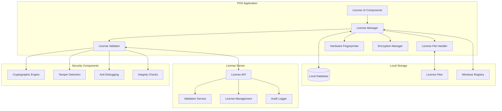

# Comprehensive License System Architecture for POS MVP

## Overview

This document outlines a robust, multi-layered license system architecture designed to provide strong anti-cracking protection while maintaining a smooth user experience for legitimate customers. The system integrates with the existing POS application's local database and supports both online and offline validation mechanisms.

## System Architecture



## License Types and Features

### 1. Trial License
- **Duration**: 30 days with full features
- **Features**: All POS functionality available
- **Limitations**: Time-limited, periodic validation reminders
- **Extension**: Support for trial extensions (up to 15 days)

### 2. Standard License
- **Duration**: Perpetual
- **Features**: Basic POS functionality
  - Order management
  - Basic reporting
  - Table management
  - Menu management (limited to 100 items)
  - User management (max 3 users)
- **Restrictions**: No advanced features, limited support

### 3. Professional License
- **Duration**: Perpetual
- **Features**: Advanced POS functionality
  - All Standard features
  - Advanced reporting and analytics
  - Inventory management
  - GST reporting
  - Data export/import
  - Menu management (unlimited items)
  - User management (max 10 users)
  - Email notifications

### 4. Enterprise License
- **Duration**: Perpetual
- **Features**: Complete POS functionality
  - All Professional features
  - Multi-location support
  - Advanced user roles and permissions
  - API access
  - Priority support
  - Custom branding
  - Unlimited users
  - Advanced integrations

## Core Data Models

### License Data Structure

```python
class LicenseData:
    def __init__(self):
        self.license_id: str = ""                    # Unique license identifier
        self.license_type: LicenseType = LicenseType.TRIAL
        self.product_key: str = ""                   # Encrypted product key
        self.hardware_fingerprint: str = ""           # Hardware binding
        self.issued_date: datetime = None
        self.expiry_date: datetime = None
        self.activation_date: datetime = None
        self.last_validation: datetime = None
        self.validation_count: int = 0
        self.max_validations: int = 1000              # Anti-tampering
        self.features: List[str] = []                 # Enabled features
        self.user_limit: int = 1
        self.location_limit: int = 1
        self.is_active: bool = False
        self.is_trial: bool = False
        self.trial_extensions: int = 0
        self.signature: str = ""                       # Cryptographic signature
        self.checksum: str = ""                       # Data integrity checksum
```

### Hardware Fingerprint Data

```python
class HardwareFingerprint:
    def __init__(self):
        self.cpu_id: str = ""
        self.motherboard_serial: str = ""
        self.disk_serial: str = ""
        self.mac_address: str = ""
        self.windows_product_id: str = ""
        self.bios_uuid: str = ""
        self.memory_size: int = 0
        self.processor_count: int = 0
        self.composite_hash: str = ""                 # Combined fingerprint hash
```

### License Validation Result

```python
class ValidationResult:
    def __init__(self):
        self.is_valid: bool = False
        self.license_type: LicenseType = LicenseType.INVALID
        self.remaining_days: int = 0
        self.validation_method: str = ""               # 'online' or 'offline'
        self.error_code: str = ""
        self.error_message: str = ""
        self.features: List[str] = []
        self.next_validation_due: datetime = None
        self.grace_period_end: datetime = None
        self.server_timestamp: datetime = None
```

## License Manager Core Class

```python
class LicenseManager:
    def __init__(self, app_instance):
        self.app = app_instance
        self.db = app_instance.db
        self.encryption_manager = get_encryption_manager()
        self.hardware_fingerprinter = HardwareFingerprinter()
        self.license_validator = LicenseValidator(self)
        self.license_file_handler = LicenseFileHandler()
        self.license_data: LicenseData = None
        self.validation_result: ValidationResult = None
        self.validation_timer = None
        self.offline_grace_period_days = 7
        
    def initialize_license_system(self) -> bool:
        """Initialize license system on application startup"""
        pass
        
    def validate_license(self, force_online: bool = False) -> ValidationResult:
        """Validate license with online/offline fallback"""
        pass
        
    def activate_license(self, license_key: str) -> bool:
        """Activate new license"""
        pass
        
    def deactivate_license(self) -> bool:
        """Deactivate current license"""
        pass
        
    def get_license_status(self) -> dict:
        """Get current license status information"""
        pass
        
    def check_feature_access(self, feature: str) -> bool:
        """Check if current license allows access to feature"""
        pass
        
    def schedule_periodic_validation(self):
        """Schedule periodic license validation"""
        pass
        
    def handle_validation_failure(self, result: ValidationResult):
        """Handle license validation failure"""
        pass
```

## Hardware Fingerprinting

The system uses multiple hardware identifiers to create a unique fingerprint that binds the license to a specific machine:

```python
class HardwareFingerprinter:
    def __init__(self):
        self.fingerprint_cache = None
        self.fingerprint_cache_time = None
        
    def generate_fingerprint(self) -> HardwareFingerprint:
        """Generate hardware fingerprint"""
        pass
        
    def get_cpu_id(self) -> str:
        """Get CPU identifier"""
        pass
        
    def get_motherboard_serial(self) -> str:
        """Get motherboard serial number"""
        pass
        
    def get_disk_serial(self) -> str:
        """Get primary disk serial number"""
        pass
        
    def get_mac_address(self) -> str:
        """Get primary network adapter MAC address"""
        pass
        
    def get_windows_product_id(self) -> str:
        """Get Windows product ID"""
        pass
        
    def get_bios_uuid(self) -> str:
        """Get BIOS UUID"""
        pass
        
    def create_composite_hash(self, components: dict) -> str:
        """Create composite hash from hardware components"""
        pass
        
    def verify_fingerprint(self, stored_fingerprint: str) -> bool:
        """Verify current fingerprint matches stored fingerprint"""
        pass
        
    def is_fingerprint_stable(self) -> bool:
        """Check if hardware fingerprint has changed significantly"""
        pass
```

## License Types Enum

```python
from enum import Enum

class LicenseType(Enum):
    TRIAL = "trial"
    STANDARD = "standard"
    PROFESSIONAL = "professional"
    ENTERPRISE = "enterprise"
    INVALID = "invalid"
    EXPIRED = "expired"
    SUSPENDED = "suspended"

class Feature(Enum):
    ORDER_MANAGEMENT = "order_management"
    TABLE_MANAGEMENT = "table_management"
    MENU_MANAGEMENT = "menu_management"
    USER_MANAGEMENT = "user_management"
    INVENTORY_MANAGEMENT = "inventory_management"
    REPORTING_BASIC = "reporting_basic"
    REPORTING_ADVANCED = "reporting_advanced"
    GST_REPORTING = "gst_reporting"
    DATA_EXPORT = "data_export"
    DATA_IMPORT = "data_import"
    EMAIL_NOTIFICATIONS = "email_notifications"
    MULTI_LOCATION = "multi_location"
    API_ACCESS = "api_access"
    CUSTOM_BRANDING = "custom_branding"
    PRIORITY_SUPPORT = "priority_support"
```

## License File Storage

The system uses multiple storage locations to prevent easy tampering:

```python
class LicenseFileHandler:
    def __init__(self):
        self.storage_locations = [
            os.path.join(os.environ['APPDATA'], 'RestaurantPOS', 'license.dat'),
            os.path.join(os.environ['LOCALAPPDATA'], 'RestaurantPOS', 'license.enc'),
            os.path.join(os.environ['PROGRAMDATA'], 'RestaurantPOS', 'license.key')
        ]
        self.registry_key = r"SOFTWARE\RestaurantPOS\License"
        
    def save_license_data(self, license_data: LicenseData) -> bool:
        """Save license data to multiple locations"""
        pass
        
    def load_license_data(self) -> LicenseData:
        """Load license data from multiple locations with verification"""
        pass
        
    def backup_license_data(self) -> bool:
        """Create backup of license data"""
        pass
        
    def restore_license_data(self) -> bool:
        """Restore license data from backup"""
        pass
        
    def verify_license_integrity(self) -> bool:
        """Verify license data integrity across all locations"""
        pass
        
    def encrypt_license_data(self, data: dict) -> str:
        """Encrypt license data for storage"""
        pass
        
    def decrypt_license_data(self, encrypted_data: str) -> dict:
        """Decrypt license data from storage"""
        pass
```

## Event Integration

The license system integrates with the existing event dispatcher:

```python
class LicenseEventTypes(Enum):
    LICENSE_VALIDATED = "license_validated"
    LICENSE_EXPIRED = "license_expired"
    LICENSE_ACTIVATED = "license_activated"
    LICENSE_DEACTIVATED = "license_deactivated"
    FEATURE_BLOCKED = "feature_blocked"
    TRIAL_EXPIRING = "trial_expiring"
    GRACE_PERIOD_STARTING = "grace_period_starting"
    OFFLINE_MODE_ENTERED = "offline_mode_entered"
    ONLINE_MODE_RESUMED = "online_mode_resumed"
```

## Constants

```python
# License Constants
LICENSE_VALIDATION_INTERVAL_HOURS = 24
OFFLINE_GRACE_PERIOD_DAYS = 7
TRIAL_PERIOD_DAYS = 30
MAX_TRIAL_EXTENSIONS = 2
TRIAL_EXTENSION_DAYS = 15
MAX_OFFLINE_VALIDATIONS = 7
LICENSE_FILE_VERSION = "2.0"
MIN_HARDWARE_MATCH_SCORE = 0.8

# License Server Configuration
LICENSE_SERVER_URL = "https://license.restaurantpos.com/api"
LICENSE_SERVER_TIMEOUT = 30
LICENSE_SERVER_RETRY_ATTEMPTS = 3

# Encryption Constants
LICENSE_KEY_DERIVATION_ITERATIONS = 100000
LICENSE_ENCRYPTION_ALGORITHM = "AES-256-GCM"
LICENSE_SIGNATURE_ALGORITHM = "RSA-4096"
```

This architecture provides a solid foundation for a secure, robust license system that integrates seamlessly with the existing POS application while providing strong anti-cracking measures.