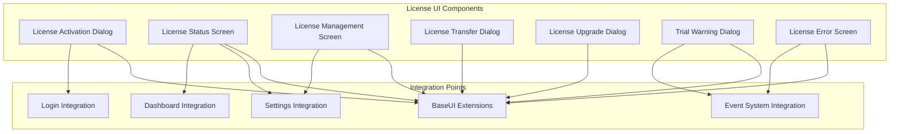

# License Management UI Components

## Overview

This document outlines the UI components for license management, designed to integrate seamlessly with the existing POS application's modern UI framework. The components provide intuitive license activation, status monitoring, and management capabilities.

## UI Component Architecture



## 1. License Activation Dialog

### 1.1 Component Structure

```python
class LicenseActivationDialog(BaseUI):
    """License activation dialog with modern design"""
    
    def __init__(self, root, app, license_manager):
        super().__init__(root, app)
        self.license_manager = license_manager
        self.dialog = None
        self.license_key_var = None
        self.customer_info_vars = {}
        self.activation_progress = None
        self.result_message = None
        
    def show(self, parent=None):
        """Show license activation dialog"""
        pass
        
    def create_dialog_layout(self):
        """Create modern dialog layout"""
        pass
        
    def validate_license_key(self, license_key: str) -> bool:
        """Validate license key format"""
        pass
        
    def activate_license(self):
        """Activate license with online validation"""
        pass
        
    def show_activation_result(self, success: bool, message: str):
        """Show activation result to user"""
        pass
```

### 1.2 UI Layout Design

```python
def create_dialog_layout(self):
    """Create modern activation dialog layout"""
    # Main dialog container with shadow effect
    dialog = tk.Toplevel(self.root)
    dialog.title("Activate License")
    dialog.geometry("600x500")
    dialog.configure(bg=COLOR_BACKGROUND_LIGHT)
    dialog.resizable(False, False)
    
    # Make dialog modal
    dialog.transient(self.root)
    dialog.grab_set()
    
    # Center dialog
    dialog.update_idletasks()
    x = (dialog.winfo_screenwidth() // 2) - 300
    y = (dialog.winfo_screenheight() // 2) - 250
    dialog.geometry(f"600x500+{x}+{y}")
    
    # Main container with card design
    main_container = self.create_modern_frame(dialog, style="Card.TFrame", padding=SPACING_XL)
    main_container.pack(fill=tk.BOTH, expand=True, padx=SPACING_XXL, pady=SPACING_XXL)
    
    # Header section
    header_frame = self.create_modern_frame(main_container, style="Panel.TFrame", padding=SPACING_L)
    header_frame.pack(fill=tk.X, pady=(0, SPACING_L))
    
    # Title with icon
    title_label = self.create_modern_label(
        header_frame,
        text="🔑 License Activation",
        style="Title.TLabel"
    )
    title_label.pack(anchor=tk.W)
    
    subtitle_label = self.create_modern_label(
        header_frame,
        text="Enter your license key to activate the POS system",
        style="Subtitle.TLabel"
    )
    subtitle_label.pack(anchor=tk.W, pady=(SPACING_S, 0))
    
    # License key section
    key_frame = self.create_modern_frame(main_container, style="Panel.TFrame", padding=SPACING_L)
    key_frame.pack(fill=tk.X, pady=SPACING_S)
    
    key_title = self.create_modern_label(
        key_frame,
        text="License Key",
        style="SectionTitle.TLabel"
    )
    key_title.pack(anchor=tk.W, pady=(0, SPACING_S))
    
    # License key entry with validation
    self.license_key_var = tk.StringVar()
    key_entry = self.create_modern_entry(
        key_frame,
        textvariable=self.license_key_var,
        font=('Consolas', 12, 'bold'),
        width=50
    )
    key_entry.pack(fill=tk.X, pady=(0, SPACING_M))
    
    # Add validation indicator
    validation_frame = ttk.Frame(key_frame)
    validation_frame.pack(fill=tk.X, pady=(SPACING_S, 0))
    
    self.validation_indicator = self.create_modern_label(
        validation_frame,
        text="",
        style="Small.TLabel"
    )
    self.validation_indicator.pack(side=tk.LEFT)
    
    # Customer information section
    info_frame = self.create_modern_frame(main_container, style="Panel.TFrame", padding=SPACING_L)
    info_frame.pack(fill=tk.X, pady=SPACING_S)
    
    info_title = self.create_modern_label(
        info_frame,
        text="Customer Information (Optional)",
        style="SectionTitle.TLabel"
    )
    info_title.pack(anchor=tk.W, pady=(0, SPACING_S))
    
    # Customer name
    self.customer_name_var = tk.StringVar()
    self.create_form_field(
        info_frame,
        "Customer Name",
        entry_type="entry",
        textvariable=self.customer_name_var,
        width=40
    )
    
    # Customer email
    self.customer_email_var = tk.StringVar()
    self.create_form_field(
        info_frame,
        "Customer Email",
        entry_type="entry",
        textvariable=self.customer_email_var,
        width=40
    )
    
    # Progress section (initially hidden)
    self.progress_frame = self.create_modern_frame(main_container, style="Panel.TFrame", padding=SPACING_L)
    
    self.progress_bar = ttk.Progressbar(
        self.progress_frame,
        mode='indeterminate',
        length=400
    )
    self.progress_label = self.create_modern_label(
        self.progress_frame,
        text="Activating license...",
        style="Body.TLabel"
    )
    
    # Button section
    button_frame = self.create_button_group(
        main_container,
        [
            ("🚀 Activate License", self.activate_license, "Success.TButton"),
            ("❌ Cancel", lambda: dialog.destroy(), "Secondary.TButton")
        ],
        spacing=SPACING_M
    )
    button_frame.pack(fill=tk.X, pady=SPACING_L)
    
    # Bind events
    self.license_key_var.trace('w', self.on_license_key_change)
    key_entry.bind('<Return>', lambda e: self.activate_license())
    
    self.dialog = dialog
    return dialog
```

## 2. License Status Screen

### 2.1 Component Structure

```python
class LicenseStatusScreen(BaseUI):
    """License status screen showing current license information"""
    
    def __init__(self, root, app, license_manager):
        super().__init__(root, app)
        self.license_manager = license_manager
        self.status_data = None
        self.refresh_timer = None
        
    def show(self, parent_frame):
        """Show license status in provided frame"""
        pass
        
    def create_status_layout(self, parent_frame):
        """Create license status layout"""
        pass
        
    def refresh_status(self):
        """Refresh license status from server"""
        pass
        
    def show_license_details(self):
        """Show detailed license information"""
        pass
```

### 2.2 Status Display Layout

```python
def create_status_layout(self, parent_frame):
    """Create comprehensive license status display"""
    # Clear parent frame
    self.clear_frame(parent_frame)
    
    # Main container with card design
    main_container = self.create_modern_frame(parent_frame, style="Card.TFrame", padding=SPACING_XL)
    main_container.pack(fill=tk.BOTH, expand=True)
    
    # Header section
    header_frame = self.create_modern_frame(main_container, style="Panel.TFrame", padding=SPACING_L)
    header_frame.pack(fill=tk.X, pady=(0, SPACING_L))
    
    # Status title with icon
    title_label = self.create_modern_label(
        header_frame,
        text="📋 License Status",
        style="Title.TLabel"
    )
    title_label.pack(side=tk.LEFT)
    
    # Refresh button
    refresh_button = self.create_modern_button(
        header_frame,
        text="🔄 Refresh",
        command=self.refresh_status,
        style="Secondary.TButton"
    )
    refresh_button.pack(side=tk.RIGHT)
    
    # License status cards
    status_container = self.create_modern_frame(main_container, style="Card.TFrame", padding=SPACING_M)
    status_container.pack(fill=tk.BOTH, expand=True, pady=SPACING_S)
    
    # Create status cards grid
    self.create_status_card(status_container, "License Type", "standard", "📜")
    self.create_status_card(status_container, "Customer", "Restaurant ABC", "👤")
    self.create_status_card(status_container, "Issued Date", "2024-01-01", "📅")
    self.create_status_card(status_container, "Expiry Date", "Never", "♾️")
    self.create_status_card(status_container, "Validations", "15/1000", "✅")
    
    # Features section
    features_frame = self.create_modern_frame(main_container, style="Panel.TFrame", padding=SPACING_L)
    features_frame.pack(fill=tk.BOTH, expand=True, pady=SPACING_S)
    
    features_title = self.create_modern_label(
        features_frame,
        text="🚀 Enabled Features",
        style="SectionTitle.TLabel"
    )
    features_title.pack(anchor=tk.W, pady=(0, SPACING_M))
    
    # Features list with modern treeview
    self.features_tree, _ = self.create_modern_treeview(
        features_frame,
        ("feature", "status", "description"),
        ("Feature", "Status", "Description"),
        (200, 100, 300)
    )
    self.features_tree.pack(fill=tk.BOTH, expand=True, pady=(0, SPACING_M))
    
    # Action buttons
    action_frame = self.create_button_group(
        main_container,
        [
            ("📄 View Details", self.show_license_details, "Primary.TButton"),
            ("🔄 Transfer License", self.transfer_license, "Secondary.TButton"),
            ("⬆️ Upgrade License", self.upgrade_license, "Secondary.TButton")
        ],
        spacing=SPACING_M
    )
    action_frame.pack(fill=tk.X, pady=SPACING_L)

def create_status_card(self, parent, label: str, value: str, icon: str):
    """Create individual status card"""
    card_frame = self.create_modern_frame(parent, style="Panel.TFrame", padding=SPACING_M)
    card_frame.pack(fill=tk.X, pady=SPACING_S)
    
    # Card header
    header_frame = ttk.Frame(card_frame, style="Panel.TFrame")
    header_frame.pack(fill=tk.X, pady=(0, SPACING_S))
    
    icon_label = self.create_modern_label(
        header_frame,
        text=icon,
        style="SectionTitle.TLabel"
    )
    icon_label.pack(side=tk.LEFT)
    
    label_widget = self.create_modern_label(
        header_frame,
        text=label,
        style="CardTitle.TLabel"
    )
    label_widget.pack(side=tk.LEFT, padx=(SPACING_S, 0))
    
    # Card value
    value_label = self.create_modern_label(
        card_frame,
        text=value,
        style="Body.TLabel"
    )
    value_label.pack(anchor=tk.W)
```

## 3. License Management Screen

### 3.1 Component Structure

```python
class LicenseManagementScreen(BaseUI):
    """Comprehensive license management screen"""
    
    def __init__(self, root, app, license_manager):
        super().__init__(root, app)
        self.license_manager = license_manager
        self.current_license = None
        self.license_list = []
        
    def show(self, parent_frame):
        """Show license management interface"""
        pass
        
    def create_management_layout(self, parent_frame):
        """Create license management layout"""
        pass
        
    def load_licenses(self):
        """Load licenses from server"""
        pass
        
    def create_new_license(self):
        """Create new license dialog"""
        pass
        
    def edit_license(self, license_id: str):
        """Edit existing license"""
        pass
        
    def revoke_license(self, license_id: str):
        """Revoke license with confirmation"""
        pass
```

### 3.2 Management Interface Layout

```python
def create_management_layout(self, parent_frame):
    """Create license management interface"""
    # Clear parent frame
    self.clear_frame(parent_frame)
    
    # Main container
    main_container = self.create_modern_frame(parent_frame, style="Card.TFrame", padding=SPACING_XL)
    main_container.pack(fill=tk.BOTH, expand=True)
    
    # Header with actions
    header_frame = self.create_modern_frame(main_container, style="Panel.TFrame", padding=SPACING_L)
    header_frame.pack(fill=tk.X, pady=(0, SPACING_L))
    
    title_label = self.create_modern_label(
        header_frame,
        text="🔧 License Management",
        style="Title.TLabel"
    )
    title_label.pack(side=tk.LEFT)
    
    # Action buttons
    action_frame = ttk.Frame(header_frame, style="Panel.TFrame")
    action_frame.pack(side=tk.RIGHT)
    
    create_button = self.create_modern_button(
        action_frame,
        text="➕ Create License",
        command=self.create_new_license,
        style="Success.TButton"
    )
    create_button.pack(side=tk.LEFT, padx=(0, SPACING_S))
    
    refresh_button = self.create_modern_button(
        action_frame,
        text="🔄 Refresh",
        command=self.load_licenses,
        style="Secondary.TButton"
    )
    refresh_button.pack(side=tk.LEFT)
    
    # Search and filter section
    filter_frame = self.create_modern_frame(main_container, style="Panel.TFrame", padding=SPACING_L)
    filter_frame.pack(fill=tk.X, pady=SPACING_S)
    
    # Search field
    self.search_var = tk.StringVar()
    search_entry = self.create_modern_entry(
        filter_frame,
        textvariable=self.search_var,
        width=30
    )
    search_entry.pack(side=tk.LEFT, padx=(0, SPACING_M))
    search_entry.bind('<KeyRelease>', self.filter_licenses)
    
    # Filter dropdown
    self.filter_var = tk.StringVar(value="All")
    filter_combo = self.create_modern_combobox(
        filter_frame,
        textvariable=self.filter_var,
        values=["All", "Active", "Inactive", "Expired", "Trial"],
        state="readonly",
        width=15
    )
    filter_combo.pack(side=tk.LEFT)
    self.filter_var.trace('w', self.filter_licenses)
    
    # License list with modern treeview
    list_frame = self.create_modern_frame(main_container, style="Card.TFrame", padding=SPACING_M)
    list_frame.pack(fill=tk.BOTH, expand=True, pady=SPACING_S)
    
    self.license_tree, scrollbar = self.create_modern_treeview(
        list_frame,
        ("license_key", "type", "customer", "status", "issued_date", "expiry_date"),
        ("License Key", "Type", "Customer", "Status", "Issued", "Expiry"),
        (150, 100, 150, 80, 100, 100)
    )
    self.license_tree.pack(side=tk.LEFT, fill=tk.BOTH, expand=True)
    scrollbar.pack(side=tk.RIGHT, fill=tk.Y)
    
    # Context menu for treeview
    self.create_context_menu()
    
    # Load initial data
    self.load_licenses()

def create_context_menu(self):
    """Create context menu for license treeview"""
    self.context_menu = tk.Menu(self.root, tearoff=0)
    
    self.context_menu.add_command(
        label="📄 View Details",
        command=self.on_view_details
    )
    self.context_menu.add_command(
        label="✏️ Edit License",
        command=self.on_edit_license
    )
    self.context_menu.add_separator()
    self.context_menu.add_command(
        label="🔄 Transfer License",
        command=self.on_transfer_license
    )
    self.context_menu.add_command(
        label="⬆️ Upgrade License",
        command=self.on_upgrade_license
    )
    self.context_menu.add_separator()
    self.context_menu.add_command(
        label="🚫 Revoke License",
        command=self.on_revoke_license
    )
    
    # Bind to treeview
    self.license_tree.bind("<Button-3>", self.show_context_menu)
```

## 4. License Transfer Dialog

### 4.1 Component Structure

```python
class LicenseTransferDialog(BaseUI):
    """License transfer dialog for moving license between machines"""
    
    def __init__(self, root, app, license_manager):
        super().__init__(root, app)
        self.license_manager = license_manager
        self.dialog = None
        self.transfer_code_var = None
        self.deactivation_code_var = None
        
    def show(self, license_data):
        """Show transfer dialog for specific license"""
        pass
        
    def generate_transfer_code(self):
        """Generate transfer code for current machine"""
        pass
        
    def complete_transfer(self):
        """Complete license transfer process"""
        pass
```

### 4.2 Transfer Dialog Layout

```python
def create_transfer_dialog(self, license_data):
    """Create license transfer dialog"""
    dialog = tk.Toplevel(self.root)
    dialog.title("Transfer License")
    dialog.geometry("500x400")
    dialog.configure(bg=COLOR_BACKGROUND_LIGHT)
    dialog.resizable(False, False)
    
    # Make dialog modal
    dialog.transient(self.root)
    dialog.grab_set()
    
    # Main container
    main_container = self.create_modern_frame(dialog, style="Card.TFrame", padding=SPACING_XL)
    main_container.pack(fill=tk.BOTH, expand=True, padx=SPACING_XXL, pady=SPACING_XXL)
    
    # Header
    header_frame = self.create_modern_frame(main_container, style="Panel.TFrame", padding=SPACING_L)
    header_frame.pack(fill=tk.X, pady=(0, SPACING_L))
    
    title_label = self.create_modern_label(
        header_frame,
        text="🔄 Transfer License",
        style="Title.TLabel"
    )
    title_label.pack(anchor=tk.W)
    
    # Current license info
    info_frame = self.create_modern_frame(main_container, style="Panel.TFrame", padding=SPACING_L)
    info_frame.pack(fill=tk.X, pady=SPACING_S)
    
    info_text = f"""License Key: {license_data['license_key']}
License Type: {license_data['license_type']}
Customer: {license_data['customer_name']}
Current Machine: {license_data['machine_id']}"""
    
    info_label = self.create_modern_label(
        info_frame,
        text=info_text,
        style="Body.TLabel"
    )
    info_label.pack(anchor=tk.W)
    
    # Step 1: Deactivate current machine
    step1_frame = self.create_modern_frame(main_container, style="Panel.TFrame", padding=SPACING_L)
    step1_frame.pack(fill=tk.X, pady=SPACING_S))
    
    step1_title = self.create_modern_label(
        step1_frame,
        text="Step 1: Deactivate Current Machine",
        style="SectionTitle.TLabel"
    )
    step1_title.pack(anchor=tk.W, pady=(0, SPACING_S))
    
    deactivation_button = self.create_modern_button(
        step1_frame,
        text="🔓 Generate Deactivation Code",
        command=self.generate_transfer_code,
        style="Primary.TButton"
    )
    deactivation_button.pack(pady=SPACING_M)
    
    self.deactivation_code_var = tk.StringVar()
    deactivation_entry = self.create_modern_entry(
        step1_frame,
        textvariable=self.deactivation_code_var,
        width=50,
        state='readonly'
    )
    deactivation_entry.pack(fill=tk.X, pady=SPACING_S)
    
    # Step 2: Activate on new machine
    step2_frame = self.create_modern_frame(main_container, style="Panel.TFrame", padding=SPACING_L)
    step2_frame.pack(fill=tk.X, pady=SPACING_S))
    
    step2_title = self.create_modern_label(
        step2_frame,
        text="Step 2: Activate on New Machine",
        style="SectionTitle.TLabel"
    )
    step2_title.pack(anchor=tk.W, pady=(0, SPACING_S))
    
    self.transfer_code_var = tk.StringVar()
    self.create_form_field(
        step2_frame,
        "Transfer Code",
        entry_type="entry",
        textvariable=self.transfer_code_var,
        width=40
    )
    
    # Action buttons
    button_frame = self.create_button_group(
        main_container,
        [
            ("✅ Complete Transfer", self.complete_transfer, "Success.TButton"),
            ("❌ Cancel", lambda: dialog.destroy(), "Secondary.TButton")
        ],
        spacing=SPACING_M
    )
    button_frame.pack(fill=tk.X, pady=SPACING_L)
    
    self.dialog = dialog
    return dialog
```

## 5. Trial Warning Dialog

### 5.1 Component Structure

```python
class TrialWarningDialog(BaseUI):
    """Trial warning and extension dialog"""
    
    def __init__(self, root, app, license_manager):
        super().__init__(root, app)
        self.license_manager = license_manager
        self.dialog = None
        self.trial_data = None
        
    def show(self, trial_data):
        """Show trial warning dialog"""
        pass
        
    def request_extension(self):
        """Request trial extension"""
        pass
        
    def activate_license(self):
        """Show license activation dialog"""
        pass
```

### 5.2 Trial Warning Layout

```python
def create_trial_warning_dialog(self, trial_data):
    """Create trial warning dialog with modern design"""
    dialog = tk.Toplevel(self.root)
    dialog.title("Trial License")
    dialog.geometry("550x450")
    dialog.configure(bg=COLOR_BACKGROUND_LIGHT)
    dialog.resizable(False, False)
    
    # Make dialog modal
    dialog.transient(self.root)
    dialog.grab_set()
    
    # Main container
    main_container = self.create_modern_frame(dialog, style="Card.TFrame", padding=SPACING_XL)
    main_container.pack(fill=tk.BOTH, expand=True, padx=SPACING_XXL, pady=SPACING_XXL)
    
    # Warning header with icon
    header_frame = self.create_modern_frame(main_container, style="Panel.TFrame", padding=SPACING_L)
    header_frame.pack(fill=tk.X, pady=(0, SPACING_L))
    
    # Calculate remaining days
    remaining_days = (trial_data['expiry_date'] - datetime.now()).days
    
    if remaining_days <= 7:
        icon_text = "⚠️"
        title_text = "Trial Expiring Soon"
        title_style = "Title.TLabel"
        bg_style = "Warning.TFrame"
    else:
        icon_text = "⏰"
        title_text = "Trial License Active"
        title_style = "SectionTitle.TLabel"
        bg_style = "Panel.TFrame"
    
    icon_label = self.create_modern_label(
        header_frame,
        text=icon_text,
        style=title_style
    )
    icon_label.pack(side=tk.LEFT)
    
    title_label = self.create_modern_label(
        header_frame,
        text=title_text,
        style=title_style
    )
    title_label.pack(side=tk.LEFT, padx=(SPACING_S, 0))
    
    # Trial information
    info_frame = self.create_modern_frame(main_container, style=bg_style, padding=SPACING_L)
    info_frame.pack(fill=tk.X, pady=SPACING_S))
    
    info_lines = [
        f"Trial Type: {trial_data['trial_type']}",
        f"Started: {trial_data['start_date'].strftime('%Y-%m-%d')}",
        f"Expires: {trial_data['expiry_date'].strftime('%Y-%m-%d')}",
        f"Remaining Days: {remaining_days}",
        f"Extensions Used: {trial_data['extensions_used']}/2"
    ]
    
    for line in info_lines:
        line_label = self.create_modern_label(
            info_frame,
            text=line,
            style="Body.TLabel"
        )
        line_label.pack(anchor=tk.W, pady=2)
    
    # Features list
    features_frame = self.create_modern_frame(main_container, style="Panel.TFrame", padding=SPACING_L)
    features_frame.pack(fill=tk.BOTH, expand=True, pady=SPACING_S))
    
    features_title = self.create_modern_label(
        features_frame,
        text="🚀 Trial Features",
        style="SectionTitle.TLabel"
    )
    features_title.pack(anchor=tk.W, pady=(0, SPACING_M))
    
    features_text = "Full access to all POS features including:\n" + "\n".join(f"• {feature}" for feature in trial_data['features'])
    
    features_label = self.create_modern_label(
        features_frame,
        text=features_text,
        style="Body.TLabel"
    )
    features_label.pack(anchor=tk.W)
    
    # Action buttons
    button_frame = self.create_button_group(
        main_container,
        [
            ("⏰ Request Extension", self.request_extension, "Primary.TButton"),
            ("🔑 Activate License", self.activate_license, "Success.TButton"),
            ("❌ Continue Trial", lambda: dialog.destroy(), "Secondary.TButton")
        ],
        spacing=SPACING_M
    )
    button_frame.pack(fill=tk.X, pady=SPACING_L)
    
    self.dialog = dialog
    return dialog
```

## 6. Integration with BaseUI

### 6.1 Extended BaseUI Methods

```python
class LicenseBaseUI(BaseUI):
    """Extended BaseUI with license-specific methods"""
    
    def create_license_status_indicator(self, parent, license_status):
        """Create license status indicator widget"""
        pass
        
    def create_feature_lock_indicator(self, parent, feature_code, is_enabled):
        """Create feature lock/unlock indicator"""
        pass
        
    def show_license_nag_dialog(self, reason, feature):
        """Show nag dialog for missing license"""
        pass
        
    def update_ui_for_license_type(self, license_type):
        """Update UI based on license type"""
        pass
```

### 6.2 License-Aware UI Components

```python
def create_license_aware_button(self, parent, text, command, required_feature, **kwargs):
    """Create button that checks license before executing"""
    def wrapped_command():
        if self.app.license_manager.check_feature_access(required_feature):
            command()
        else:
            self.show_license_nag_dialog(f"Feature '{required_feature}' requires {required_feature} license", required_feature)
    
    return self.create_modern_button(parent, text, wrapped_command, **kwargs)

def create_license_aware_menu_item(self, parent, text, command, required_feature):
    """Create menu item that checks license"""
    def wrapped_command():
        if self.app.license_manager.check_feature_access(required_feature):
            command()
        else:
            self.show_license_nag_dialog(f"Feature '{required_feature}' requires {required_feature} license", required_feature)
    
    return parent.add_command(label=text, command=wrapped_command)
```

## 7. Event Integration

### 7.1 License Event Handlers

```python
class LicenseUIEventHandler:
    """Handle license-related events and update UI accordingly"""
    
    def __init__(self, app, license_manager):
        self.app = app
        self.license_manager = license_manager
        self.setup_event_handlers()
        
    def setup_event_handlers(self):
        """Setup event handlers for license events"""
        event_dispatcher.subscribe(EventType.LICENSE_VALIDATED, self.on_license_validated)
        event_dispatcher.subscribe(EventType.LICENSE_EXPIRED, self.on_license_expired)
        event_dispatcher.subscribe(EventType.FEATURE_BLOCKED, self.on_feature_blocked)
        event_dispatcher.subscribe(EventType.TRIAL_EXPIRING, self.on_trial_expiring)
        
    def on_license_validated(self, data):
        """Handle successful license validation"""
        # Update status displays
        self.update_license_status_display(data['result'])
        
        # Show success notification
        self.show_notification("License validated successfully", "success")
        
    def on_license_expired(self, data):
        """Handle license expiration"""
        # Show expiration dialog
        self.show_license_error_dialog("License has expired", data['expiry_date'])
        
        # Limit application functionality
        self.limit_application_functionality()
        
    def on_feature_blocked(self, data):
        """Handle blocked feature access"""
        feature = data['feature']
        self.show_license_nag_dialog(f"Feature '{feature}' is not available with current license", feature)
        
    def on_trial_expiring(self, data):
        """Handle trial expiration warning"""
        remaining_days = data['remaining_days']
        if remaining_days <= 7:
            self.show_trial_warning_dialog(data)
```

These UI components provide a comprehensive, modern interface for license management that integrates seamlessly with the existing POS application while maintaining excellent user experience.