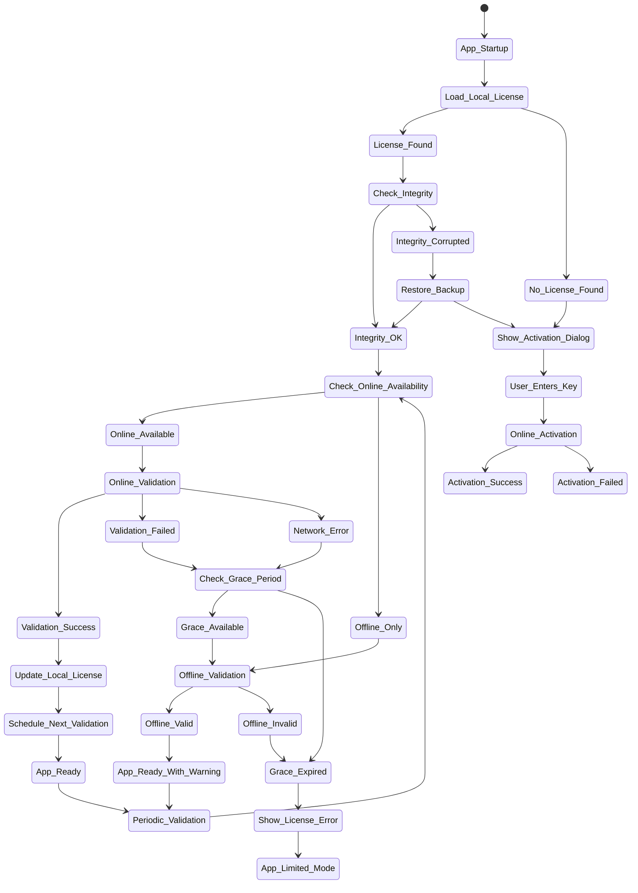

# License Validation Flow Design

## Overview

The license validation system uses a multi-layered approach with online validation as primary method and offline validation as fallback. The system ensures continuous compliance while providing graceful degradation during connectivity issues.

## Validation Flow Diagram



## Detailed Validation Process

### 1. Application Startup Validation

```python
class LicenseValidator:
    def __init__(self, license_manager):
        self.license_manager = license_manager
        self.last_validation_result = None
        self.validation_history = []
        self.offline_validation_count = 0
        self.max_offline_validations = MAX_OFFLINE_VALIDATIONS
        
    def validate_on_startup(self) -> ValidationResult:
        """Perform initial license validation on application startup"""
        try:
            # Step 1: Load local license data
            license_data = self.load_local_license()
            if not license_data:
                return self.create_no_license_result()
            
            # Step 2: Verify license integrity
            if not self.verify_license_integrity(license_data):
                # Try to restore from backup
                if not self.restore_license_backup():
                    return self.create_corrupted_license_result()
                license_data = self.load_local_license()
            
            # Step 3: Check hardware binding
            if not self.verify_hardware_binding(license_data):
                return self.create_hardware_mismatch_result()
            
            # Step 4: Attempt online validation
            if self.is_internet_available():
                result = self.validate_online(license_data)
                if result.is_valid:
                    self.save_validation_result(result)
                    return result
                else:
                    # Online validation failed, check if we can use offline
                    return self.handle_online_validation_failure(license_data, result)
            else:
                # No internet, use offline validation
                return self.validate_offline(license_data)
                
        except Exception as e:
            logger.error(f"License validation error: {e}")
            return self.create_validation_error_result(str(e))
```

### 2. Online Validation

```python
def validate_online(self, license_data: LicenseData, force: bool = False) -> ValidationResult:
    """Perform online license validation"""
    try:
        # Prepare validation request
        request_data = {
            'license_key': license_data.product_key,
            'hardware_fingerprint': self.get_current_fingerprint(),
            'machine_id': self.get_machine_id(),
            'app_version': self.get_app_version(),
            'validation_count': license_data.validation_count,
            'last_validation': license_data.last_validation.isoformat() if license_data.last_validation else None,
            'request_timestamp': datetime.utcnow().isoformat(),
            'request_type': 'validation'
        }
        
        # Sign the request
        request_signature = self.sign_request(request_data)
        request_data['signature'] = request_signature
        
        # Send to license server
        response = self.send_license_request(request_data)
        
        if response.status_code == 200:
            response_data = response.json()
            return self.process_validation_response(response_data, license_data)
        else:
            return self.create_server_error_result(response.status_code, response.text)
            
    except requests.exceptions.RequestException as e:
        logger.error(f"Online validation network error: {e}")
        return self.create_network_error_result(str(e))
    except Exception as e:
        logger.error(f"Online validation error: {e}")
        return self.create_validation_error_result(str(e))
```

### 3. Offline Validation

```python
def validate_offline(self, license_data: LicenseData) -> ValidationResult:
    """Perform offline license validation"""
    try:
        # Check if offline validation is allowed
        if self.offline_validation_count >= self.max_offline_validations:
            return self.create_offline_limit_exceeded_result()
        
        # Verify license hasn't expired (local check)
        if license_data.expiry_date and datetime.utcnow() > license_data.expiry_date:
            return self.create_expired_result(license_data.expiry_date)
        
        # Verify hardware binding
        if not self.verify_hardware_binding(license_data):
            return self.create_hardware_mismatch_result()
        
        # Check if grace period is active
        grace_period_end = self.calculate_grace_period_end(license_data)
        if grace_period_end and datetime.utcnow() > grace_period_end:
            return self.create_grace_period_expired_result()
        
        # Perform offline validation
        validation_result = ValidationResult()
        validation_result.is_valid = True
        validation_result.license_type = license_data.license_type
        validation_result.validation_method = 'offline'
        validation_result.features = license_data.features
        validation_result.grace_period_end = grace_period_end
        
        # Calculate remaining days
        if license_data.expiry_date:
            validation_result.remaining_days = (license_data.expiry_date - datetime.utcnow()).days
        else:
            validation_result.remaining_days = -1  # Perpetual
        
        # Increment offline validation count
        self.offline_validation_count += 1
        
        # Schedule next validation
        validation_result.next_validation_due = datetime.utcnow() + timedelta(hours=LICENSE_VALIDATION_INTERVAL_HOURS)
        
        # Save validation state
        self.save_offline_validation_state(license_data, validation_result)
        
        return validation_result
        
    except Exception as e:
        logger.error(f"Offline validation error: {e}")
        return self.create_validation_error_result(str(e))
```

### 4. Grace Period Handling

```python
def calculate_grace_period_end(self, license_data: LicenseData) -> datetime:
    """Calculate grace period end date"""
    if not license_data.last_validation:
        return None
    
    # Grace period starts from last successful online validation
    grace_start = license_data.last_validation
    grace_end = grace_start + timedelta(days=self.license_manager.offline_grace_period_days)
    
    return grace_end

def handle_grace_period(self, license_data: LicenseData, validation_result: ValidationResult):
    """Handle grace period logic"""
    grace_end = self.calculate_grace_period_end(license_data)
    remaining_grace_hours = 0
    
    if grace_end:
        remaining_grace_hours = max(0, (grace_end - datetime.utcnow()).total_seconds() / 3600)
    
    if remaining_grace_hours <= 24:
        # Show urgent warning
        self.show_urgent_warning(f"License grace period expires in {int(remaining_grace_hours)} hours")
        event_dispatcher.dispatch(EventType.GRACE_PERIOD_EXPIRING, {
            'hours_remaining': remaining_grace_hours,
            'grace_end': grace_end
        })
    elif remaining_grace_hours <= 72:
        # Show warning
        self.show_warning(f"License grace period expires in {int(remaining_grace_hours/24)} days")
```

### 5. Validation Result Types

```python
def create_no_license_result(self) -> ValidationResult:
    """Create result for no license found"""
    result = ValidationResult()
    result.is_valid = False
    result.error_code = "NO_LICENSE"
    result.error_message = "No valid license found. Please activate your license."
    return result

def create_expired_result(self, expiry_date: datetime) -> ValidationResult:
    """Create result for expired license"""
    result = ValidationResult()
    result.is_valid = False
    result.error_code = "LICENSE_EXPIRED"
    result.error_message = f"License expired on {expiry_date.strftime('%Y-%m-%d')}"
    return result

def create_hardware_mismatch_result(self) -> ValidationResult:
    """Create result for hardware mismatch"""
    result = ValidationResult()
    result.is_valid = False
    result.error_code = "HARDWARE_MISMATCH"
    result.error_message = "License is not valid for this hardware configuration."
    return result

def create_offline_limit_exceeded_result(self) -> ValidationResult:
    """Create result for offline validation limit exceeded"""
    result = ValidationResult()
    result.is_valid = False
    result.error_code = "OFFLINE_LIMIT_EXCEEDED"
    result.error_message = "Offline validation limit exceeded. Please connect to internet."
    return result

def create_grace_period_expired_result(self) -> ValidationResult:
    """Create result for grace period expired"""
    result = ValidationResult()
    result.is_valid = False
    result.error_code = "GRACE_PERIOD_EXPIRED"
    result.error_message = "Grace period expired. Please connect to internet to validate license."
    return result
```

### 6. Network Connectivity Detection

```python
def is_internet_available(self) -> bool:
    """Check if internet connectivity is available"""
    try:
        # Try multiple methods to check connectivity
        connectivity_checks = [
            self.check_dns_resolution(),
            self.check_http_connection(),
            self.check_license_server_connectivity()
        ]
        
        # Require at least 2 successful checks
        successful_checks = sum(1 for check in connectivity_checks if check)
        return successful_checks >= 2
        
    except Exception as e:
        logger.error(f"Error checking internet connectivity: {e}")
        return False

def check_dns_resolution(self) -> bool:
    """Check DNS resolution"""
    try:
        import socket
        socket.gethostbyname('google.com')
        return True
    except socket.gaierror:
        return False

def check_http_connection(self) -> bool:
    """Check HTTP connection"""
    try:
        import requests
        response = requests.get('https://httpbin.org/get', timeout=5)
        return response.status_code == 200
    except:
        return False

def check_license_server_connectivity(self) -> bool:
    """Check license server connectivity"""
    try:
        import requests
        response = requests.get(f"{LICENSE_SERVER_URL}/health", timeout=5)
        return response.status_code == 200
    except:
        return False
```

### 7. Validation State Management

```python
def save_validation_state(self, validation_result: ValidationResult):
    """Save validation state to local storage"""
    try:
        state_data = {
            'last_validation': datetime.utcnow().isoformat(),
            'validation_method': validation_result.validation_method,
            'offline_validation_count': self.offline_validation_count,
            'next_validation_due': validation_result.next_validation_due.isoformat() if validation_result.next_validation_due else None,
            'grace_period_end': validation_result.grace_period_end.isoformat() if validation_result.grace_period_end else None
        }
        
        # Save to database
        self.license_manager.db.execute_query(
            "UPDATE settings SET value = ? WHERE key = ?",
            (json.dumps(state_data), 'license_validation_state')
        )
        self.license_manager.db.commit()
        
    except Exception as e:
        logger.error(f"Error saving validation state: {e}")

def load_validation_state(self) -> dict:
    """Load validation state from local storage"""
    try:
        result = self.license_manager.db.execute_query(
            "SELECT value FROM settings WHERE key = ?",
            ('license_validation_state',)
        )
        row = self.license_manager.db.fetch_one()
        
        if row:
            return json.loads(row[0])
        return {}
        
    except Exception as e:
        logger.error(f"Error loading validation state: {e}")
        return {}
```

This validation flow provides robust online/offline validation with graceful degradation and strong security measures.