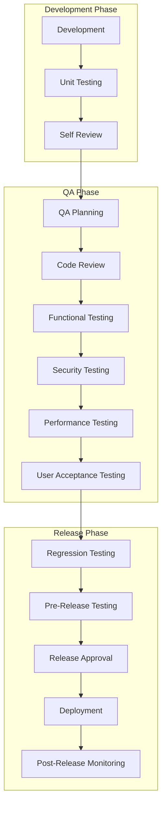
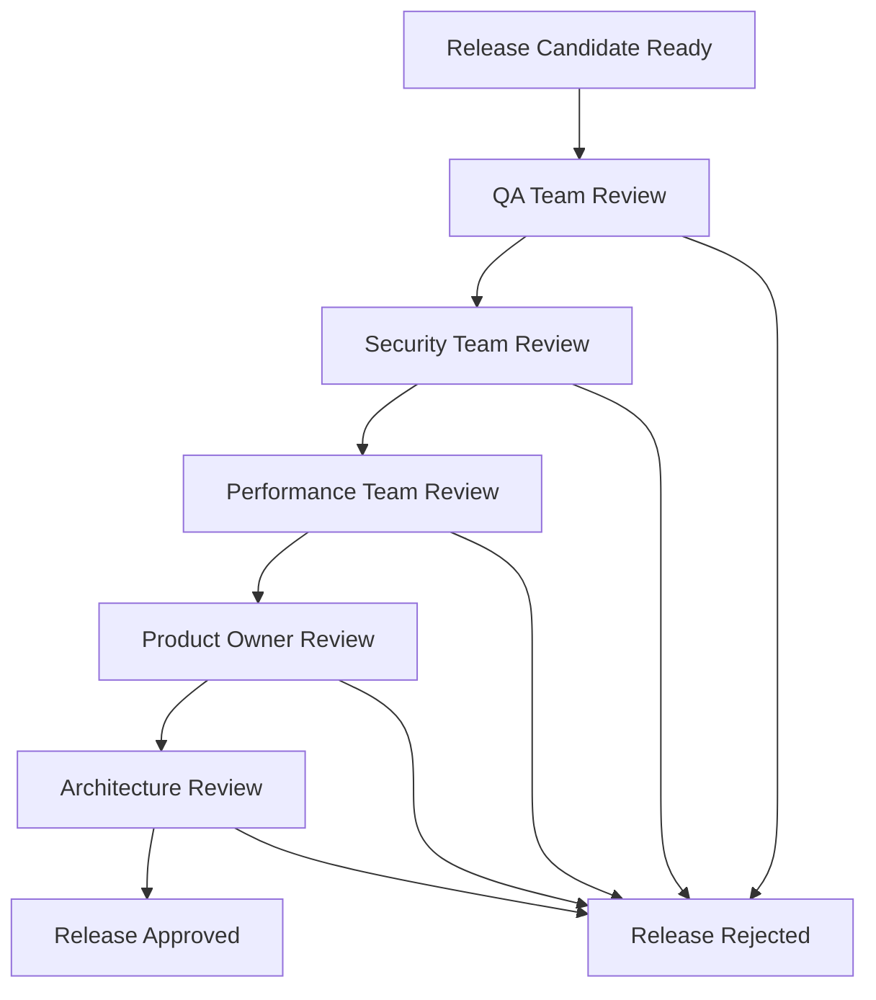
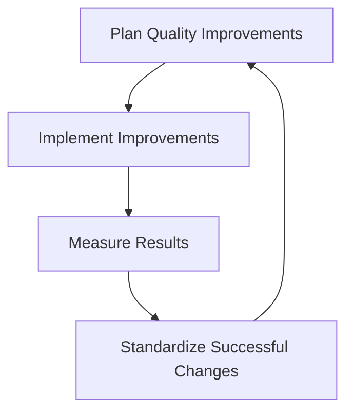

# Quality Assurance Procedures for POS MVP Support and License Systems

## Overview

This document outlines comprehensive quality assurance (QA) procedures for both the support system and license validation system implemented in the POS MVP application. These procedures ensure that both systems meet high-quality standards, are reliable, secure, and provide excellent user experience.

## Quality Assurance Objectives

1. **Code Quality**: Ensure code follows best practices and standards
2. **Functionality**: Verify all features work as specified
3. **Security**: Ensure systems are secure and protected against threats
4. **Performance**: Confirm systems perform efficiently under expected load
5. **Usability**: Ensure systems are user-friendly and intuitive
6. **Reliability**: Verify systems are stable and dependable
7. **Maintainability**: Ensure code is maintainable and extensible

## QA Process Framework



## Code Quality Standards

### 1. Code Review Standards

#### Review Checklist

```python
# code_review_checklist.py
class CodeReviewChecklist:
    """Code review checklist for quality assurance"""
    
    @staticmethod
    def review_python_code(code_file):
        """Review Python code for quality standards"""
        checklist = {
            'naming_conventions': False,
            'documentation': False,
            'error_handling': False,
            'security_practices': False,
            'performance_considerations': False,
            'testing_coverage': False,
            'code_complexity': False,
            'dependency_management': False
        }
        
        # Check naming conventions
        if CodeReviewChecklist.check_naming_conventions(code_file):
            checklist['naming_conventions'] = True
        
        # Check documentation
        if CodeReviewChecklist.check_documentation(code_file):
            checklist['documentation'] = True
        
        # Check error handling
        if CodeReviewChecklist.check_error_handling(code_file):
            checklist['error_handling'] = True
        
        # Check security practices
        if CodeReviewChecklist.check_security_practices(code_file):
            checklist['security_practices'] = True
        
        # Check performance considerations
        if CodeReviewChecklist.check_performance_considerations(code_file):
            checklist['performance_considerations'] = True
        
        # Check testing coverage
        if CodeReviewChecklist.check_testing_coverage(code_file):
            checklist['testing_coverage'] = True
        
        # Check code complexity
        if CodeReviewChecklist.check_code_complexity(code_file):
            checklist['code_complexity'] = True
        
        # Check dependency management
        if CodeReviewChecklist.check_dependency_management(code_file):
            checklist['dependency_management'] = True
        
        return checklist
```

#### Review Process

1. **Self-Review**: Developer reviews their own code before submission
2. **Peer Review**: At least one peer developer reviews the code
3. **Senior Review**: Senior developer reviews critical components
4. **Security Review**: Security specialist reviews security-sensitive code
5. **Approval**: Code is approved after all reviews are complete

#### Review Criteria

- **Functionality**: Code implements requirements correctly
- **Readability**: Code is clear and understandable
- **Maintainability**: Code is easy to maintain and extend
- **Performance**: Code is efficient and optimized
- **Security**: Code follows security best practices
- **Testing**: Code has adequate test coverage
- **Documentation**: Code is properly documented

### 2. Code Quality Metrics

#### Quality Metrics

```python
# quality_metrics.py
class QualityMetrics:
    """Code quality metrics measurement"""
    
    @staticmethod
    def calculate_complexity(code):
        """Calculate cyclomatic complexity"""
        import radon
        from radon.complexity import cc_visit
        
        complexity = cc_visit(code)
        return max(item.complexity for item in complexity)
    
    @staticmethod
    def calculate_maintainability_index(code):
        """Calculate maintainability index"""
        import radon
        from radon.metrics import mi_visit
        
        metrics = mi_visit(code, True)
        return metrics[0].mi
    
    @staticmethod
    def calculate_test_coverage(test_results):
        """Calculate test coverage percentage"""
        total_tests = len(test_results)
        passed_tests = sum(1 for t in test_results if t.passed)
        return (passed_tests / total_tests) * 100
    
    @staticmethod
    def calculate_code_duplication(codebase):
        """Calculate code duplication percentage"""
        # Implementation for code duplication analysis
        pass
```

#### Quality Gates

- **Cyclomatic Complexity**: ≤ 10 per function
- **Maintainability Index**: ≥ 70
- **Test Coverage**: ≥ 90% for critical code
- **Code Duplication**: ≤ 5%
- **Documentation Coverage**: ≥ 80%

## Documentation Review Process

### 1. Documentation Standards

#### Documentation Checklist

```markdown
# Documentation Review Checklist

## Content Quality
- [ ] Information is accurate and up-to-date
- [ ] Content is complete and comprehensive
- [ ] Language is clear and concise
- [ ] Structure is logical and easy to follow

## Technical Accuracy
- [ ] Code examples are tested and functional
- [ ] Technical details are correct
- [ ] API documentation matches implementation
- [ ] Configuration examples work as described

## User Experience
- [ ] Documentation addresses user needs
- [ ] Navigation is intuitive
- [ ] Search functionality works
- [ ] Cross-references are helpful

## Accessibility
- [ ] Content is accessible to users with disabilities
- [ ] Alternative formats are provided
- [ ] Language is simple and inclusive
- [ ] Visual aids are used effectively
```

### 2. Documentation Review Process

1. **Author Review**: Author reviews documentation for completeness
2. **Technical Review**: Technical expert reviews for accuracy
3. **Editorial Review**: Editor reviews for clarity and consistency
4. **User Review**: Target users review for usefulness
5. **Final Approval**: Documentation owner gives final approval

## Testing Validation Criteria

### 1. Unit Testing Validation

#### Test Quality Criteria

```python
# test_validation.py
class TestValidation:
    """Test validation criteria"""
    
    @staticmethod
    def validate_unit_test(test_case):
        """Validate unit test quality"""
        criteria = {
            'test_name_descriptive': False,
            'test_independent': False,
            'test_repeatable': False,
            'test_assertions_clear': False,
            'test_edge_cases_covered': False,
            'test_mocks_appropriate': False
        }
        
        # Check if test name is descriptive
        if TestValidation.is_descriptive_name(test_case.name):
            criteria['test_name_descriptive'] = True
        
        # Check if test is independent
        if TestValidation.is_independent(test_case):
            criteria['test_independent'] = True
        
        # Check if test is repeatable
        if TestValidation.is_repeatable(test_case):
            criteria['test_repeatable'] = True
        
        # Check if assertions are clear
        if TestValidation.has_clear_assertions(test_case):
            criteria['test_assertions_clear'] = True
        
        # Check if edge cases are covered
        if TestValidation.covers_edge_cases(test_case):
            criteria['test_edge_cases_covered'] = True
        
        # Check if mocks are appropriate
        if TestValidation.has_appropriate_mocks(test_case):
            criteria['test_mocks_appropriate'] = True
        
        return criteria
```

### 2. Integration Testing Validation

#### Integration Test Criteria

- **End-to-End Scenarios**: Complete user workflows are tested
- **System Interactions**: Interactions between components are tested
- **Data Flow**: Data flow between systems is verified
- **Error Handling**: Error scenarios across system boundaries are tested
- **Performance**: Performance under realistic load is tested

### 3. Security Testing Validation

#### Security Test Criteria

```python
# security_test_validation.py
class SecurityTestValidation:
    """Security test validation criteria"""
    
    REQUIRED_SECURITY_TESTS = [
        'authentication_bypass',
        'authorization_escalation',
        'data_injection',
        'cross_site_scripting',
        'sensitive_data_exposure',
        'security_misconfiguration',
        'weak_cryptography',
        'insecure_deserialization',
        'insufficient_logging',
        'insecure_communication'
    ]
    
    @staticmethod
    def validate_security_coverage(test_results):
        """Validate security test coverage"""
        covered_tests = set()
        
        for test_result in test_results:
            if test_result.test_category in SecurityTestValidation.REQUIRED_SECURITY_TESTS:
                covered_tests.add(test_result.test_category)
        
        missing_tests = set(SecurityTestValidation.REQUIRED_SECURITY_TESTS) - covered_tests
        return {
            'coverage_percentage': (len(covered_tests) / len(SecurityTestValidation.REQUIRED_SECURITY_TESTS)) * 100,
            'missing_tests': list(missing_tests),
            'is_complete': len(missing_tests) == 0
        }
```

## Release Approval Procedures

### 1. Release Readiness Checklist

#### Pre-Release Checklist

```markdown
# Release Readiness Checklist

## Code Quality
- [ ] All code reviews completed
- [ ] All unit tests passing
- [ ] Code coverage meets requirements (≥90%)
- [ ] No critical security vulnerabilities
- [ ] Performance benchmarks met

## Testing
- [ ] All integration tests passing
- [ ] All security tests passing
- [ ] All performance tests passing
- [ ] User acceptance tests completed
- [ ] Regression tests completed

## Documentation
- [ ] User documentation updated
- [ ] Administrator documentation updated
- [ ] Developer documentation updated
- [ ] API documentation updated
- [ ] Release notes prepared

## Deployment
- [ ] Deployment scripts tested
- [ ] Database migration scripts tested
- [ ] Rollback procedures tested
- [ ] Monitoring systems configured
- [ ] Backup procedures verified

## Communication
- [ ] Stakeholders notified
- [ ] Release announcement prepared
- [ ] Support team trained
- [ ] User communication plan ready
```

### 2. Release Approval Workflow



#### Approval Roles and Responsibilities

- **QA Team**: Validates overall quality and testing completeness
- **Security Team**: Validates security requirements are met
- **Performance Team**: Validates performance requirements are met
- **Product Owner**: Validates business requirements are met
- **Architecture Team**: Validates architectural integrity

### 3. Release Criteria

#### Must-Have Criteria

- All critical bugs fixed
- All security vulnerabilities addressed
- All tests passing
- Documentation complete and accurate
- Performance benchmarks met
- No breaking changes without migration path

#### Nice-to-Have Criteria

- All non-critical bugs fixed
- Test coverage above minimum threshold
- Performance exceeds benchmarks
- Documentation includes examples and tutorials
- User feedback incorporated

## Post-Deployment Monitoring

### 1. Monitoring Procedures

#### Real-time Monitoring

```python
# post_deployment_monitoring.py
class PostDeploymentMonitoring:
    """Post-deployment monitoring procedures"""
    
    def __init__(self):
        self.metrics_collector = MetricsCollector()
        self.alert_manager = AlertManager()
        self.dashboard = MonitoringDashboard()
    
    def monitor_system_health(self):
        """Monitor overall system health"""
        metrics = {
            'cpu_usage': self.metrics_collector.get_cpu_usage(),
            'memory_usage': self.metrics_collector.get_memory_usage(),
            'disk_usage': self.metrics_collector.get_disk_usage(),
            'network_latency': self.metrics_collector.get_network_latency(),
            'error_rate': self.metrics_collector.get_error_rate(),
            'response_time': self.metrics_collector.get_response_time()
        }
        
        # Check for alerts
        if metrics['error_rate'] > 0.05:  # 5% error rate threshold
            self.alert_manager.send_alert("High error rate detected")
        
        if metrics['response_time'] > 1000:  # 1 second response time threshold
            self.alert_manager.send_alert("High response time detected")
        
        # Update dashboard
        self.dashboard.update_metrics(metrics)
        
        return metrics
    
    def monitor_license_system(self):
        """Monitor license system specifically"""
        license_metrics = {
            'validation_success_rate': self.metrics_collector.get_license_validation_success_rate(),
            'validation_time': self.metrics_collector.get_license_validation_time(),
            'activation_success_rate': self.metrics_collector.get_license_activation_success_rate(),
            'feature_access_errors': self.metrics_collector.get_feature_access_errors()
        }
        
        # Check for license-specific alerts
        if license_metrics['validation_success_rate'] < 0.95:  # 95% success rate threshold
            self.alert_manager.send_alert("Low license validation success rate")
        
        return license_metrics
    
    def monitor_support_system(self):
        """Monitor support system specifically"""
        support_metrics = {
            'ticket_creation_success_rate': self.metrics_collector.get_ticket_creation_success_rate(),
            'email_notification_success_rate': self.metrics_collector.get_email_notification_success_rate(),
            'attachment_upload_success_rate': self.metrics_collector.get_attachment_upload_success_rate(),
            'database_query_time': self.metrics_collector.get_database_query_time()
        }
        
        # Check for support-specific alerts
        if support_metrics['email_notification_success_rate'] < 0.90:  # 90% success rate threshold
            self.alert_manager.send_alert("Low email notification success rate")
        
        return support_metrics
```

### 2. Issue Response Procedures

#### Issue Classification

```python
# issue_classification.py
class IssueClassification:
    """Issue classification and response procedures"""
    
    SEVERITY_LEVELS = {
        'critical': {
            'response_time': '15 minutes',
            'escalation_time': '1 hour',
            'resolution_time': '4 hours',
            'notification_channels': ['sms', 'email', 'phone', 'slack']
        },
        'high': {
            'response_time': '1 hour',
            'escalation_time': '4 hours',
            'resolution_time': '24 hours',
            'notification_channels': ['email', 'slack', 'phone']
        },
        'medium': {
            'response_time': '4 hours',
            'escalation_time': '24 hours',
            'resolution_time': '72 hours',
            'notification_channels': ['email', 'slack']
        },
        'low': {
            'response_time': '24 hours',
            'escalation_time': '72 hours',
            'resolution_time': '1 week',
            'notification_channels': ['email']
        }
    }
    
    @staticmethod
    def classify_issue(issue_data):
        """Classify issue based on impact and urgency"""
        impact = issue_data.get('impact', 'medium')
        urgency = issue_data.get('urgency', 'medium')
        
        # Classification matrix
        if impact == 'critical' or urgency == 'critical':
            return 'critical'
        elif impact == 'high' or urgency == 'high':
            return 'high'
        elif impact == 'medium' or urgency == 'medium':
            return 'medium'
        else:
            return 'low'
```

#### Response Procedures

1. **Issue Detection**: Automated monitoring detects issue
2. **Classification**: Issue is classified by severity
3. **Notification**: Relevant teams are notified
4. **Investigation**: Team investigates issue
5. **Resolution**: Issue is resolved or mitigated
6. **Communication**: Stakeholders are updated
7. **Post-mortem**: Root cause analysis is performed

## Quality Metrics and KPIs

### 1. Quality Metrics

#### Code Quality Metrics

- **Defect Density**: Number of defects per lines of code
- **Code Coverage**: Percentage of code covered by tests
- **Code Complexity**: Average cyclomatic complexity
- **Technical Debt**: Estimated effort to fix quality issues
- **Documentation Coverage**: Percentage of documented code

#### Process Quality Metrics

- **Review Effectiveness**: Number of defects found in review vs. testing
- **Test Effectiveness**: Number of defects found in testing vs. production
- **Release Success Rate**: Percentage of successful releases
- **Rollback Rate**: Percentage of releases that require rollback
- **Time to Market**: Time from feature request to release

### 2. KPI Targets

#### Quality Targets

```python
# quality_kpis.py
class QualityKPIs:
    """Quality Key Performance Indicators"""
    
    TARGETS = {
        'code_coverage': {
            'target': 90,
            'minimum': 80,
            'unit': '%'
        },
        'defect_density': {
            'target': 1,
            'maximum': 5,
            'unit': 'defects/KLOC'
        },
        'test_pass_rate': {
            'target': 98,
            'minimum': 95,
            'unit': '%'
        },
        'release_success_rate': {
            'target': 95,
            'minimum': 90,
            'unit': '%'
        },
        'mean_time_to_resolution': {
            'target': 24,
            'maximum': 72,
            'unit': 'hours'
        },
        'customer_satisfaction': {
            'target': 4.5,
            'minimum': 4.0,
            'unit': 'out of 5'
        }
    }
    
    @staticmethod
    def calculate_quality_score(metrics):
        """Calculate overall quality score"""
        score = 0
        total_weight = 0
        
        for metric, value in metrics.items():
            if metric in QualityKPIs.TARGETS:
                target = QualityKPIs.TARGETS[metric]['target']
                weight = 1.0  # Can be adjusted based on importance
                
                # Calculate normalized score (0-100)
                if metric in ['code_coverage', 'test_pass_rate', 'release_success_rate', 'customer_satisfaction']:
                    normalized_score = min(100, (value / target) * 100)
                else:  # For metrics where lower is better
                    normalized_score = min(100, (target / max(value, target)) * 100)
                
                score += normalized_score * weight
                total_weight += weight
        
        return score / total_weight if total_weight > 0 else 0
```

## Continuous Improvement

### 1. Quality Improvement Process

#### PDCA Cycle



#### Improvement Activities

1. **Quality Meetings**: Weekly quality review meetings
2. **Retrospectives**: Post-release retrospectives
3. **Training**: Continuous skill development
4. **Tool Improvement**: Regular evaluation and upgrade of tools
5. **Process Optimization**: Continuous process refinement

### 2. Quality Assurance Tools

#### Tool Stack

```python
# qa_tools.py
class QATools:
    """Quality assurance tools and their purposes"""
    
    TOOLS = {
        'code_analysis': {
            'pylint': 'Code quality analysis',
            'radon': 'Code complexity analysis',
            'bandit': 'Security vulnerability scanning',
            'mypy': 'Type checking',
            'black': 'Code formatting'
        },
        'testing': {
            'pytest': 'Unit testing framework',
            'selenium': 'UI testing',
            'locust': 'Load testing',
            'owasp_zap': 'Security testing'
        },
        'ci_cd': {
            'github_actions': 'Continuous integration',
            'jenkins': 'Build automation',
            'docker': 'Containerization',
            'kubernetes': 'Orchestration'
        },
        'monitoring': {
            'prometheus': 'Metrics collection',
            'grafana': 'Visualization',
            'elasticsearch': 'Log aggregation',
            'sentry': 'Error tracking'
        },
        'documentation': {
            'sphinx': 'API documentation',
            'mkdocs': 'User documentation',
            'swagger': 'API specification'
        }
    }
```

## Implementation Timeline

### Phase 1: Foundation (Week 1-2)
1. Establish QA processes and standards
2. Set up code review procedures
3. Implement quality metrics collection
4. Create documentation review process

### Phase 2: Implementation (Week 3-6)
1. Implement automated quality checks
2. Set up testing validation procedures
3. Create release approval workflow
4. Establish monitoring procedures

### Phase 3: Optimization (Week 7-8)
1. Refine QA processes based on feedback
2. Optimize quality metrics collection
3. Improve monitoring and alerting
4. Enhance documentation review process

### Phase 4: Maturation (Week 9-12)
1. Establish continuous improvement cycle
2. Implement advanced quality analytics
3. Create quality dashboards
4. Develop quality training programs

## Success Criteria

1. **Process Compliance**: 100% compliance with QA procedures
2. **Quality Metrics**: All quality KPIs meet targets
3. **Release Success**: 95%+ release success rate
4. **Customer Satisfaction**: 4.5+ average satisfaction rating
5. **Continuous Improvement**: Ongoing quality improvements

These comprehensive quality assurance procedures ensure that both the support system and license validation system maintain high quality standards throughout their lifecycle.