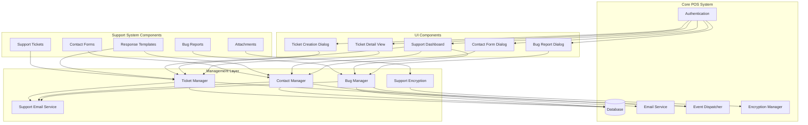

# Support System Architecture for POS MVP Application

## Overview

This document outlines the comprehensive support system architecture for the Restaurant POS MVP application. The system includes support ticket management, contact forms, bug logging, and integration with existing POS infrastructure.

## 1. Database Schema Design

### 1.1 Support Tickets Table

```sql
CREATE TABLE support_tickets (
    id INTEGER PRIMARY KEY AUTOINCREMENT,
    ticket_number TEXT UNIQUE NOT NULL,
    user_id INTEGER,
    category TEXT NOT NULL CHECK (category IN ('Bug Report', 'Feature Request', 'General Inquiry', 'Technical Support')),
    priority TEXT NOT NULL DEFAULT 'Medium' CHECK (priority IN ('Low', 'Medium', 'High', 'Critical')),
    subject TEXT NOT NULL,
    description TEXT NOT NULL,
    status TEXT NOT NULL DEFAULT 'Open' CHECK (status IN ('Open', 'In Progress', 'Resolved', 'Closed')),
    assigned_to INTEGER,
    created_at TIMESTAMP DEFAULT CURRENT_TIMESTAMP,
    updated_at TIMESTAMP DEFAULT CURRENT_TIMESTAMP,
    resolved_at TIMESTAMP,
    FOREIGN KEY (user_id) REFERENCES users (id),
    FOREIGN KEY (assigned_to) REFERENCES users (id)
);
```

### 1.2 Ticket Conversations Table

```sql
CREATE TABLE ticket_conversations (
    id INTEGER PRIMARY KEY AUTOINCREMENT,
    ticket_id INTEGER NOT NULL,
    user_id INTEGER,
    message TEXT NOT NULL,
    is_internal BOOLEAN DEFAULT FALSE,
    created_at TIMESTAMP DEFAULT CURRENT_TIMESTAMP,
    FOREIGN KEY (ticket_id) REFERENCES support_tickets (id) ON DELETE CASCADE,
    FOREIGN KEY (user_id) REFERENCES users (id)
);
```

### 1.3 Attachments Table

```sql
CREATE TABLE support_attachments (
    id INTEGER PRIMARY KEY AUTOINCREMENT,
    ticket_id INTEGER,
    contact_form_id INTEGER,
    bug_report_id INTEGER,
    filename TEXT NOT NULL,
    file_path TEXT NOT NULL,
    file_size INTEGER,
    mime_type TEXT,
    uploaded_by INTEGER,
    created_at TIMESTAMP DEFAULT CURRENT_TIMESTAMP,
    FOREIGN KEY (ticket_id) REFERENCES support_tickets (id) ON DELETE CASCADE,
    FOREIGN KEY (contact_form_id) REFERENCES contact_forms (id) ON DELETE CASCADE,
    FOREIGN KEY (bug_report_id) REFERENCES bug_reports (id) ON DELETE CASCADE,
    FOREIGN KEY (uploaded_by) REFERENCES users (id)
);
```

### 1.4 Contact Forms Table

```sql
CREATE TABLE contact_forms (
    id INTEGER PRIMARY KEY AUTOINCREMENT,
    contact_id TEXT UNIQUE NOT NULL,
    name TEXT NOT NULL,
    email TEXT NOT NULL,
    phone TEXT,
    contact_method TEXT NOT NULL DEFAULT 'email' CHECK (contact_method IN ('email', 'phone', 'in_app')),
    subject TEXT NOT NULL,
    message TEXT NOT NULL,
    status TEXT NOT NULL DEFAULT 'New' CHECK (status IN ('New', 'Acknowledged', 'Responded', 'Closed')),
    priority TEXT NOT NULL DEFAULT 'Medium' CHECK (priority IN ('Low', 'Medium', 'High', 'Critical')),
    assigned_to INTEGER,
    response_template TEXT,
    auto_acknowledged BOOLEAN DEFAULT FALSE,
    created_at TIMESTAMP DEFAULT CURRENT_TIMESTAMP,
    updated_at TIMESTAMP DEFAULT CURRENT_TIMESTAMP,
    responded_at TIMESTAMP,
    FOREIGN KEY (assigned_to) REFERENCES users (id)
);
```

### 1.5 Bug Reports Table

```sql
CREATE TABLE bug_reports (
    id INTEGER PRIMARY KEY AUTOINCREMENT,
    bug_id TEXT UNIQUE NOT NULL,
    user_id INTEGER,
    error_type TEXT NOT NULL,
    error_message TEXT,
    stack_trace TEXT,
    reproduction_steps TEXT,
    session_info TEXT,
    system_info TEXT,
    app_version TEXT,
    screenshot_path TEXT,
    priority TEXT NOT NULL DEFAULT 'Medium' CHECK (priority IN ('Low', 'Medium', 'High', 'Critical')),
    status TEXT NOT NULL DEFAULT 'New' CHECK (status IN ('New', 'Investigating', 'Fixed', 'Verified', 'Closed')),
    assigned_to INTEGER,
    resolution_notes TEXT,
    created_at TIMESTAMP DEFAULT CURRENT_TIMESTAMP,
    updated_at TIMESTAMP DEFAULT CURRENT_TIMESTAMP,
    resolved_at TIMESTAMP,
    FOREIGN KEY (user_id) REFERENCES users (id),
    FOREIGN KEY (assigned_to) REFERENCES users (id)
);
```

### 1.6 Response Templates Table

```sql
CREATE TABLE response_templates (
    id INTEGER PRIMARY KEY AUTOINCREMENT,
    name TEXT NOT NULL,
    category TEXT NOT NULL,
    subject TEXT,
    template_text TEXT NOT NULL,
    is_active BOOLEAN DEFAULT TRUE,
    created_by INTEGER,
    created_at TIMESTAMP DEFAULT CURRENT_TIMESTAMP,
    updated_at TIMESTAMP DEFAULT CURRENT_TIMESTAMP,
    FOREIGN KEY (created_by) REFERENCES users (id)
);
```

## 2. Support Ticket System Architecture

### 2.1 Class Structure

```python
class SupportTicket:
    """Support ticket model with full CRUD operations"""
    
    def __init__(self, db_manager):
        self.db = db_manager
        self.encryption_manager = get_encryption_manager()
    
    def create(self, ticket_data):
        """Create new support ticket"""
        
    def update(self, ticket_id, ticket_data):
        """Update existing ticket"""
        
    def get_by_id(self, ticket_id):
        """Get ticket by ID"""
        
    def get_by_user(self, user_id):
        """Get tickets for specific user"""
        
    def get_by_status(self, status):
        """Get tickets by status"""
        
    def assign_to_staff(self, ticket_id, staff_id):
        """Assign ticket to support staff"""
        
    def update_status(self, ticket_id, status):
        """Update ticket status"""
        
    def get_conversation(self, ticket_id):
        """Get conversation thread for ticket"""
        
    def add_conversation_message(self, ticket_id, user_id, message, is_internal=False):
        """Add message to ticket conversation"""
```

### 2.2 Ticket Manager

```python
class TicketManager:
    """High-level ticket management with business logic"""
    
    def __init__(self, db_manager, email_service, event_dispatcher):
        self.ticket_model = SupportTicket(db_manager)
        self.email_service = email_service
        self.event_dispatcher = event_dispatcher
        
    def create_ticket(self, user_id, category, subject, description, priority='Medium'):
        """Create new ticket with automatic notifications"""
        
    def escalate_ticket(self, ticket_id, new_priority):
        """Escalate ticket priority"""
        
    def resolve_ticket(self, ticket_id, resolution_notes):
        """Resolve ticket with closure process"""
        
    def generate_ticket_number(self):
        """Generate unique ticket number"""
```

## 3. Contact Form System Architecture

### 3.1 Class Structure

```python
class ContactForm:
    """Contact form model with multi-channel support"""
    
    def __init__(self, db_manager):
        self.db = db_manager
        self.encryption_manager = get_encryption_manager()
    
    def submit(self, contact_data):
        """Submit new contact form"""
        
    def acknowledge(self, contact_id):
        """Mark contact form as acknowledged"""
        
    def respond(self, contact_id, response_text):
        """Respond to contact form submission"""
        
    def get_pending(self):
        """Get pending contact forms"""
        
    def get_by_status(self, status):
        """Get contact forms by status"""
```

### 3.2 Contact Manager

```python
class ContactManager:
    """Contact form management with automated responses"""
    
    def __init__(self, db_manager, email_service, template_manager):
        self.contact_model = ContactForm(db_manager)
        self.email_service = email_service
        self.template_manager = template_manager
        
    def process_submission(self, contact_data):
        """Process new contact form submission"""
        
    def send_auto_acknowledgment(self, contact_id):
        """Send automated acknowledgment"""
        
    def apply_template_response(self, contact_id, template_id):
        """Apply response template"""
```

## 4. Bug Logging System Architecture

### 4.1 Class Structure

```python
class BugReport:
    """Bug report model with automatic error capture"""
    
    def __init__(self, db_manager):
        self.db = db_manager
        self.encryption_manager = get_encryption_manager()
    
    def create(self, bug_data):
        """Create new bug report"""
        
    def capture_error(self, error_type, error_message, stack_trace, context=None):
        """Automatic error capture from application"""
        
    def get_by_status(self, status):
        """Get bug reports by status"""
        
    def update_status(self, bug_id, status):
        """Update bug report status"""
        
    def add_resolution(self, bug_id, resolution_notes):
        """Add resolution notes to bug report"""
```

### 4.2 Bug Manager

```python
class BugManager:
    """Bug report management with automated capture"""
    
    def __init__(self, db_manager, email_service, event_dispatcher):
        self.bug_model = BugReport(db_manager)
        self.email_service = email_service
        self.event_dispatcher = event_dispatcher
        
    def auto_capture_error(self, exception, context=None):
        """Automatically capture and log errors"""
        
    def create_screenshot(self, error_context):
        """Capture screenshot for bug report"""
        
    def collect_system_info(self):
        """Collect system environment information"""
        
    def generate_bug_id(self):
        """Generate unique bug ID"""
```

## 5. UI Components Architecture

### 5.1 Support Dashboard Screen

```python
class SupportDashboardScreen(BaseUI):
    """Main support dashboard with ticket overview"""
    
    def __init__(self, root, app):
        super().__init__(root, app)
        self.ticket_manager = app.ticket_manager
        self.contact_manager = app.contact_manager
        self.bug_manager = app.bug_manager
    
    def show(self, content_frame):
        """Display support dashboard"""
        
    def create_ticket_summary_widget(self, parent):
        """Create ticket summary widget"""
        
    def create_recent_tickets_widget(self, parent):
        """Create recent tickets widget"""
        
    def create_quick_actions_widget(self, parent):
        """Create quick actions widget"""
```

### 5.2 Ticket Creation Dialog

```python
class TicketCreationDialog(tk.Toplevel):
    """Dialog for creating new support tickets"""
    
    def __init__(self, parent, app):
        super().__init__(parent)
        self.app = app
        self.ticket_manager = app.ticket_manager
        
    def setup_ui(self):
        """Setup dialog UI"""
        
    def create_form_fields(self):
        """Create ticket form fields"""
        
    def add_attachment_support(self):
        """Add file attachment functionality"""
        
    def submit_ticket(self):
        """Submit new ticket"""
```

### 5.3 Ticket Detail View

```python
class TicketDetailView(BaseUI):
    """Detailed view of individual tickets"""
    
    def __init__(self, root, app, ticket_id):
        super().__init__(root, app)
        self.ticket_id = ticket_id
        self.ticket_manager = app.ticket_manager
        
    def show(self, content_frame):
        """Display ticket details"""
        
    def create_ticket_info_widget(self, parent):
        """Create ticket information widget"""
        
    def create_conversation_widget(self, parent):
        """Create conversation thread widget"""
        
    def create_attachment_widget(self, parent):
        """Create attachment management widget"""
        
    def add_message(self, message, is_internal=False):
        """Add message to conversation"""
```

## 6. Integration Patterns

### 6.1 Event Dispatcher Integration

```python
# Add to EventType enum in event_dispatcher.py
class EventType(Enum):
    # ... existing events ...
    TICKET_CREATED = "ticket_created"
    TICKET_UPDATED = "ticket_updated"
    TICKET_ASSIGNED = "ticket_assigned"
    TICKET_RESOLVED = "ticket_resolved"
    BUG_REPORTED = "bug_reported"
    CONTACT_FORM_SUBMITTED = "contact_form_submitted"
```

### 6.2 Email Service Integration

```python
class SupportEmailService:
    """Email service integration for support system"""
    
    def __init__(self, email_service):
        self.email_service = email_service
        
    def send_ticket_acknowledgment(self, ticket_data):
        """Send ticket acknowledgment email"""
        
    def send_ticket_update(self, ticket_data, update_message):
        """Send ticket update notification"""
        
    def send_bug_report_notification(self, bug_data):
        """Send bug report notification to support team"""
        
    def send_contact_response(self, contact_data, response_text):
        """Send contact form response"""
```

### 6.3 Encryption Integration

```python
class SupportEncryption:
    """Encryption utilities for support system"""
    
    def __init__(self, encryption_manager):
        self.encryption_manager = encryption_manager
        
    def encrypt_sensitive_data(self, data):
        """Encrypt sensitive user data"""
        
    def encrypt_attachments(self, file_path):
        """Encrypt attachment files"""
        
    def decrypt_sensitive_data(self, encrypted_data):
        """Decrypt sensitive user data"""
```

## 7. Security Considerations

### 7.1 Role-Based Access Control

```python
class SupportPermissions:
    """Permission system for support features"""
    
    PERMISSIONS = {
        'view_all_tickets': ['Admin', 'Support Staff'],
        'assign_tickets': ['Admin', 'Support Staff'],
        'resolve_tickets': ['Admin', 'Support Staff'],
        'view_own_tickets': ['Admin', 'Support Staff', 'Cashier'],
        'create_tickets': ['Admin', 'Support Staff', 'Cashier'],
        'view_bug_reports': ['Admin', 'Support Staff'],
        'manage_bug_reports': ['Admin', 'Support Staff'],
        'view_contact_forms': ['Admin', 'Support Staff'],
        'manage_contact_forms': ['Admin', 'Support Staff']
    }
    
    @staticmethod
    def has_permission(user_role, permission):
        """Check if user has specific permission"""
        return user_role in SupportPermissions.PERMISSIONS.get(permission, [])
```

### 7.2 Data Protection

- Encrypt all sensitive user information in database
- Encrypt attachment files at rest
- Secure file upload validation and scanning
- Audit logging for all support operations
- Session-based authentication for support access

## 8. Constants and Configuration

### 8.1 Add to constants.py

```python
# Support System Constants
TICKET_CATEGORIES = ['Bug Report', 'Feature Request', 'General Inquiry', 'Technical Support']
TICKET_STATUSES = ['Open', 'In Progress', 'Resolved', 'Closed']
TICKET_PRIORITIES = ['Low', 'Medium', 'High', 'Critical']
CONTACT_METHODS = ['email', 'phone', 'in_app']
CONTACT_STATUSES = ['New', 'Acknowledged', 'Responded', 'Closed']
BUG_STATUSES = ['New', 'Investigating', 'Fixed', 'Verified', 'Closed']

# Support System Colors
COLOR_TICKET_OPEN = '#3498db'
COLOR_TICKET_IN_PROGRESS = '#f39c12'
COLOR_TICKET_RESOLVED = '#27ae60'
COLOR_TICKET_CLOSED = '#95a5a6'
COLOR_BUG_NEW = '#e74c3c'
COLOR_BUG_INVESTIGATING = '#f39c12'
COLOR_BUG_FIXED = '#27ae60'
COLOR_CONTACT_NEW = '#3498db'
COLOR_CONTACT_RESPONDED = '#27ae60'

# Support System File Paths
SUPPORT_ATTACHMENTS_DIR = 'support_attachments'
BUG_SCREENSHOTS_DIR = 'bug_screenshots'
```

## 9. Implementation Plan

### 9.1 Database Migration

```python
# Create migration script: src/migrations/add_support_system_tables.py
def migrate_support_tables():
    """Add support system tables to existing database"""
    # Execute table creation SQL
    # Add indexes for performance
    # Create foreign key constraints
```

### 9.2 Model Integration

```python
# Update src/models/__init__.py
from .support_ticket import SupportTicket
from .contact_form import ContactForm
from .bug_report import BugReport
from .response_template import ResponseTemplate
```

### 9.3 App Integration

```python
# Update src/app.py
class RestaurantPOSApp:
    def __init__(self, root):
        # ... existing initialization ...
        
        # Initialize support system components
        self.support_ticket_model = SupportTicket(self.db)
        self.contact_form_model = ContactForm(self.db)
        self.bug_report_model = BugReport(self.db)
        
        self.ticket_manager = TicketManager(self.db, self.email_service, event_dispatcher)
        self.contact_manager = ContactManager(self.db, self.email_service, None)
        self.bug_manager = BugManager(self.db, self.email_service, event_dispatcher)
        
        # Initialize UI components
        self.support_dashboard_screen = SupportDashboardScreen(root, self)
```

## 10. Mermaid Architecture Diagram



## 11. Error Handling and Logging

### 11.1 Support System Logger

```python
class SupportLogger:
    """Specialized logger for support system"""
    
    def __init__(self):
        self.logger = logging.getLogger('support_system')
        
    def log_ticket_action(self, ticket_id, action, user_id, details=None):
        """Log ticket-related actions"""
        
    def log_bug_capture(self, bug_id, error_type, context):
        """Log bug capture events"""
        
    def log_contact_submission(self, contact_id, method, details):
        """Log contact form submissions"""
```

### 11.2 Error Recovery

```python
class SupportErrorHandler:
    """Error handling for support system"""
    
    def handle_ticket_creation_error(self, error, context):
        """Handle ticket creation errors"""
        
    def handle_attachment_error(self, error, file_info):
        """Handle attachment processing errors"""
        
    def handle_email_notification_error(self, error, notification_type):
        """Handle email notification errors"""
```

## 12. Performance Considerations

### 12.1 Database Optimization

- Add indexes on frequently queried columns
- Implement pagination for large ticket lists
- Use database connection pooling
- Optimize queries with proper joins

### 12.2 UI Performance

- Lazy loading for ticket conversations
- Async loading for attachment previews
- Efficient treeview updates
- Memory-efficient screenshot handling

## 13. Testing Strategy

### 13.1 Unit Tests

```python
# Test support ticket creation and management
# Test contact form submission and response
# Test bug report capture and processing
# Test email notification integration
# Test encryption/decryption of sensitive data
```

### 13.2 Integration Tests

```python
# Test end-to-end ticket workflow
# Test multi-channel contact form processing
# Test automatic bug capture from application errors
# Test real-time updates via event dispatcher
```

## 14. Deployment Considerations

### 14.1 Database Migration

- Run migration scripts during application update
- Backup existing data before migration
- Validate migration integrity
- Rollback procedures if needed

### 14.2 File System Setup

- Create support attachments directory
- Set appropriate permissions
- Configure file cleanup policies
- Implement backup procedures

## 15. Future Enhancements

### 15.1 Advanced Features

- Ticket escalation workflows
- SLA tracking and reporting
- Knowledge base integration
- Chat support integration
- Mobile support interface

### 15.2 Analytics and Reporting

- Support ticket analytics
- Bug trend analysis
- Response time metrics
- Customer satisfaction surveys