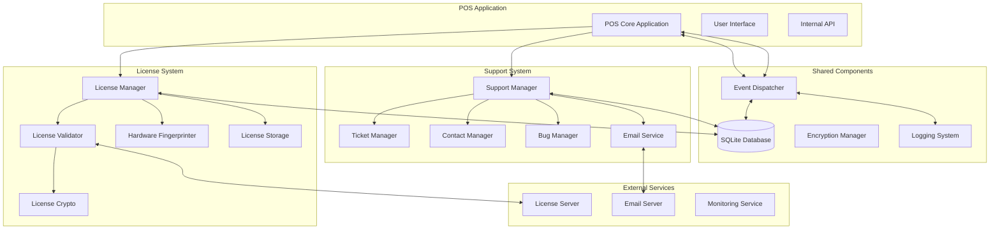
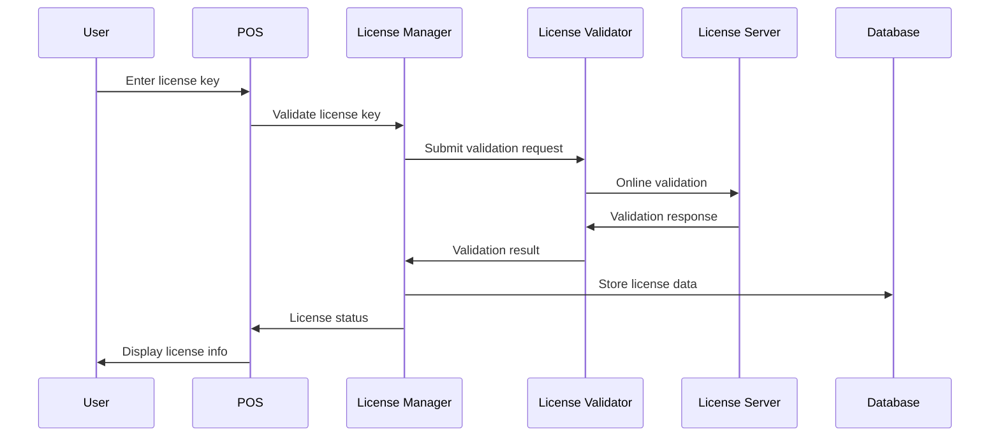
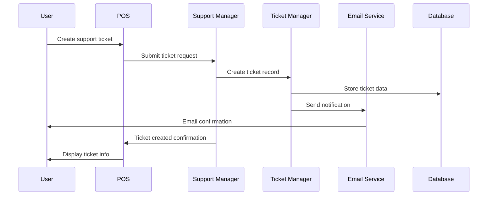

# Technical Architecture Documentation for Support and License Systems

## Overview

This document provides comprehensive technical architecture documentation for both the support system and license validation system implemented in the Restaurant POS MVP application. It covers system architecture, data models, security implementation, and integration patterns.

## Table of Contents

1. [System Architecture Overview](#system-architecture-overview)
2. [License System Architecture](#license-system-architecture)
3. [Support System Architecture](#support-system-architecture)
4. [Database Architecture](#database-architecture)
5. [Security Architecture](#security-architecture)
6. [Integration Architecture](#integration-architecture)
7. [Performance Architecture](#performance-architecture)
8. [Deployment Architecture](#deployment-architecture)

## System Architecture Overview

### High-Level Architecture



### Component Interactions

#### License System Flow



#### Support System Flow



## License System Architecture

### Core Components

#### License Manager

```python
# src/utils/license_manager.py
class LicenseManager:
    """Central license management component"""
    
    def __init__(self, app_instance):
        self.app = app_instance
        self.db = app_instance.db
        self.encryption_manager = get_encryption_manager()
        self.hardware_fingerprinter = HardwareFingerprinter()
        self.license_validator = LicenseValidator(self)
        self.license_storage = LicenseStorage()
        self.validation_timer = None
        self.offline_grace_period_days = 7
        
        # Current license data
        self.license_data = None
        self.validation_result = None
        
        # Initialize license system
        self.initialize_license_system()
    
    def initialize_license_system(self):
        """Initialize license system on application startup"""
        try:
            # Load license data from storage
            self.license_data = self.license_storage.load_license_data()
            
            if self.license_data:
                # Verify hardware binding
                if self.verify_hardware_binding():
                    # Perform initial validation
                    self.validate_license()
                else:
                    # Handle hardware mismatch
                    self.handle_hardware_mismatch()
            else:
                # No license found - check for trial
                self.initialize_trial_mode()
        
        except Exception as e:
            logger.error(f"License initialization error: {str(e)}")
            self.handle_license_error(e)
    
    def validate_license(self, force_online=False):
        """Validate license with online/offline fallback"""
        try:
            # Try online validation first
            if force_online or self.should_validate_online():
                validation_result = self.license_validator.validate_online(self.license_data)
            else:
                validation_result = self.license_validator.validate_offline(self.license_data)
            
            # Store validation result
            self.validation_result = validation_result
            
            # Schedule next validation
            self.schedule_next_validation()
            
            # Update UI with validation result
            self.update_license_ui(validation_result)
            
            return validation_result
            
        except Exception as e:
            logger.error(f"License validation error: {str(e)}")
            return self.create_error_result(e)
    
    def check_feature_access(self, feature):
        """Check if current license allows access to feature"""
        if not self.license_data or not self.validation_result:
            return False
        
        # Check if feature is in allowed list
        allowed_features = self.license_data.get('features', [])
        return feature in allowed_features
    
    def activate_license(self, license_key, customer_info):
        """Activate new license"""
        try:
            # Generate hardware fingerprint
            hardware_fingerprint = self.hardware_fingerprinter.generate_fingerprint()
            
            # Validate license online
            validation_result = self.license_validator.validate_online({
                'license_key': license_key,
                'hardware_fingerprint': hardware_fingerprint,
                'customer_info': customer_info
            })
            
            if validation_result.is_valid:
                # Store license data
                self.license_data = validation_result.license_data
                self.license_storage.save_license_data(self.license_data)
                
                # Update UI
                self.update_license_ui(validation_result)
                
                return True
            else:
                return False
                
        except Exception as e:
            logger.error(f"License activation error: {str(e)}")
            return False
```

#### License Validator

```python
# src/utils/license_validator.py
class LicenseValidator:
    """License validation with multiple methods"""
    
    def __init__(self, license_manager):
        self.license_manager = license_manager
        self.license_crypto = LicenseCrypto()
        self.api_client = LicenseApiClient()
        
    def validate_online(self, license_data):
        """Online license validation"""
        try:
            # Create validation request
            request_data = {
                'license_key': license_data['license_key'],
                'hardware_fingerprint': license_data['hardware_fingerprint'],
                'validation_type': 'online',
                'timestamp': datetime.utcnow().isoformat()
            }
            
            # Sign request
            signature = self.license_crypto.sign_data(request_data)
            
            # Send to license server
            response = self.api_client.validate_license(request_data, signature)
            
            # Verify response signature
            if self.verify_response_signature(response):
                return ValidationResult(
                    is_valid=response['valid'],
                    license_data=response.get('license_data'),
                    validation_method='online',
                    server_timestamp=response.get('timestamp')
                )
            else:
                raise LicenseValidationError("Invalid response signature")
                
        except Exception as e:
            logger.error(f"Online validation error: {str(e)}")
            return ValidationResult(is_valid=False, error=str(e))
    
    def validate_offline(self, license_data):
        """Offline license validation"""
        try:
            # Check license expiry
            if self.is_license_expired(license_data):
                return ValidationResult(is_valid=False, error="License expired")
            
            # Verify hardware binding
            if not self.verify_hardware_binding(license_data):
                return ValidationResult(is_valid=False, error="Hardware mismatch")
            
            # Verify license signature
            if not self.verify_license_signature(license_data):
                return ValidationResult(is_valid=False, error="Invalid signature")
            
            # Check validation count
            if self.exceeds_validation_limit(license_data):
                return ValidationResult(is_valid=False, error="Validation limit exceeded")
            
            return ValidationResult(is_valid=True, validation_method='offline')
            
        except Exception as e:
            logger.error(f"Offline validation error: {str(e)}")
            return ValidationResult(is_valid=False, error=str(e))
```

#### Hardware Fingerprinter

```python
# src/utils/hardware_fingerprint.py
class HardwareFingerprinter:
    """Hardware fingerprinting for license binding"""
    
    def __init__(self):
        self.fingerprint_cache = None
        self.fingerprint_cache_time = None
        
    def generate_fingerprint(self):
        """Generate unique hardware fingerprint"""
        # Check cache first
        if self.is_cache_valid():
            return self.fingerprint_cache
        
        try:
            # Collect hardware components
            components = {
                'cpu_id': self.get_cpu_id(),
                'motherboard_serial': self.get_motherboard_serial(),
                'disk_serial': self.get_disk_serial(),
                'mac_address': self.get_mac_address(),
                'windows_product_id': self.get_windows_product_id(),
                'bios_uuid': self.get_bios_uuid(),
                'memory_size': self.get_memory_size(),
                'processor_count': self.get_processor_count()
            }
            
            # Generate composite fingerprint
            fingerprint = self.create_composite_hash(components)
            
            # Cache fingerprint
            self.fingerprint_cache = fingerprint
            self.fingerprint_cache_time = datetime.now()
            
            return fingerprint
            
        except Exception as e:
            logger.error(f"Hardware fingerprint generation error: {str(e)}")
            raise HardwareFingerprintError(f"Failed to generate fingerprint: {str(e)}")
    
    def create_composite_hash(self, components):
        """Create composite hash from hardware components"""
        # Combine components into string
        component_string = json.dumps(components, sort_keys=True)
        
        # Generate SHA-256 hash
        hash_object = hashlib.sha256(component_string.encode())
        composite_hash = hash_object.hexdigest()
        
        return composite_hash
    
    def verify_fingerprint(self, stored_fingerprint):
        """Verify current fingerprint matches stored fingerprint"""
        current_fingerprint = self.generate_fingerprint()
        
        # Calculate similarity score
        similarity = self.calculate_similarity(current_fingerprint, stored_fingerprint)
        
        # Consider match if similarity > 80%
        return similarity > 0.8
    
    def calculate_similarity(self, fp1, fp2):
        """Calculate similarity between two fingerprints"""
        # For this implementation, we'll use exact matching
        # In production, you might implement fuzzy matching
        return 1.0 if fp1 == fp2 else 0.0
```

## Support System Architecture

### Core Components

#### Support Manager

```python
# src/utils/support_manager.py
class SupportManager:
    """Central support system management"""
    
    def __init__(self, app_instance):
        self.app = app_instance
        self.db = app_instance.db
        self.encryption_manager = get_encryption_manager()
        self.ticket_manager = TicketManager(self.db)
        self.contact_manager = ContactManager(self.db)
        self.bug_manager = BugManager(self.db)
        self.email_service = EmailService()
        
        # Initialize support system
        self.initialize_support_system()
    
    def create_ticket(self, user_id, category, subject, description, priority='Medium', attachments=None):
        """Create new support ticket"""
        try:
            # Generate ticket number
            ticket_number = self.generate_ticket_number()
            
            # Create ticket record
            ticket_data = {
                'ticket_number': ticket_number,
                'user_id': user_id,
                'category': category,
                'priority': priority,
                'subject': subject,
                'description': self.encrypt_sensitive_data(description),
                'status': 'Open',
                'created_at': datetime.now()
            }
            
            ticket_id = self.ticket_manager.create(ticket_data)
            
            # Handle attachments
            if attachments:
                self.process_attachments(ticket_id, attachments)
            
            # Send notifications
            self.email_service.send_ticket_acknowledgment(ticket_data)
            
            # Dispatch event
            event_dispatcher.ticket_created(ticket_id, ticket_data)
            
            return ticket_id
            
        except Exception as e:
            logger.error(f"Ticket creation error: {str(e)}")
            raise SupportError(f"Failed to create ticket: {str(e)}")
    
    def update_ticket(self, ticket_id, status=None, assigned_to=None, internal_note=None, customer_message=None):
        """Update support ticket"""
        try:
            # Get current ticket
            ticket = self.ticket_manager.get_by_id(ticket_id)
            
            # Update ticket fields
            if status:
                ticket.status = status
            if assigned_to:
                ticket.assigned_to = assigned_to
            if internal_note:
                ticket.internal_note = self.encrypt_sensitive_data(internal_note)
            if customer_message:
                ticket.customer_message = customer_message
            
            ticket.updated_at = datetime.now()
            
            # Save changes
            self.ticket_manager.update(ticket_id, ticket)
            
            # Send notifications
            self.email_service.send_ticket_update(ticket)
            
            # Dispatch event
            event_dispatcher.ticket_updated(ticket_id, ticket)
            
            return True
            
        except Exception as e:
            logger.error(f"Ticket update error: {str(e)}")
            raise SupportError(f"Failed to update ticket: {str(e)}")
```

#### Ticket Manager

```python
# src/managers/ticket_manager.py
class TicketManager:
    """Support ticket management"""
    
    def __init__(self, db_manager):
        self.db = db_manager
        self.encryption_manager = get_encryption_manager()
        
    def create(self, ticket_data):
        """Create new support ticket"""
        try:
            # Validate ticket data
            self.validate_ticket_data(ticket_data)
            
            # Insert into database
            query = """
                INSERT INTO support_tickets (
                    ticket_number, user_id, category, priority, 
                    subject, description, status, created_at
                ) VALUES (?, ?, ?, ?, ?, ?, ?, ?)
            """
            
            cursor = self.db.execute_query(query, (
                ticket_data['ticket_number'],
                ticket_data['user_id'],
                ticket_data['category'],
                ticket_data['priority'],
                ticket_data['subject'],
                ticket_data['description'],
                ticket_data['status'],
                ticket_data['created_at']
            ))
            
            ticket_id = cursor.lastrowid
            self.db.commit()
            
            return ticket_id
            
        except Exception as e:
            self.db.rollback()
            raise DatabaseError(f"Failed to create ticket: {str(e)}")
    
    def get_by_id(self, ticket_id):
        """Get ticket by ID"""
        try:
            query = """
                SELECT * FROM support_tickets WHERE id = ?
            """
            
            cursor = self.db.execute_query(query, (ticket_id,))
            ticket_data = cursor.fetchone()
            
            if ticket_data:
                # Decrypt sensitive data
                ticket_data = dict(ticket_data)
                ticket_data['description'] = self.encryption_manager.decrypt(ticket_data['description'])
                
            return ticket_data
            
        except Exception as e:
            raise DatabaseError(f"Failed to get ticket: {str(e)}")
    
    def update(self, ticket_id, ticket_data):
        """Update ticket data"""
        try:
            # Encrypt sensitive data
            if 'description' in ticket_data:
                ticket_data['description'] = self.encryption_manager.encrypt(ticket_data['description'])
            
            # Build update query
            set_clauses = []
            values = []
            
            for key, value in ticket_data.items():
                set_clauses.append(f"{key} = ?")
                values.append(value)
            
            query = f"""
                UPDATE support_tickets 
                SET {', '.join(set_clauses)}, updated_at = ?
                WHERE id = ?
            """
            
            values.extend([datetime.now(), ticket_id])
            
            self.db.execute_query(query, values)
            self.db.commit()
            
            return True
            
        except Exception as e:
            self.db.rollback()
            raise DatabaseError(f"Failed to update ticket: {str(e)}")
```

#### Contact Manager

```python
# src/managers/contact_manager.py
class ContactManager:
    """Contact form management"""
    
    def __init__(self, db_manager):
        self.db = db_manager
        self.encryption_manager = get_encryption_manager()
        self.email_service = EmailService()
        
    def submit_contact_form(self, contact_data):
        """Process contact form submission"""
        try:
            # Generate contact ID
            contact_id = self.generate_contact_id()
            
            # Encrypt sensitive data
            encrypted_email = self.encryption_manager.encrypt(contact_data['email'])
            encrypted_phone = self.encryption_manager.encrypt(contact_data.get('phone', ''))
            
            # Create contact record
            record = {
                'contact_id': contact_id,
                'name': contact_data['name'],
                'email': encrypted_email,
                'phone': encrypted_phone,
                'contact_method': contact_data['contact_method'],
                'subject': contact_data['subject'],
                'message': self.encrypt_sensitive_data(contact_data['message']),
                'status': 'New',
                'created_at': datetime.now()
            }
            
            contact_record_id = self.create_contact_record(record)
            
            # Send auto-acknowledgment
            self.email_service.send_contact_acknowledgment(contact_data)
            
            # Apply response template if applicable
            self.apply_template_response(contact_record_id, contact_data)
            
            return contact_record_id
            
        except Exception as e:
            logger.error(f"Contact form processing error: {str(e)}")
            raise SupportError(f"Failed to process contact form: {str(e)}")
```

## Database Architecture

### Database Schema

#### License System Tables

```sql
-- Licenses table
CREATE TABLE licenses (
    id INTEGER PRIMARY KEY AUTOINCREMENT,
    license_key TEXT UNIQUE NOT NULL,
    license_type TEXT NOT NULL,
    status TEXT NOT NULL DEFAULT 'inactive',
    customer_info TEXT,  -- Encrypted JSON
    features TEXT,  -- JSON array of features
    issued_date TIMESTAMP,
    expiry_date TIMESTAMP,
    activation_date TIMESTAMP,
    last_validation TIMESTAMP,
    validation_count INTEGER DEFAULT 0,
    hardware_fingerprint TEXT,
    signature TEXT NOT NULL,  -- Digital signature
    checksum TEXT NOT NULL,  -- Data integrity checksum
    created_at TIMESTAMP DEFAULT CURRENT_TIMESTAMP,
    updated_at TIMESTAMP DEFAULT CURRENT_TIMESTAMP
);

-- License activations table
CREATE TABLE license_activations (
    id INTEGER PRIMARY KEY AUTOINCREMENT,
    license_id INTEGER NOT NULL,
    activation_id TEXT UNIQUE NOT NULL,
    hardware_fingerprint TEXT NOT NULL,
    activation_type TEXT NOT NULL,  -- online, offline, transfer
    activation_date TIMESTAMP DEFAULT CURRENT_TIMESTAMP,
    status TEXT NOT NULL DEFAULT 'active',
    ip_address TEXT,
    user_agent TEXT,
    created_at TIMESTAMP DEFAULT CURRENT_TIMESTAMP,
    FOREIGN KEY (license_id) REFERENCES licenses (id) ON DELETE CASCADE
);

-- Hardware bindings table
CREATE TABLE hardware_bindings (
    id INTEGER PRIMARY KEY AUTOINCREMENT,
    license_id INTEGER NOT NULL,
    hardware_fingerprint TEXT NOT NULL,
    binding_date TIMESTAMP DEFAULT CURRENT_TIMESTAMP,
    is_active BOOLEAN DEFAULT TRUE,
    created_at TIMESTAMP DEFAULT CURRENT_TIMESTAMP,
    FOREIGN KEY (license_id) REFERENCES licenses (id) ON DELETE CASCADE
);

-- License audit log table
CREATE TABLE license_audit_log (
    id INTEGER PRIMARY KEY AUTOINCREMENT,
    license_id INTEGER,
    event_type TEXT NOT NULL,  -- activation, validation, expiry, etc.
    event_severity TEXT NOT NULL,  -- info, warning, error, critical
    event_data TEXT,  -- JSON with event details
    ip_address TEXT,
    user_agent TEXT,
    created_at TIMESTAMP DEFAULT CURRENT_TIMESTAMP,
    FOREIGN KEY (license_id) REFERENCES licenses (id) ON DELETE CASCADE
);
```

#### Support System Tables

```sql
-- Support tickets table
CREATE TABLE support_tickets (
    id INTEGER PRIMARY KEY AUTOINCREMENT,
    ticket_number TEXT UNIQUE NOT NULL,
    user_id INTEGER,
    category TEXT NOT NULL CHECK (category IN ('Bug Report', 'Feature Request', 'General Inquiry', 'Technical Support')),
    priority TEXT NOT NULL DEFAULT 'Medium' CHECK (priority IN ('Low', 'Medium', 'High', 'Critical')),
    subject TEXT NOT NULL,
    description TEXT,  -- Encrypted
    status TEXT NOT NULL DEFAULT 'Open' CHECK (status IN ('Open', 'In Progress', 'Resolved', 'Closed')),
    assigned_to INTEGER,
    created_at TIMESTAMP DEFAULT CURRENT_TIMESTAMP,
    updated_at TIMESTAMP DEFAULT CURRENT_TIMESTAMP,
    resolved_at TIMESTAMP,
    FOREIGN KEY (user_id) REFERENCES users (id),
    FOREIGN KEY (assigned_to) REFERENCES users (id)
);

-- Ticket conversations table
CREATE TABLE ticket_conversations (
    id INTEGER PRIMARY KEY AUTOINCREMENT,
    ticket_id INTEGER NOT NULL,
    user_id INTEGER,
    message TEXT NOT NULL,  -- Encrypted
    is_internal BOOLEAN DEFAULT FALSE,
    created_at TIMESTAMP DEFAULT CURRENT_TIMESTAMP,
    FOREIGN KEY (ticket_id) REFERENCES support_tickets (id) ON DELETE CASCADE,
    FOREIGN KEY (user_id) REFERENCES users (id)
);

-- Support attachments table
CREATE TABLE support_attachments (
    id INTEGER PRIMARY KEY AUTOINCREMENT,
    ticket_id INTEGER,
    contact_form_id INTEGER,
    bug_report_id INTEGER,
    filename TEXT NOT NULL,
    file_path TEXT NOT NULL,
    file_size INTEGER,
    mime_type TEXT,
    uploaded_by INTEGER,
    created_at TIMESTAMP DEFAULT CURRENT_TIMESTAMP,
    FOREIGN KEY (ticket_id) REFERENCES support_tickets (id) ON DELETE CASCADE,
    FOREIGN KEY (contact_form_id) REFERENCES contact_forms (id) ON DELETE CASCADE,
    FOREIGN KEY (bug_report_id) REFERENCES bug_reports (id) ON DELETE CASCADE,
    FOREIGN KEY (uploaded_by) REFERENCES users (id)
);

-- Contact forms table
CREATE TABLE contact_forms (
    id INTEGER PRIMARY KEY AUTOINCREMENT,
    contact_id TEXT UNIQUE NOT NULL,
    name TEXT NOT NULL,
    email TEXT,  -- Encrypted
    phone TEXT,  -- Encrypted
    contact_method TEXT NOT NULL DEFAULT 'email' CHECK (contact_method IN ('email', 'phone', 'in_app')),
    subject TEXT NOT NULL,
    message TEXT,  -- Encrypted
    status TEXT NOT NULL DEFAULT 'New' CHECK (status IN ('New', 'Acknowledged', 'Responded', 'Closed')),
    priority TEXT NOT NULL DEFAULT 'Medium' CHECK (priority IN ('Low', 'Medium', 'High', 'Critical')),
    assigned_to INTEGER,
    response_template TEXT,
    auto_acknowledged BOOLEAN DEFAULT FALSE,
    created_at TIMESTAMP DEFAULT CURRENT_TIMESTAMP,
    updated_at TIMESTAMP DEFAULT CURRENT_TIMESTAMP,
    responded_at TIMESTAMP,
    FOREIGN KEY (assigned_to) REFERENCES users (id)
);

-- Bug reports table
CREATE TABLE bug_reports (
    id INTEGER PRIMARY KEY AUTOINCREMENT,
    bug_id TEXT UNIQUE NOT NULL,
    user_id INTEGER,
    error_type TEXT NOT NULL,
    error_message TEXT,
    stack_trace TEXT,
    reproduction_steps TEXT,
    session_info TEXT,  -- JSON with session data
    system_info TEXT,  -- JSON with system info
    app_version TEXT,
    screenshot_path TEXT,
    priority TEXT NOT NULL DEFAULT 'Medium' CHECK (priority IN ('Low', 'Medium', 'High', 'Critical')),
    status TEXT NOT NULL DEFAULT 'New' CHECK (status IN ('New', 'Investigating', 'Fixed', 'Verified', 'Closed')),
    assigned_to INTEGER,
    resolution_notes TEXT,
    created_at TIMESTAMP DEFAULT CURRENT_TIMESTAMP,
    updated_at TIMESTAMP DEFAULT CURRENT_TIMESTAMP,
    resolved_at TIMESTAMP,
    FOREIGN KEY (user_id) REFERENCES users (id),
    FOREIGN KEY (assigned_to) REFERENCES users (id)
);
```

### Database Indexes

```sql
-- License system indexes
CREATE INDEX idx_licenses_key ON licenses (license_key);
CREATE INDEX idx_licenses_type ON licenses (license_type);
CREATE INDEX idx_licenses_status ON licenses (status);
CREATE INDEX idx_licenses_expiry ON licenses (expiry_date);

-- Support system indexes
CREATE INDEX idx_support_tickets_user ON support_tickets (user_id);
CREATE INDEX idx_support_tickets_status ON support_tickets (status);
CREATE INDEX idx_support_tickets_priority ON support_tickets (priority);
CREATE INDEX idx_support_tickets_created ON support_tickets (created_at);
CREATE INDEX idx_ticket_conversations_ticket ON ticket_conversations (ticket_id);
CREATE INDEX idx_contact_forms_status ON contact_forms (status);
CREATE INDEX idx_bug_reports_status ON bug_reports (status);
```

## Security Architecture

### Encryption Implementation

#### Data Encryption

```python
# src/utils/encryption.py
class EncryptionManager:
    """Centralized encryption management"""
    
    def __init__(self):
        self.key = self.load_or_generate_key()
        self.cipher_suite = self.initialize_cipher_suite()
        
    def encrypt_field(self, data):
        """Encrypt individual field"""
        if not data:
            return None
        
        # Generate random IV
        iv = os.urandom(16)
        
        # Encrypt data
        cipher = Cipher(
            algorithms.AES(self.key),
            modes.GCM(iv),
            backend=default_backend()
        )
        encryptor = cipher.encryptor()
        
        # Add authenticated data
        encryptor.update(b"field_data")
        ciphertext = encryptor.update(data.encode()) + encryptor.finalize()
        
        # Return encrypted data with IV and tag
        return {
            'iv': base64.b64encode(iv).decode(),
            'ciphertext': base64.b64encode(ciphertext[:-16]).decode(),
            'tag': base64.b64encode(ciphertext[-16:]).decode()
        }
    
    def decrypt_field(self, encrypted_data):
        """Decrypt individual field"""
        if not encrypted_data or 'iv' not in encrypted_data:
            return None
        
        try:
            # Extract components
            iv = base64.b64decode(encrypted_data['iv'])
            ciphertext = base64.b64decode(encrypted_data['ciphertext'])
            tag = base64.b64decode(encrypted_data['tag'])
            
            # Decrypt data
            cipher = Cipher(
                algorithms.AES(self.key),
                modes.GCM(iv, tag),
                backend=default_backend()
            )
            decryptor = cipher.decryptor()
            
            # Add authenticated data
            decryptor.update(b"field_data")
            plaintext = decryptor.update(ciphertext) + decryptor.finalize()
            
            return plaintext.decode()
            
        except Exception as e:
            logger.error(f"Decryption error: {str(e)}")
            raise EncryptionError(f"Failed to decrypt data: {str(e)}")
```

#### Access Control

```python
# src/utils/access_control.py
class AccessControl:
    """Role-based access control"""
    
    PERMISSIONS = {
        # License system permissions
        'license_view': ['admin', 'license_manager'],
        'license_activate': ['admin', 'license_manager'],
        'license_revoke': ['admin', 'license_manager'],
        'license_transfer': ['admin', 'license_manager'],
        
        # Support system permissions
        'support_view_all': ['admin', 'support_manager'],
        'support_assign': ['admin', 'support_manager'],
        'support_escalate': ['admin', 'support_manager'],
        'support_delete': ['admin'],
        
        # System permissions
        'user_manage': ['admin'],
        'system_configure': ['admin'],
        'reports_view': ['admin', 'manager'],
        'backup_create': ['admin'],
        'audit_view': ['admin']
    }
    
    @classmethod
    def has_permission(cls, user_role, permission):
        """Check if user role has specific permission"""
        return user_role in cls.PERMISSIONS.get(permission, [])
    
    @classmethod
    def get_user_permissions(cls, user_role):
        """Get all permissions for a user role"""
        permissions = []
        for permission, roles in cls.PERMISSIONS.items():
            if user_role in roles:
                permissions.append(permission)
        return permissions
```

### Authentication Security

```python
# src/utils/authentication.py
class AuthenticationManager:
    """Secure authentication management"""
    
    def __init__(self):
        self.session_timeout = 3600  # 1 hour
        self.max_login_attempts = 5
        self.lockout_duration = 900  # 15 minutes
        
    def authenticate_user(self, username, password):
        """Authenticate user with security measures"""
        try:
            # Check for account lockout
            if self.is_account_locked(username):
                raise AuthenticationError("Account is temporarily locked")
            
            # Get user from database
            user = self.get_user_by_username(username)
            
            if not user:
                # Prevent username enumeration
                self.record_failed_attempt(username)
                raise AuthenticationError("Invalid credentials")
            
            # Verify password
            if not self.verify_password(password, user['password_hash']):
                self.record_failed_attempt(username)
                raise AuthenticationError("Invalid credentials")
            
            # Check account status
            if user['status'] != 'active':
                raise AuthenticationError("Account is not active")
            
            # Create session
            session_id = self.create_secure_session(user)
            
            # Clear failed attempts
            self.clear_failed_attempts(username)
            
            return {
                'user_id': user['id'],
                'session_id': session_id,
                'permissions': AccessControl.get_user_permissions(user['role'])
            }
            
        except Exception as e:
            logger.error(f"Authentication error: {str(e)}")
            raise AuthenticationError(f"Authentication failed: {str(e)}")
    
    def create_secure_session(self, user):
        """Create secure session"""
        # Generate secure session token
        session_token = secrets.token_urlsafe(32)
        
        # Create session record
        session_data = {
            'session_id': session_token,
            'user_id': user['id'],
            'created_at': datetime.now(),
            'expires_at': datetime.now() + timedelta(seconds=self.session_timeout),
            'ip_address': self.get_client_ip(),
            'user_agent': self.get_user_agent()
        }
        
        # Store session
        self.store_session(session_data)
        
        return session_token
```

## Integration Architecture

### Event System Integration

```python
# src/utils/event_dispatcher.py
class EventDispatcher:
    """Central event dispatching system"""
    
    def __init__(self):
        self.subscribers = {}
        self.event_history = []
        
    def subscribe(self, event_type, handler):
        """Subscribe to event type"""
        if event_type not in self.subscribers:
            self.subscribers[event_type] = []
        
        self.subscribers[event_type].append(handler)
    
    def dispatch(self, event_type, data):
        """Dispatch event to all subscribers"""
        if event_type in self.subscribers:
            event_record = {
                'event_type': event_type,
                'data': data,
                'timestamp': datetime.now(),
                'handler_count': len(self.subscribers[event_type])
            }
            
            self.event_history.append(event_record)
            
            # Notify all subscribers
            for handler in self.subscribers[event_type]:
                try:
                    handler(data)
                except Exception as e:
                    logger.error(f"Event handler error: {str(e)}")
    
    def license_validated(self, license_data, validation_result):
        """Dispatch license validated event"""
        self.dispatch('license_validated', {
            'license_data': license_data,
            'validation_result': validation_result
        })
    
    def ticket_created(self, ticket_id, ticket_data):
        """Dispatch ticket created event"""
        self.dispatch('ticket_created', {
            'ticket_id': ticket_id,
            'ticket_data': ticket_data
        })
    
    def ticket_updated(self, ticket_id, ticket_data):
        """Dispatch ticket updated event"""
        self.dispatch('ticket_updated', {
            'ticket_id': ticket_id,
            'ticket_data': ticket_data
        })
```

### API Integration

```python
# src/utils/license_api_client.py
class LicenseApiClient:
    """API client for license server communication"""
    
    def __init__(self, base_url, api_key):
        self.base_url = base_url
        self.api_key = api_key
        self.session = requests.Session()
        self.session.headers.update({
            'Authorization': f'Bearer {api_key}',
            'Content-Type': 'application/json',
            'User-Agent': 'RestaurantPOS/2.1.0'
        })
        
        # Set up retry strategy
        retry_strategy = Retry(
            total=3,
            backoff_factor=2,
            status_forcelist=[429, 500, 502, 503, 504]
        )
        self.session.mount('https://', HTTPAdapter(max_retries=retry_strategy))
    
    def validate_license(self, request_data, signature):
        """Validate license with server"""
        endpoint = f"{self.base_url}/licenses/validate"
        
        payload = {
            'request_data': request_data,
            'signature': signature,
            'timestamp': datetime.utcnow().isoformat(),
            'client_info': self.get_client_info()
        }
        
        try:
            response = self.session.post(endpoint, json=payload, timeout=30)
            response.raise_for_status()
            
            # Verify response signature
            if self.verify_response_signature(response.json()):
                return response.json()
            else:
                raise ApiError("Invalid response signature")
                
        except requests.exceptions.RequestException as e:
            logger.error(f"API request error: {str(e)}")
            raise ApiError(f"License validation failed: {str(e)}")
    
    def verify_response_signature(self, response_data):
        """Verify API response signature"""
        try:
            signature = response_data.get('signature')
            if not signature:
                return False
            
            # Get server public key (cached)
            public_key = self.get_server_public_key()
            
            # Verify signature
            response_string = json.dumps(response_data.get('data', {}), sort_keys=True)
            
            try:
                public_key.verify(
                    base64.b64decode(signature),
                    response_string.encode(),
                    hashes.SHA256()
                )
                return True
            except Exception:
                return False
                
        except Exception as e:
            logger.error(f"Signature verification error: {str(e)}")
            return False
```

## Performance Architecture

### Caching Strategy

```python
# src/utils/cache_manager.py
class CacheManager:
    """Performance optimization through caching"""
    
    def __init__(self):
        self.cache = {}
        self.cache_ttl = {
            'license_validation': 300,  # 5 minutes
            'user_permissions': 600,  # 10 minutes
            'system_config': 1800,  # 30 minutes
            'feature_access': 900   # 15 minutes
        }
        
    def get(self, key):
        """Get cached value"""
        if key in self.cache:
            cache_entry = self.cache[key]
            
            # Check if cache is still valid
            if datetime.now() < cache_entry['expires']:
                return cache_entry['value']
            else:
                # Remove expired cache
                del self.cache[key]
        
        return None
    
    def set(self, key, value, ttl=None):
        """Set cached value"""
        if ttl is None:
            ttl = self.cache_ttl.get(key, 300)
        
        cache_entry = {
            'value': value,
            'created_at': datetime.now(),
            'expires': datetime.now() + timedelta(seconds=ttl)
        }
        
        self.cache[key] = cache_entry
    
    def invalidate(self, key):
        """Invalidate cache entry"""
        if key in self.cache:
            del self.cache[key]
```

### Database Optimization

```python
# src/utils/database_optimizer.py
class DatabaseOptimizer:
    """Database performance optimization"""
    
    def __init__(self, db_manager):
        self.db = db_manager
        self.query_cache = {}
        
    def execute_optimized_query(self, query, params=None):
        """Execute query with optimization"""
        # Check cache first
        cache_key = self.generate_query_cache_key(query, params)
        
        if cache_key in self.query_cache:
            cache_entry = self.query_cache[cache_key]
            
            # Check if cache is still valid
            if datetime.now() < cache_entry['expires']:
                return cache_entry['result']
        
        # Execute query
        start_time = time.time()
        result = self.db.execute_query(query, params)
        execution_time = time.time() - start_time
        
        # Cache result if query is slow
        if execution_time > 0.1:  # 100ms threshold
            self.cache_query_result(cache_key, result)
        
        return result
    
    def cache_query_result(self, key, result):
        """Cache query result"""
        cache_entry = {
            'result': result,
            'created_at': datetime.now(),
            'expires': datetime.now() + timedelta(minutes=5)
        }
        
        self.query_cache[key] = cache_entry
    
    def analyze_query_performance(self):
        """Analyze query performance"""
        slow_queries = []
        
        for query_key, cache_entry in self.query_cache.items():
            if cache_entry['created_at']:
                # This is a cached result, indicating slow query
                slow_queries.append({
                    'query_key': query_key,
                    'cached_at': cache_entry['created_at']
                })
        
        return slow_queries
```

## Deployment Architecture

### Environment Configuration

```python
# src/config/environment.py
class EnvironmentConfig:
    """Environment-specific configuration"""
    
    def __init__(self):
        self.environment = os.environ.get('ENVIRONMENT', 'development')
        self.config = self.load_environment_config()
        
    def load_environment_config(self):
        """Load configuration based on environment"""
        if self.environment == 'production':
            return self.get_production_config()
        elif self.environment == 'staging':
            return self.get_staging_config()
        else:
            return self.get_development_config()
    
    def get_production_config(self):
        """Production environment configuration"""
        return {
            'database': {
                'url': os.environ.get('DATABASE_URL'),
                'pool_size': 20,
                'timeout': 30
            },
            'license_server': {
                'url': 'https://license.restaurantpos.com/api/v1',
                'timeout': 30,
                'retry_attempts': 3
            },
            'email': {
                'smtp_server': 'smtp.restaurantpos.com',
                'smtp_port': 587,
                'use_tls': True
            },
            'security': {
                'session_timeout': 1800,  # 30 minutes
                'max_login_attempts': 5,
                'password_min_length': 8
            },
            'logging': {
                'level': 'INFO',
                'file': 'logs/production.log',
                'max_size_mb': 100,
                'backup_count': 10
            }
        }
    
    def get_development_config(self):
        """Development environment configuration"""
        return {
            'database': {
                'url': 'sqlite:///restaurant_pos_dev.db',
                'pool_size': 5,
                'timeout': 10
            },
            'license_server': {
                'url': 'https://dev-license.restaurantpos.com/api/v1',
                'timeout': 10,
                'retry_attempts': 1
            },
            'email': {
                'smtp_server': 'localhost',
                'smtp_port': 1025,
                'use_tls': False
            },
            'security': {
                'session_timeout': 3600,  # 1 hour
                'max_login_attempts': 10,
                'password_min_length': 6
            },
            'logging': {
                'level': 'DEBUG',
                'file': 'logs/development.log',
                'max_size_mb': 50,
                'backup_count': 5
            }
        }
```

### Health Monitoring

```python
# src/utils/health_monitor.py
class HealthMonitor:
    """System health monitoring"""
    
    def __init__(self):
        self.metrics = {}
        self.alerts = []
        
    def check_system_health(self):
        """Perform comprehensive health check"""
        health_status = {
            'overall_status': 'healthy',
            'checks': {},
            'timestamp': datetime.now().isoformat()
        }
        
        # Check database health
        db_health = self.check_database_health()
        health_status['checks']['database'] = db_health
        
        # Check license system health
        license_health = self.check_license_system_health()
        health_status['checks']['license_system'] = license_health
        
        # Check support system health
        support_health = self.check_support_system_health()
        health_status['checks']['support_system'] = support_health
        
        # Check system resources
        resource_health = self.check_system_resources()
        health_status['checks']['system_resources'] = resource_health
        
        # Determine overall status
        if any(check['status'] != 'healthy' for check in health_status['checks'].values()):
            health_status['overall_status'] = 'unhealthy'
        
        return health_status
    
    def check_database_health(self):
        """Check database health"""
        try:
            # Test database connection
            start_time = time.time()
            result = self.db.execute_query("SELECT 1")
            response_time = time.time() - start_time
            
            if response_time > 1.0:  # 1 second threshold
                return {
                    'status': 'warning',
                    'message': 'Slow database response time',
                    'response_time': response_time
                }
            
            return {
                'status': 'healthy',
                'response_time': response_time
            }
            
        except Exception as e:
            return {
                'status': 'unhealthy',
                'message': f'Database connection failed: {str(e)}'
            }
    
    def check_license_system_health(self):
        """Check license system health"""
        try:
            # Check license validation
            if not self.license_manager.validate_license():
                return {
                    'status': 'unhealthy',
                    'message': 'License validation failed'
                }
            
            return {
                'status': 'healthy',
                'message': 'License system operating normally'
            }
            
        except Exception as e:
            return {
                'status': 'unhealthy',
                'message': f'License system error: {str(e)}'
            }
    
    def check_support_system_health(self):
        """Check support system health"""
        try:
            # Check email service
            if not self.email_service.test_connection():
                return {
                    'status': 'warning',
                    'message': 'Email service not responding'
                }
            
            return {
                'status': 'healthy',
                'message': 'Support system operating normally'
            }
            
        except Exception as e:
            return {
                'status': 'unhealthy',
                'message': f'Support system error: {str(e)}'
            }
```

---

This technical architecture documentation provides comprehensive information about the design and implementation of both the support system and license validation system. It serves as a reference for developers, system administrators, and technical teams working with these systems.