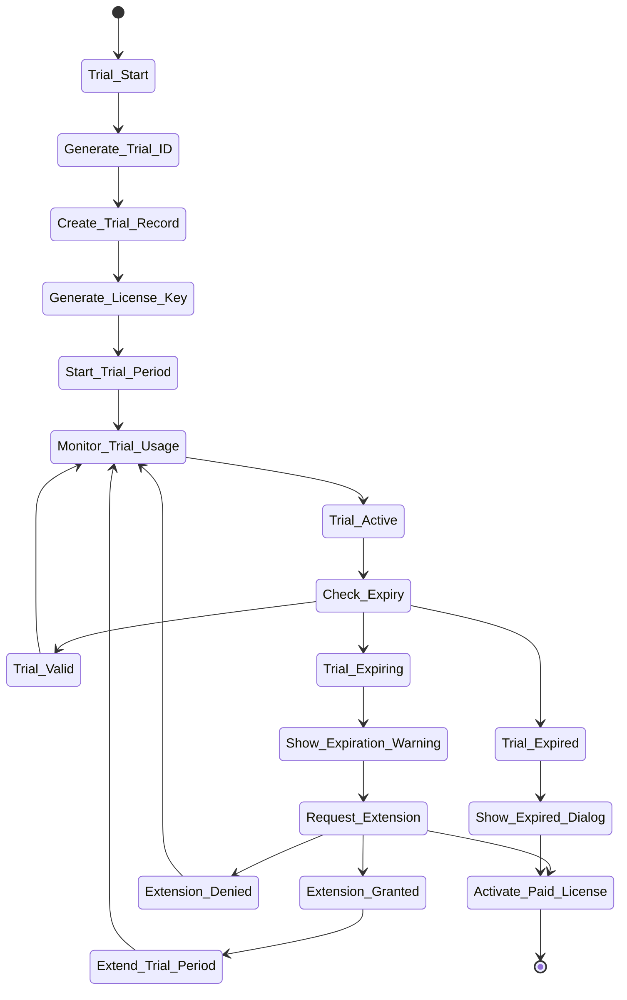

# Trial System Implementation

## Overview

This document outlines the trial system implementation designed to provide prospective customers with full access to POS features for a limited time, with secure tracking and extension mechanisms.

## Trial System Architecture



## Trial Data Model

### 1. Trial License Structure

```python
class TrialLicense:
    """Trial license data structure"""
    
    def __init__(self):
        self.trial_id: str = ""                    # Unique trial identifier
        self.license_key: str = ""                  # Generated license key
        self.trial_type: TrialType = TrialType.FULL_FEATURES
        self.customer_name: str = ""
        self.customer_email: str = ""
        self.start_date: datetime = None
        self.expiry_date: datetime = None
        self.duration_days: int = 30
        self.extensions_used: int = 0
        self.max_extensions: int = 2
        self.extension_days: int = 15
        self.hardware_fingerprint: str = ""
        self.machine_id: str = ""
        self.features: List[str] = []                # All features enabled
        self.user_limit: int = 10
        self.location_limit: int = 3
        self.is_active: bool = False
        self.usage_stats: TrialUsageStats = None
        self.extension_history: List[TrialExtension] = []
        self.signature: str = ""
        self.checksum: str = ""
        self.created_at: datetime = None
        self.updated_at: datetime = None

class TrialUsageStats:
    """Trial usage statistics"""
    
    def __init__(self):
        self.orders_created: int = 0
        self.menu_items_created: int = 0
        self.reports_generated: int = 0
        self.users_created: int = 0
        self.tables_managed: int = 0
        self.inventory_transactions: int = 0
        self.last_activity: datetime = None
        self.total_sessions: int = 0
        self.session_duration_total: int = 0  # Total minutes

class TrialExtension:
    """Trial extension record"""
    
    def __init__(self):
        self.extension_id: str = ""
        self.trial_id: str = ""
        self.extension_date: datetime = None
        self.extension_days: int = 0
        self.reason: str = ""
        self.approved: bool = False
        self.approved_by: str = ""
        self.approved_date: datetime = None
        self.old_expiry_date: datetime = None
        self.new_expiry_date: datetime = None

class TrialType(Enum):
    """Trial types"""
    FULL_FEATURES = "full_features"          # All features available
    LIMITED_FEATURES = "limited_features"      # Limited features
    BASIC_FUNCTIONALITY = "basic_functionality" # Basic features only
```

## Trial Manager Implementation

### 2.1 Core Trial Manager

```python
class TrialManager:
    """Manages trial licenses and extensions"""
    
    def __init__(self, license_manager, api_client):
        self.license_manager = license_manager
        self.api_client = api_client
        self.current_trial: TrialLicense = None
        self.trial_monitor = None
        self.extension_requests = []
        
    def start_trial(self, customer_info: dict) -> TrialLicense:
        """Start a new trial period"""
        try:
            # Generate trial ID
            trial_id = self.generate_trial_id()
            
            # Create trial license
            trial = TrialLicense()
            trial.trial_id = trial_id
            trial.customer_name = customer_info.get('name', '')
            trial.customer_email = customer_info.get('email', '')
            trial.trial_type = TrialType.FULL_FEATURES
            trial.start_date = datetime.utcnow()
            trial.expiry_date = trial.start_date + timedelta(days=TRIAL_PERIOD_DAYS)
            trial.duration_days = TRIAL_PERIOD_DAYS
            trial.max_extensions = MAX_TRIAL_EXTENSIONS
            trial.extension_days = TRIAL_EXTENSION_DAYS
            trial.hardware_fingerprint = self.license_manager.hardware_fingerprinter.generate_fingerprint()
            trial.machine_id = self.license_manager.hardware_fingerprinter.get_machine_id()
            trial.features = self.get_all_features()
            trial.user_limit = 10
            trial.location_limit = 3
            trial.is_active = True
            trial.usage_stats = TrialUsageStats()
            trial.extension_history = []
            trial.created_at = datetime.utcnow()
            trial.updated_at = datetime.utcnow()
            
            # Generate license key
            trial.license_key = self.generate_trial_license_key(trial)
            
            # Sign trial data
            trial.signature = self.sign_trial_data(trial)
            trial.checksum = self.calculate_trial_checksum(trial)
            
            # Save trial locally
            self.save_trial_locally(trial)
            
            # Register trial with server
            if self.register_trial_with_server(trial):
                # Start monitoring
                self.start_trial_monitoring(trial)
                self.current_trial = trial
                
                # Dispatch trial started event
                event_dispatcher.dispatch(EventType.TRIAL_STARTED, {
                    'trial_id': trial_id,
                    'customer_name': trial.customer_name,
                    'expiry_date': trial.expiry_date
                })
                
                return trial
            else:
                raise TrialError("Failed to register trial with server")
                
        except Exception as e:
            logger.error(f"Error starting trial: {e}")
            raise TrialError(f"Failed to start trial: {str(e)}")
    
    def extend_trial(self, trial_id: str, extension_days: int, reason: str) -> bool:
        """Request trial extension"""
        try:
            # Check if extension is allowed
            if not self.can_extend_trial(trial_id):
                return False
            
            # Create extension request
            extension = TrialExtension()
            extension.extension_id = self.generate_extension_id()
            extension.trial_id = trial_id
            extension.extension_days = extension_days
            extension.reason = reason
            extension.extension_date = datetime.utcnow()
            extension.approved = False
            
            # Submit extension request to server
            if self.submit_extension_request(extension):
                # Add to pending requests
                self.extension_requests.append(extension)
                
                # Dispatch extension requested event
                event_dispatcher.dispatch(EventType.TRIAL_EXTENSION_REQUESTED, {
                    'trial_id': trial_id,
                    'extension_days': extension_days,
                    'reason': reason
                })
                
                return True
            else:
                return False
                
        except Exception as e:
            logger.error(f"Error extending trial: {e}")
            return False
    
    def approve_trial_extension(self, extension_id: str, approved_by: str) -> bool:
        """Approve a trial extension (admin function)"""
        try:
            # Find extension request
            extension = self.find_extension_request(extension_id)
            if not extension:
                return False
            
            # Get trial
            trial = self.load_trial(extension.trial_id)
            if not trial:
                return False
            
            # Update extension
            extension.approved = True
            extension.approved_by = approved_by
            extension.approved_date = datetime.utcnow()
            extension.old_expiry_date = trial.expiry_date
            extension.new_expiry_date = trial.expiry_date + timedelta(days=extension.extension_days)
            
            # Update trial
            trial.expiry_date = extension.new_expiry_date
            trial.extensions_used += 1
            trial.extension_history.append(extension)
            trial.updated_at = datetime.utcnow()
            
            # Save updated trial
            self.save_trial_locally(trial)
            
            # Update server
            if self.update_trial_on_server(trial):
                # Dispatch extension approved event
                event_dispatcher.dispatch(EventType.TRIAL_EXTENSION_APPROVED, {
                    'trial_id': trial.trial_id,
                    'extension_days': extension.extension_days,
                    'new_expiry_date': extension.new_expiry_date
                })
                
                return True
            else:
                return False
                
        except Exception as e:
            logger.error(f"Error approving trial extension: {e}")
            return False
    
    def monitor_trial_usage(self):
        """Monitor trial usage and track statistics"""
        if not self.current_trial:
            return
        
        try:
            # Update usage statistics
            self.update_usage_stats()
            
            # Check if trial is expiring
            if self.is_trial_expiring():
                self.show_trial_expiration_warning()
            
            # Check if trial has expired
            if self.is_trial_expired():
                self.handle_trial_expiration()
                return
            
            # Check for suspicious usage patterns
            if self.detect_suspicious_usage():
                self.handle_suspicious_usage()
            
            # Schedule next monitoring cycle
            self.schedule_next_monitoring()
            
        except Exception as e:
            logger.error(f"Error monitoring trial usage: {e}")
    
    def is_trial_expiring(self) -> bool:
        """Check if trial is expiring soon"""
        if not self.current_trial:
            return False
        
        remaining_days = (self.current_trial.expiry_date - datetime.utcnow()).days
        return remaining_days <= 7 and remaining_days > 0
    
    def is_trial_expired(self) -> bool:
        """Check if trial has expired"""
        if not self.current_trial:
            return False
        
        return datetime.utcnow() > self.current_trial.expiry_date
    
    def can_extend_trial(self, trial_id: str) -> bool:
        """Check if trial can be extended"""
        trial = self.load_trial(trial_id)
        if not trial:
            return False
        
        return trial.extensions_used < trial.max_extensions
```

### 2.2 Trial Key Generation

```python
def generate_trial_license_key(self, trial: TrialLicense) -> str:
    """Generate trial license key"""
    try:
        # Trial key format: POS-TRIAL-YYYY-TRIAL123-EXT456
        year = datetime.now().strftime('%Y')
        trial_code = self.generate_trial_code()
        extension_code = self.generate_extension_code()
        
        license_key = f"POS-TRIAL-{year}-{trial_code}-{extension_code}"
        
        return license_key
        
    except Exception as e:
        logger.error(f"Error generating trial license key: {e}")
        raise TrialError(f"Failed to generate trial license key: {str(e)}")

def generate_trial_code(self) -> str:
    """Generate unique trial code"""
    import secrets
    import string
    
    # Generate 8-character alphanumeric code
    chars = string.ascii_uppercase + string.digits
    return ''.join(secrets.choice(chars) for _ in range(8))

def generate_extension_code(self) -> str:
    """Generate extension code"""
    import secrets
    import string
    
    # Generate 6-character alphanumeric code
    chars = string.ascii_uppercase + string.digits
    return ''.join(secrets.choice(chars) for _ in range(6))
```

### 2.3 Trial Monitoring

```python
class TrialMonitor:
    """Monitor trial usage and enforce limits"""
    
    def __init__(self, trial_manager):
        self.trial_manager = trial_manager
        self.monitoring_active = False
        self.monitoring_thread = None
        self.usage_trackers = {}
        
    def start_monitoring(self, trial: TrialLicense):
        """Start monitoring for a trial"""
        try:
            self.monitoring_active = True
            self.current_trial = trial
            
            # Initialize usage trackers
            self.initialize_usage_trackers()
            
            # Start monitoring thread
            self.monitoring_thread = threading.Thread(
                target=self.monitoring_loop,
                daemon=True
            )
            self.monitoring_thread.start()
            
        except Exception as e:
            logger.error(f"Error starting trial monitoring: {e}")
    
    def initialize_usage_trackers(self):
        """Initialize usage tracking for different features"""
        self.usage_trackers = {
            'orders': UsageTracker('orders'),
            'menu_items': UsageTracker('menu_items'),
            'reports': UsageTracker('reports'),
            'users': UsageTracker('users'),
            'tables': UsageTracker('tables'),
            'inventory': UsageTracker('inventory')
        }
    
    def monitoring_loop(self):
        """Main monitoring loop"""
        while self.monitoring_active:
            try:
                # Collect usage data
                self.collect_usage_data()
                
                # Check for anomalies
                self.check_usage_anomalies()
                
                # Update statistics
                self.update_trial_statistics()
                
                # Sleep for monitoring interval
                time.sleep(TRIAL_MONITORING_INTERVAL)
                
            except Exception as e:
                logger.error(f"Error in monitoring loop: {e}")
                time.sleep(TRIAL_MONITORING_INTERVAL)
    
    def collect_usage_data(self):
        """Collect usage data from application"""
        try:
            # Collect order statistics
            orders_today = self.get_orders_created_today()
            self.usage_trackers['orders'].add_count(orders_today)
            
            # Collect menu item statistics
            menu_items_today = self.get_menu_items_created_today()
            self.usage_trackers['menu_items'].add_count(menu_items_today)
            
            # Collect report statistics
            reports_today = self.get_reports_generated_today()
            self.usage_trackers['reports'].add_count(reports_today)
            
            # Collect user statistics
            users_today = self.get_users_created_today()
            self.usage_trackers['users'].add_count(users_today)
            
            # Collect table statistics
            tables_today = self.get_tables_managed_today()
            self.usage_trackers['tables'].add_count(tables_today)
            
            # Collect inventory statistics
            inventory_today = self.get_inventory_transactions_today()
            self.usage_trackers['inventory'].add_count(inventory_today)
            
        except Exception as e:
            logger.error(f"Error collecting usage data: {e}")

class UsageTracker:
    """Track usage for specific features"""
    
    def __init__(self, feature_name: str):
        self.feature_name = feature_name
        self.daily_counts = {}
        self.hourly_counts = {}
        self.total_count = 0
        self.last_reset = datetime.now().date()
    
    def add_count(self, count: int):
        """Add usage count"""
        current_date = datetime.now().date()
        current_hour = datetime.now().hour
        
        # Reset if new day
        if current_date != self.last_reset:
            self.daily_counts = {}
            self.hourly_counts = {}
            self.last_reset = current_date
        
        # Update counts
        self.daily_counts[current_date] = self.daily_counts.get(current_date, 0) + count
        self.hourly_counts[current_hour] = self.hourly_counts.get(current_hour, 0) + count
        self.total_count += count
```

## 3. Trial UI Implementation

### 3.1 Trial Status Display

```python
class TrialStatusDisplay:
    """Display trial status and information"""
    
    def __init__(self, parent, trial_manager):
        self.parent = parent
        self.trial_manager = trial_manager
        self.status_frame = None
        
    def create_trial_status_widget(self, parent):
        """Create trial status display widget"""
        # Create status frame
        status_frame = self.create_modern_frame(parent, style="Panel.TFrame", padding=SPACING_M)
        status_frame.pack(fill=tk.X, pady=SPACING_S)
        
        # Trial indicator
        trial_frame = ttk.Frame(status_frame, style="Panel.TFrame")
        trial_frame.pack(fill=tk.X, pady=(0, SPACING_S))
        
        # Trial icon and text
        icon_label = self.create_modern_label(
            trial_frame,
            text="⏰",
            style="SectionTitle.TLabel"
        )
        icon_label.pack(side=tk.LEFT)
        
        text_label = self.create_modern_label(
            trial_frame,
            text="Trial License Active",
            style="SectionTitle.TLabel"
        )
        text_label.pack(side=tk.LEFT, padx=(SPACING_S, 0))
        
        # Trial details
        details_frame = self.create_modern_frame(status_frame, style="Panel.TFrame", padding=SPACING_M)
        details_frame.pack(fill=tk.X, pady=SPACING_S))
        
        self.trial_details_label = self.create_modern_label(
            details_frame,
            text="",
            style="Body.TLabel"
        )
        self.trial_details_label.pack(anchor=tk.W)
        
        # Update display
        self.update_trial_display()
        
        return status_frame
    
    def update_trial_display(self):
        """Update trial status display"""
        if not self.trial_manager.current_trial:
            return
        
        trial = self.trial_manager.current_trial
        remaining_days = (trial.expiry_date - datetime.utcnow()).days
        
        if remaining_days <= 0:
            status_text = "Trial Expired"
            status_color = COLOR_ERROR
        elif remaining_days <= 7:
            status_text = f"Trial Expiring in {remaining_days} days"
            status_color = COLOR_WARNING
        else:
            status_text = f"Trial Active - {remaining_days} days remaining"
            status_color = COLOR_SUCCESS
        
        # Update details
        details_text = f"""Customer: {trial.customer_name}
Started: {trial.start_date.strftime('%Y-%m-%d')}
Expires: {trial.expiry_date.strftime('%Y-%m-%d')}
Extensions Used: {trial.extensions_used}/{trial.max_extensions}
Features: All POS Features Available"""
        
        self.trial_details_label.config(text=details_text)
        
        # Update status text color
        self.trial_details_label.config(foreground=status_color)
```

### 3.2 Trial Extension Dialog

```python
class TrialExtensionDialog(BaseUI):
    """Dialog for requesting trial extensions"""
    
    def __init__(self, root, app, trial_manager):
        super().__init__(root, app)
        self.trial_manager = trial_manager
        self.dialog = None
        self.extension_reason_var = None
        self.extension_days_var = None
        
    def show(self, trial_data):
        """Show trial extension dialog"""
        pass
        
    def create_extension_dialog(self, trial_data):
        """Create trial extension dialog"""
        dialog = tk.Toplevel(self.root)
        dialog.title("Extend Trial")
        dialog.geometry("450x350")
        dialog.configure(bg=COLOR_BACKGROUND_LIGHT)
        dialog.resizable(False, False)
        
        # Make dialog modal
        dialog.transient(self.root)
        dialog.grab_set()
        
        # Main container
        main_container = self.create_modern_frame(dialog, style="Card.TFrame", padding=SPACING_XL)
        main_container.pack(fill=tk.BOTH, expand=True, padx=SPACING_XXL, pady=SPACING_XXL)
        
        # Header
        header_frame = self.create_modern_frame(main_container, style="Panel.TFrame", padding=SPACING_L)
        header_frame.pack(fill=tk.X, pady=(0, SPACING_L))
        
        title_label = self.create_modern_label(
            header_frame,
            text="⏰ Extend Trial Period",
            style="Title.TLabel"
        )
        title_label.pack(anchor=tk.W)
        
        # Current trial info
        info_frame = self.create_modern_frame(main_container, style="Panel.TFrame", padding=SPACING_L)
        info_frame.pack(fill=tk.X, pady=SPACING_S))
        
        remaining_days = (trial_data['expiry_date'] - datetime.now()).days
        extensions_remaining = trial_data['max_extensions'] - trial_data['extensions_used']
        
        info_text = f"""Current Trial: {trial_data['customer_name']}
Remaining Days: {remaining_days}
Extensions Available: {extensions_remaining}
Extension Length: {TRIAL_EXTENSION_DAYS} days"""
        
        info_label = self.create_modern_label(
            info_frame,
            text=info_text,
            style="Body.TLabel"
        )
        info_label.pack(anchor=tk.W)
        
        # Extension form
        form_frame = self.create_modern_frame(main_container, style="Panel.TFrame", padding=SPACING_L)
        form_frame.pack(fill=tk.X, pady=SPACING_S))
        
        # Reason field
        self.extension_reason_var = tk.StringVar()
        self.create_form_field(
            form_frame,
            "Extension Reason",
            entry_type="entry",
            textvariable=self.extension_reason_var,
            width=40
        )
        
        # Days selection
        self.extension_days_var = tk.StringVar(value=str(TRIAL_EXTENSION_DAYS))
        self.create_form_field(
            form_frame,
            "Extension Days",
            entry_type="combobox",
            textvariable=self.extension_days_var,
            values=["7", "15", "30"],
            state="readonly",
            width=38
        )
        
        # Action buttons
        button_frame = self.create_button_group(
            main_container,
            [
                ("📤 Request Extension", self.request_extension, "Primary.TButton"),
                ("❌ Cancel", lambda: dialog.destroy(), "Secondary.TButton")
            ],
            spacing=SPACING_M
        )
        button_frame.pack(fill=tk.X, pady=SPACING_L)
        
        self.dialog = dialog
        return dialog
    
    def request_extension(self):
        """Request trial extension"""
        reason = self.extension_reason_var.get().strip()
        days = int(self.extension_days_var.get())
        
        if not reason:
            self.show_message("Error", "Please provide a reason for extension", "error")
            return
        
        # Request extension
        if self.trial_manager.extend_trial(
            self.trial_manager.current_trial.trial_id,
            days,
            reason
        ):
            self.show_message("Success", "Extension request submitted successfully", "info")
            self.dialog.destroy()
            
            # Show confirmation dialog
            self.show_extension_confirmation_dialog(days, reason)
        else:
            self.show_message("Error", "Failed to submit extension request", "error")
```

## 4. Trial Security Measures

### 4.1 Trial Abuse Prevention

```python
class TrialAbusePrevention:
    """Prevent trial abuse and ensure fair usage"""
    
    def __init__(self, trial_manager):
        self.trial_manager = trial_manager
        self.abuse_detectors = [
            HardwareChangeDetector(),
            MultipleInstanceDetector(),
            UsagePatternAnalyzer(),
            TimeManipulationDetector()
        ]
        
    def check_trial_abuse(self, trial: TrialLicense) -> dict:
        """Check for various types of trial abuse"""
        abuse_indicators = {}
        
        for detector in self.abuse_detectors:
            result = detector.analyze(trial)
            abuse_indicators[detector.name] = result
        
        return abuse_indicators
    
    def is_trial_abuse_detected(self, abuse_indicators: dict) -> bool:
        """Check if any abuse is detected"""
        for detector_name, result in abuse_indicators.items():
            if result.get('is_abuse', False):
                logger.warning(f"Trial abuse detected by {detector_name}: {result}")
                return True
        return False

class HardwareChangeDetector:
    """Detect hardware changes during trial"""
    
    def __init__(self):
        self.name = "HardwareChangeDetector"
        
    def analyze(self, trial: TrialLicense) -> dict:
        """Analyze for hardware changes"""
        current_fingerprint = self.get_current_fingerprint()
        stored_fingerprint = trial.hardware_fingerprint
        
        similarity = self.calculate_fingerprint_similarity(current_fingerprint, stored_fingerprint)
        
        return {
            'is_abuse': similarity < 0.8,
            'similarity_score': similarity,
            'details': f"Fingerprint similarity: {similarity:.2f}"
        }

class MultipleInstanceDetector:
    """Detect multiple trial instances"""
    
    def __init__(self):
        self.name = "MultipleInstanceDetector"
        self.instance_tracker = {}
        
    def analyze(self, trial: TrialLicense) -> dict:
        """Analyze for multiple instances"""
        current_time = datetime.utcnow()
        
        # Check for recent activations from same IP
        recent_activations = self.get_recent_activations(trial.customer_email, hours=24)
        
        return {
            'is_abuse': len(recent_activations) > 3,
            'instance_count': len(recent_activations),
            'details': f"Recent activations: {len(recent_activations)}"
        }
```

## 5. Trial Constants and Configuration

```python
# Trial Configuration
TRIAL_PERIOD_DAYS = 30
TRIAL_EXTENSION_DAYS = 15
MAX_TRIAL_EXTENSIONS = 2
TRIAL_MONITORING_INTERVAL = 300  # 5 minutes
TRIAL_WARNING_THRESHOLD_DAYS = 7
TRIAL_ABUSE_THRESHOLD_SIMILARITY = 0.8
TRIAL_MAX_INSTANCES_PER_IP = 3

# Trial Features
TRIAL_FEATURES = [
    'order_management',
    'table_management',
    'menu_management',
    'user_management',
    'reporting_advanced',
    'inventory_management',
    'gst_reporting',
    'data_export',
    'data_import',
    'email_notifications',
    'multi_location',
    'api_access',
    'custom_branding',
    'priority_support'
]

# Trial Extension Reasons
EXTENSION_REASONS = [
    'Evaluating for purchase',
    'Implementation delay',
    'Technical issues',
    'Business requirements',
    'Training period',
    'Customization needs'
]

# Trial Abuse Detection Thresholds
ABUSE_DETECTION_THRESHOLDS = {
    'max_daily_orders': 1000,
    'max_daily_menu_items': 500,
    'max_daily_reports': 100,
    'max_session_duration_hours': 24,
    'max_concurrent_sessions': 3
}
```

This comprehensive trial system provides secure, flexible trial management with abuse prevention and extension capabilities while maintaining excellent user experience.