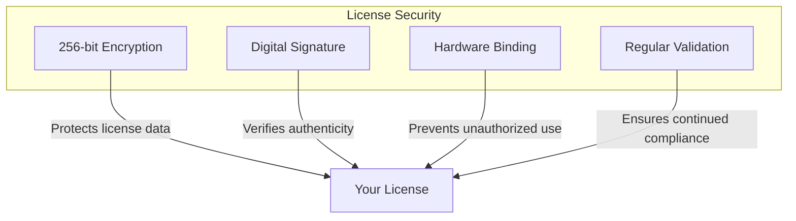
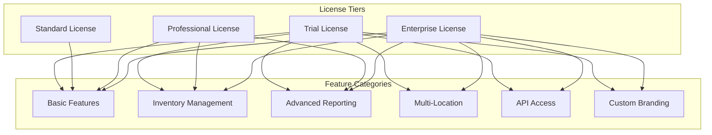

# License System User Guide

## Overview

This guide provides comprehensive instructions for managing licenses in the Restaurant POS MVP application. The license system controls access to features based on your license type and ensures compliance with software usage terms.

## Table of Contents

1. [Understanding Licenses](#understanding-licenses)
2. [License Types](#license-types)
3. [Activating Your License](#activating-your-license)
4. [Managing Your License](#managing-your-license)
5. [Feature Access](#feature-access)
6. [License Status](#license-status)
7. [Troubleshooting](#troubleshooting)
8. [FAQ](#faq)

## Understanding Licenses

### What is a License?

A license is a digital key that grants you permission to use the Restaurant POS software with specific features and capabilities. Each license is:

- **Unique**: Tied to your specific installation
- **Secure**: Protected by advanced encryption
- **Flexible**: Available in different tiers to match your needs
- **Upgradable**: Can be upgraded to access more features

### License Security Features

Your license is protected by multiple security measures:

### How Licenses Work

1. **Activation**: You enter a license key to activate features
2. **Validation**: System periodically validates license authenticity
3. **Hardware Binding**: License is tied to your computer hardware
4. **Feature Control**: Available features are based on license type
5. **Renewal**: Some licenses require periodic renewal

## License Types

### Trial License

**Duration**: 30 days with full feature access

**Features**:
- Complete POS functionality
- All reporting features
- Full inventory management
- Multi-user support (up to 5 users)
- Email notifications
- Data export/import

**Limitations**:
- Time-limited to 30 days
- Requires internet connection for validation
- Cannot be transferred to another computer

**Best For**:
- Evaluating the software before purchase
- Short-term projects or events
- Testing compatibility with your systems

### Standard License

**Duration**: Perpetual (one-time purchase)

**Features**:
- Basic POS functionality
- Order management
- Table management
- Menu management (up to 100 items)
- Basic reporting
- User management (up to 3 users)
- Standard support

**Limitations**:
- No inventory management
- No advanced reporting
- No GST reporting
- No data export/import
- No email notifications

**Best For**:
- Small restaurants with basic needs
- Single-location operations
- Budget-conscious businesses

### Professional License

**Duration**: Perpetual (one-time purchase)

**Features**:
- All Standard features
- Inventory management
- Advanced reporting and analytics
- GST reporting
- Data export/import
- Menu management (unlimited items)
- User management (up to 10 users)
- Email notifications
- Priority support

**Limitations**:
- No multi-location support
- No API access
- No custom branding
- No dedicated support

**Best For**:
- Growing restaurants
- Multi-user environments
- Businesses needing detailed reporting
- Operations requiring inventory control

### Enterprise License

**Duration**: Perpetual (one-time purchase)

**Features**:
- All Professional features
- Multi-location support (unlimited)
- API access for integrations
- Custom branding options
- Unlimited users
- Dedicated support
- Advanced integrations
- Custom development support

**Limitations**:
- None (full feature access)

**Best For**:
- Restaurant chains
- Large operations
- Businesses with multiple locations
- Operations requiring custom integrations

## Activating Your License

### Finding Your License Key

Your license key is provided:

- **Email**: Sent to your registered email address
- **Purchase Confirmation**: Included in your purchase receipt
- **Customer Portal**: Available in your online account
- **Physical Package**: Included in product packaging (if applicable)

License key format: `XXXXX-YYYYY-ZZZZZ`
- 5 characters, hyphen, 5 characters, hyphen, 5 characters
- Case-insensitive (can be entered in any case)

### Step-by-Step Activation

1. **Open License Activation**:
   - From main menu, click "Help" → "License"
   - Or press `Ctrl+Shift+L`
   - Or click on license status indicator in status bar

2. **Enter License Information**:
   - **License Key**: Enter your complete license key
   - **Company Name**: Your business name (optional)
   - **Email Address**: Your contact email
   - **Phone Number**: Your contact phone (optional)

3. **Verify Information**:
   - Review all entered information for accuracy
   - Ensure license key is entered correctly
   - Check for typos in email address

4. **Activate License**:
   - Click "Activate License" button
   - System will validate license key online
   - Hardware fingerprint will be generated
   - License will be bound to your computer

5. **Confirmation**:
   - Successful activation shows confirmation message
   - License type and features will be displayed
   - Expiry information (if applicable) will be shown

### Activation Troubleshooting

#### Common Activation Issues

**"Invalid license key"**
- Verify license key is entered correctly
- Check for extra spaces or characters
- Ensure you're using the correct license type
- Contact support if issue persists

**"License already in use"**
- License is already activated on another computer
- Contact support to transfer license
- Purchase additional license if needed

**"Unable to connect to license server"**
- Check your internet connection
- Verify firewall allows connection
- Try again in a few minutes
- Contact support if issue continues

**"Hardware binding failed"**
- Try restarting your computer
- Ensure no major hardware changes recently
- Contact support for hardware binding issues

## Managing Your License

### Viewing License Information

1. **Access License Status**:
   - From main menu: Help → License Status
   - From status bar: Click on license indicator
   - Keyboard shortcut: `Ctrl+Shift+S`

2. **License Information Displayed**:
   - **License Type**: Your current license tier
   - **License Key**: Your license key (partially masked)
   - **Activation Date**: When license was activated
   - **Expiry Date**: When license expires (if applicable)
   - **Hardware ID**: Your hardware fingerprint
   - **Validation Status**: Last successful validation
   - **Features**: Available features with your license

### Updating License Information

1. **Contact Information Update**:
   - From License Status screen, click "Update Contact Info"
   - Update your email address and phone number
   - Click "Save" to confirm changes

2. **License Renewal**:
   - For expiring licenses, renewal options appear 30 days before expiry
   - Click "Renew License" to start renewal process
   - Follow on-screen instructions for payment
   - New license key will be automatically applied

### Transferring License

1. **Deactivate on Old Computer**:
   - From License Status, click "Transfer License"
   - Select "Deactivate on This Computer"
   - Confirm deactivation
   - License is released from hardware binding

2. **Activate on New Computer**:
   - Install POS application on new computer
   - Follow standard activation process
   - Use same license key
   - License will be bound to new hardware

### License Backup and Recovery

1. **Automatic Backup**:
   - License information is automatically backed up
   - Backups are stored in multiple secure locations
   - System can recover from backup if needed

2. **Manual Backup**:
   - From License Status, click "Backup License"
   - Choose backup location
   - Save backup file securely

3. **Recovery Process**:
   - From License Status, click "Recover License"
   - Select backup file
   - Confirm recovery
   - License information is restored

## Feature Access

### Understanding Feature Control

Your license controls access to features through a permission system:

### Feature Access Indicators

Throughout the application, you'll see indicators for feature access:

- **🟢 Available**: Feature is available with your license
- **🟡 Limited**: Feature has limited access based on license
- **🔴 Locked**: Feature requires higher license tier

### Requesting Feature Access

When you try to access a locked feature:

1. **Access Attempt**:
   - Click on locked feature or menu item
   - System displays access restriction message

2. **Upgrade Options**:
   - "Upgrade Now" button to purchase higher license
   - "Learn More" button to view license comparison
   - "Contact Sales" button to speak with sales representative

3. **Trial Period**:
   - Some features offer 7-day trial
   - Click "Try Feature" for temporary access
   - Full access after license upgrade

### Feature Comparison

| Feature | Trial | Standard | Professional | Enterprise |
|----------|--------|----------|-------------|------------|
| **Basic POS Operations** | ✅ | ✅ | ✅ | ✅ |
| Order Management | ✅ | ✅ | ✅ | ✅ |
| Table Management | ✅ | ✅ | ✅ | ✅ |
| Basic Reporting | ✅ | ✅ | ✅ | ✅ |
| **Advanced Features** | | | | |
| Inventory Management | ✅ | ❌ | ✅ | ✅ |
| Advanced Analytics | ✅ | ❌ | ✅ | ✅ |
| GST Reporting | ✅ | ❌ | ✅ | ✅ |
| Data Export/Import | ✅ | ❌ | ✅ | ✅ |
| **Premium Features** | | | | |
| Multi-Location | ❌ | ❌ | ❌ | ✅ |
| API Access | ❌ | ❌ | ❌ | ✅ |
| Custom Branding | ❌ | ❌ | ❌ | ✅ |
| **Support & Users** | | | | |
| Max Users | 5 | 3 | 10 | Unlimited |
| Support Level | Standard | Standard | Priority | Dedicated |
| Phone Support | ❌ | ❌ | ✅ | ✅ |

## License Status

### Understanding Status Indicators

Your license status is shown in multiple places:

1. **Status Bar Indicator**:
   - 🟢 **Active**: License is valid and active
   - 🟡 **Expiring Soon**: License expires in less than 30 days
   - 🔴 **Expired**: License has expired
   - 🟠 **Grace Period**: License expired but in grace period
   - 🔴 **Invalid**: License is invalid or corrupted

2. **License Status Screen**:
   - Detailed information about your license
   - Last validation date and time
   - Next validation due date
   - Any issues or warnings

### Validation Process

The system periodically validates your license:

1. **Online Validation**:
   - Requires internet connection
   - Verifies license with central server
   - Updates license status if needed
   - Frequency: Every 7 days

2. **Offline Validation**:
   - Works without internet connection
   - Uses locally stored validation data
   - Limited to 7 consecutive days
   - After 7 days, requires online validation

3. **Grace Period**:
   - 7 days after expiry for renewal
   - Full functionality continues
   - Renewal reminders increase in frequency
   - After grace period, features become restricted

### Validation Troubleshooting

#### Validation Failed

**"Online validation failed"**
- Check internet connection
- Verify firewall allows connection
- Try manual validation from License Status
- Contact support if issue persists

**"Offline validation expired"**
- Connect to internet for online validation
- System will automatically validate when online
- Contact support if unable to validate online

**"License corrupted"**
- Try license recovery from backup
- Contact support for license replacement
- May need to reactivate license

## Troubleshooting

### Common License Issues

#### Activation Problems

**Issue**: License key not accepted
**Solutions**:
1. Verify license key is entered correctly
2. Check for extra spaces or characters
3. Ensure using correct license type
4. Contact support for key verification

**Issue**: Activation fails with network error
**Solutions**:
1. Check internet connection
2. Verify firewall settings
3. Try different network if available
4. Contact support if issue continues

**Issue**: Hardware binding fails
**Solutions**:
1. Restart computer and try again
2. Ensure no recent hardware changes
3. Check for virtual machine environments
4. Contact support for hardware issues

#### Validation Problems

**Issue**: Frequent validation failures
**Solutions**:
1. Check internet connection stability
2. Verify system date/time is correct
3. Check for interference from security software
4. Contact support for validation issues

**Issue**: Features locked despite valid license
**Solutions**:
1. Restart application
2. Check license status screen
3. Try manual validation
4. Contact support for feature access issues

#### Performance Issues

**Issue**: Slow license validation
**Solutions**:
1. Check system resources
2. Close other applications
3. Verify network performance
4. Contact support for performance issues

### Getting Help

#### Built-in Diagnostics

1. **Run License Diagnostics**:
   - From License Status, click "Diagnostics"
   - System will run comprehensive checks
   - Results will show any issues found

2. **Diagnostic Results**:
   - Connection test results
   - Hardware binding status
   - License file integrity
   - System compatibility check

#### Contact Information

For license-related issues:

1. **Support Portal**: support.restaurantpos.com
2. **Email**: license@restaurantpos.com
3. **Phone**: +1-800-POS-LICENSE
4. **Live Chat**: Available on website during business hours

## FAQ

### General Questions

**Q: Can I use the same license on multiple computers?**
A: License transfer restrictions vary by type:
- Trial: 1 computer only
- Standard: 1 computer only
- Professional: Up to 3 computers
- Enterprise: Unlimited computers at one location

**Q: What happens if my computer fails?**
A: You can transfer your license to a new computer:
1. Deactivate on failed computer (if possible)
2. Install on new computer
3. Activate with same license key
4. Contact support if deactivation isn't possible

**Q: How often does the system validate my license?**
A: Validation frequency depends on license type:
- Trial: Every 3 days
- Standard/Professional: Every 7 days
- Enterprise: Every 14 days

### Technical Questions

**Q: What information is collected during hardware binding?**
A: System collects hardware identifiers to create a unique fingerprint:
- CPU information
- Motherboard serial number
- Disk serial number
- MAC address
- Windows product ID
No personal data is collected during this process.

**Q: Is my personal information secure?**
A: Yes, all personal information is:
- Encrypted during transmission
- Stored securely on our servers
- Never shared with third parties
- Protected by industry-standard security measures

**Q: Can I use the software without internet?**
A: Yes, but with limitations:
- Offline validation works for 7 consecutive days
- After 7 days, internet connection is required
- Some features may require internet (email, updates)

### Upgrade Questions

**Q: How do I upgrade my license?**
A: License upgrade process:
1. Contact sales or use online portal
2. Pay price difference between licenses
3. Receive new license key
4. Enter new license key in application
5. Your features are immediately upgraded

**Q: Do I lose my settings when upgrading?**
A: No, all your settings are preserved:
- Database remains unchanged
- Configuration settings are kept
- User preferences are maintained
- Only license features change

### Renewal Questions

**Q: Do perpetual licenses require renewal?**
A: No, perpetual licenses don't expire:
- Standard, Professional, and Enterprise are perpetual
- One-time purchase, no recurring fees
- Optional maintenance plans available

**Q: What happens when my trial expires?**
A: Trial expiration process:
1. You'll receive warnings at 30, 14, and 7 days
2. After expiry, 7-day grace period begins
3. During grace period, all features continue working
4. After grace period, you must purchase a license

### Business Questions

**Q: Can I get a refund if I'm not satisfied?**
A: Yes, we offer a 30-day money-back guarantee:
- Full refund within 30 days of purchase
- No questions asked policy
- Contact sales for refund process

**Q: Do you offer volume discounts?**
A: Yes, volume discounts are available:
- 5-9 licenses: 10% discount
- 10-24 licenses: 20% discount
- 25+ licenses: 30% discount
- Contact sales for custom quotes

**Q: Can I customize my license?**
A: Yes, Enterprise licenses can be customized:
- Custom feature sets
- Specialized reporting
- Integration with existing systems
- Contact sales for custom requirements

## Tips for License Management

### Best Practices

1. **Record Keeping**:
   - Save license key in secure location
   - Keep purchase confirmation emails
   - Document activation dates
   - Store contact information

2. **Security**:
   - Never share your license key
   - Use strong passwords for online accounts
   - Keep contact information updated
   - Report suspicious activity immediately

3. **Planning**:
   - Choose license type based on growth plans
   - Consider future needs when purchasing
   - Plan for budget cycles
   - Evaluate feature requirements regularly

4. **Maintenance**:
   - Keep system updated
   - Run regular diagnostics
   - Monitor license status
   - Renew before expiry if applicable

### Proactive Management

1. **Expiry Monitoring**:
   - Check license status regularly
   - Set calendar reminders for expirations
   - Plan budget for renewals
   - Start renewal process early

2. **Feature Utilization**:
   - Review available features periodically
   - Learn to use all licensed features
   - Train staff on new features
   - Provide feedback on feature usefulness

3. **Backup Planning**:
   - Create regular license backups
   - Store backups in secure locations
   - Test recovery process periodically
   - Include backups in disaster recovery plan

---

This guide should help you effectively manage your Restaurant POS license and make the most of your licensed features. For additional assistance, don't hesitate to contact our license support team.