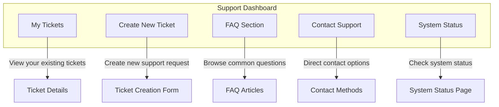
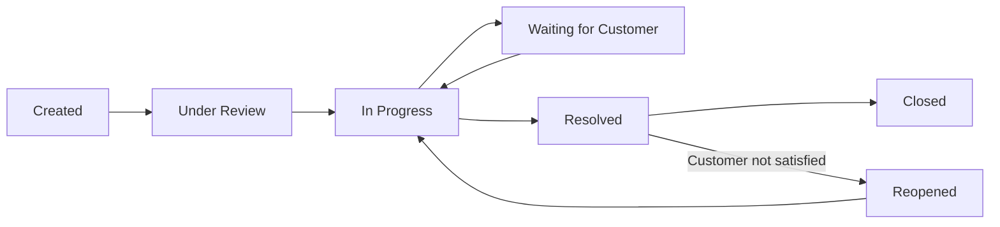

# Support System User Guide

## Overview

This guide provides comprehensive instructions for using the support system in the Restaurant POS MVP application. The support system allows you to get help with technical issues, report bugs, request features, and communicate with the support team.

## Table of Contents

1. [Getting Started](#getting-started)
2. [Creating Support Tickets](#creating-support-tickets)
3. [Managing Your Tickets](#managing-your-tickets)
4. [Using Contact Forms](#using-contact-forms)
5. [Reporting Bugs](#reporting-bugs)
6. [Tracking Ticket Status](#tracking-ticket-status)
7. [Troubleshooting Common Issues](#troubleshooting-common-issues)
8. [FAQ](#faq)

## Getting Started

### Accessing the Support System

1. **From the Main Menu**:
   - Click on "Support" in the main navigation menu
   - Select "Support Dashboard" from the dropdown

2. **From the Help Menu**:
   - Press `F1` or click the Help icon (❓)
   - Select "Get Support" from the help menu

3. **Keyboard Shortcut**:
   - Press `Ctrl+Shift+S` to open support directly

### Support Dashboard Overview

The support dashboard provides an overview of all support activities:



## Creating Support Tickets

### Step-by-Step Ticket Creation

1. **Navigate to Ticket Creation**:
   - From the Support Dashboard, click "Create New Ticket"
   - Or use the keyboard shortcut `Ctrl+Shift+T`

2. **Fill in Ticket Information**:

   #### Required Fields
   - **Category**: Select the most appropriate category
     - *Bug Report*: Technical issues or errors
     - *Feature Request*: Suggestions for new features
     - *General Inquiry*: Questions about functionality
     - *Technical Support*: Help with configuration or setup
   
   - **Priority**: Select urgency level
     - *Low*: Non-urgent issues
     - *Medium*: Issues affecting normal operation
     - *High*: Issues significantly impacting operations
     - *Critical*: System-down or data-loss situations
   
   - **Subject**: Brief, descriptive title (max 100 characters)
   
   - **Description**: Detailed explanation of the issue
     - Include steps to reproduce the problem
     - Describe expected vs. actual behavior
     - Include any error messages

3. **Add Attachments (Optional)**:
   - Click "Add Attachment" to include files
   - Supported formats: Images (.jpg, .png, .gif), Documents (.pdf, .doc, .txt)
   - Maximum file size: 10MB per file
   - Maximum number of files: 5 per ticket

4. **Submit the Ticket**:
   - Review all information for accuracy
   - Click "Submit Ticket"
   - You'll receive a confirmation with your ticket number

### Ticket Creation Best Practices

#### Writing Effective Subject Lines

✅ **Good Examples**:
- "KOT orders not appearing in kitchen display"
- "License validation fails after system update"
- "Unable to export reports to Excel format"

❌ **Poor Examples**:
- "Help"
- "Problem"
- "Urgent"

#### Writing Effective Descriptions

Use this template for technical issues:

```
**Issue Description**: Brief description of the problem

**Steps to Reproduce**:
1. Step one
2. Step two
3. Step three

**Expected Behavior**: What should have happened

**Actual Behavior**: What actually happened

**Error Messages**: Any error messages received

**System Information**:
- POS Version: [Help → About]
- Operating System: Windows/Mac/Linux version
- License Type: Trial/Standard/Professional/Enterprise
```

## Managing Your Tickets

### Viewing Your Tickets

1. **From the Support Dashboard**:
   - Click "My Tickets" to see all your tickets
   - Tickets are sorted by most recent activity

2. **Ticket Status Indicators**:
   - 🟢 **Open**: Ticket is being reviewed
   - 🟡 **In Progress**: Support team is working on it
   - 🟢 **Resolved**: Issue has been resolved
   - ⚪ **Closed**: Ticket is completed and archived

3. **Priority Indicators**:
   - 🔴 **Critical**: Immediate attention required
   - 🟠 **High**: High priority issue
   - 🟡 **Medium**: Normal priority
   - ⚪ **Low**: Low priority

### Updating Your Tickets

1. **Open the Ticket**:
   - Click on the ticket subject from your ticket list
   - Or enter the ticket number in the search box

2. **Add Information**:
   - Use the message box to add updates
   - Attach additional files if needed
   - Click "Add Update" to submit

3. **Mark as Resolved**:
   - If your issue is resolved, click "Mark as Resolved"
   - Add a brief comment about the resolution
   - This helps the support team close the ticket

### Ticket Communication

#### Message Types

- **Public Messages**: Visible to you and support staff
- **Internal Notes**: Visible only to support staff
- **System Messages**: Automated notifications from the system

#### Response Time Expectations

| Priority | Initial Response | Resolution Target |
|-----------|------------------|-------------------|
| Critical | 15 minutes | 4 hours |
| High | 1 hour | 24 hours |
| Medium | 4 hours | 72 hours |
| Low | 24 hours | 1 week |

## Using Contact Forms

### When to Use Contact Forms

Contact forms are best for:
- General inquiries that don't require a ticket
- Pre-sales questions
- Feedback and suggestions
- Partnership inquiries

### Accessing Contact Forms

1. **From Support Dashboard**:
   - Click "Contact Support"
   - Select appropriate contact form

2. **Contact Form Types**:
   - **General Inquiry**: General questions and information
   - **Technical Support**: Quick technical questions
   - **Sales Inquiry**: Pricing and licensing questions
   - **Feedback**: Share your experience and suggestions

### Filling Out Contact Forms

#### Required Information

- **Name**: Your full name
- **Email**: Your email address for responses
- **Subject**: Brief description of your inquiry
- **Message**: Detailed explanation of your question or feedback

#### Optional Information

- **Phone Number**: For phone callback requests
- **Company**: Your organization name
- **Preferred Contact Method**: Email, Phone, or In-App

#### Contact Form Best Practices

✅ **Do**:
- Be specific about your question
- Include relevant context
- Provide your contact information accurately
- Choose the appropriate form type

❌ **Don't**:
- Submit bug reports (use ticket system instead)
- Include sensitive information
- Submit multiple forms for the same issue
- Use inappropriate language

## Reporting Bugs

### Automatic Bug Reporting

The POS system includes automatic bug reporting for critical errors:

1. **When Errors Occur**:
   - System detects critical errors automatically
   - Bug report is created with system information
   - You'll receive a notification about the bug report

2. **What's Included**:
   - Error message and stack trace
   - System information (OS, version, etc.)
   - Application state at time of error
   - Screenshot (if applicable)

3. **Review and Submit**:
   - Review the automatically collected information
   - Add any additional context or steps to reproduce
   - Submit or cancel the bug report

### Manual Bug Reporting

For non-critical issues or when automatic reporting doesn't trigger:

1. **Create Bug Report**:
   - From Support Dashboard, click "Report Bug"
   - Or from any error dialog, click "Report This Bug"

2. **Bug Report Form**:
   - **Error Type**: Select the type of error
   - **Error Message**: Copy and paste any error messages
   - **Steps to Reproduce**: Detailed steps to reproduce the bug
   - **Expected Behavior**: What should have happened
   - **Actual Behavior**: What actually happened
   - **Frequency**: How often does this occur?
   - **Impact**: How does this affect your operations?

3. **Add System Information**:
   - The system automatically collects:
     - POS version
     - Operating system
     - License type
     - Hardware information
   - Review and add any missing information

4. **Attach Files**:
   - Screenshots are very helpful
   - Log files if available
   - Any other relevant files

### Bug Report Tips

#### Taking Effective Screenshots

1. **Capture the Error**:
   - Include the error message
   - Show surrounding context
   - Include the entire window if possible

2. **Annotate if Needed**:
   - Use image editing software to highlight important areas
   - Add arrows or circles to point to specific elements
   - Add text notes if helpful

3. **Save in Appropriate Format**:
   - PNG format for screenshots (best quality)
   - JPEG for photos (smaller file size)
   - Keep file size reasonable (under 5MB)

#### Writing Effective Bug Reports

Use the S.T.A.R. method:

- **Situation**: What were you doing when the bug occurred?
- **Task**: What were you trying to accomplish?
- **Action**: What specific action did you take?
- **Result**: What was the result of your action?

Example:
```
Situation: I was processing a customer order at the main counter
Task: I was trying to add a discount to the order
Action: I clicked the "Apply Discount" button and entered 10%
Result: The application froze and displayed an error message
```

## Tracking Ticket Status

### Real-Time Updates

1. **In-App Notifications**:
   - Desktop notifications for ticket updates
   - Badge indicators on the Support menu
   - Sound alerts for new messages (configurable)

2. **Email Notifications**:
   - Automatic email updates for ticket changes
   - Include direct links to your tickets
   - Can be configured in your profile settings

3. **Status Page**:
   - Check system status at status.restaurantpos.com
   - View ongoing issues and maintenance
   - Subscribe to status updates

### Understanding Ticket Workflow



### Ticket Status Meanings

- **Created**: Your ticket has been received and is in the queue
- **Under Review**: Support team is reviewing your ticket
- **In Progress**: A support agent is actively working on your ticket
- **Waiting for Customer**: Support team needs additional information from you
- **Resolved**: The support team believes the issue is resolved
- **Closed**: The ticket is complete and archived
- **Reopened**: The ticket was reopened because the issue persists

## Troubleshooting Common Issues

### Before Creating a Ticket

Try these troubleshooting steps before creating a support ticket:

#### General Issues

1. **Restart the Application**:
   - Close the POS application completely
   - Wait 10 seconds
   - Restart the application

2. **Check System Status**:
   - Visit status.restaurantpos.com
   - Check for known issues or maintenance

3. **Verify License Status**:
   - Go to Help → License Status
   - Ensure your license is valid and active

#### Performance Issues

1. **Check System Resources**:
   - Ensure adequate memory (4GB+ recommended)
   - Check disk space (1GB+ free)
   - Close other applications if needed

2. **Clear Cache**:
   - Go to Settings → Maintenance
   - Click "Clear Application Cache"
   - Restart the application

3. **Check Database**:
   - Go to Settings → Database
   - Click "Verify Database Integrity"
   - Fix any issues found

#### Network Issues

1. **Check Internet Connection**:
   - Verify you can access other websites
   - Check if other applications can connect
   - Restart your router if needed

2. **Firewall Settings**:
   - Ensure POS application is allowed through firewall
   - Check port 443 (HTTPS) is open
   - Contact IT administrator if needed

3. **Proxy Settings**:
   - Check if proxy settings are correct
   - Test with direct connection if possible
   - Contact network administrator for assistance

### Common Error Messages

#### License Errors

**"License validation failed"**
- Check internet connection
- Verify license key is entered correctly
- Ensure system date/time is correct
- Contact support if issue persists

**"License expired"**
- Check license expiry date
- Consider license renewal
- Contact sales for extension options

#### Database Errors

**"Database connection failed"**
- Verify database file exists
- Check file permissions
- Ensure database is not corrupted
- Restore from backup if needed

**"Database locked"**
- Check if another instance is running
- Restart the application
- Restart the computer if needed

#### Performance Errors

**"Application is not responding"**
- Wait a few more minutes
- Check system resources
- Restart the application
- Contact support if frequent

**"Out of memory"**
- Close other applications
- Increase system memory
- Check for memory leaks
- Restart the computer

## FAQ

### General Questions

**Q: How quickly will I receive a response to my ticket?**
A: Response times vary by priority:
- Critical: 15 minutes
- High: 1 hour
- Medium: 4 hours
- Low: 24 hours

**Q: Can I speak with someone directly?**
A: Yes, phone support is available for Professional and Enterprise license holders during business hours.

**Q: Is there a mobile app for support?**
A: Currently, support is available through the desktop application and web portal.

**Q: How do I check my license status?**
A: Go to Help → License Status in the application, or log in to your account on our website.

### Technical Questions

**Q: What information should I include in a bug report?**
A: Include:
- Steps to reproduce the issue
- Error messages (exact text)
- Screenshots if applicable
- System information (version, OS, etc.)

**Q: How do I enable automatic bug reporting?**
A: Go to Settings → Support → Enable automatic bug reporting. This helps us fix issues faster.

**Q: Can I attach files to my tickets?**
A: Yes, you can attach up to 5 files per ticket, with a maximum size of 10MB per file.

### License Questions

**Q: How do I transfer my license to a new computer?**
A: Go to Help → License → Transfer License. Follow the on-screen instructions to deactivate on the old computer and activate on the new one.

**Q: What happens if my license expires?**
A: You'll receive warnings 30, 14, and 7 days before expiry. After expiry, you'll have a 7-day grace period to renew.

**Q: Can I use the same license on multiple computers?**
A: License types have different restrictions:
- Trial: 1 computer
- Standard: 1 computer
- Professional: Up to 3 computers
- Enterprise: Unlimited computers at one location

### Account Questions

**Q: How do I reset my password?**
A: Click "Forgot Password" on the login screen, or contact support for assistance.

**Q: Can I change my email address?**
A: Yes, go to your account settings or contact support to update your email.

**Q: How do I update my contact information?**
A: Log in to your account on our website or contact support for assistance.

## Getting Additional Help

### Support Channels

1. **In-Application Support**:
   - Fastest response time
   - Automatic system information collection
   - Direct integration with your account

2. **Email Support**:
   - support@restaurantpos.com
   - Include your ticket number in subject
   - Response within 24 hours

3. **Phone Support**:
   - Available for Professional and Enterprise licenses
   - Monday-Friday, 9 AM - 6 PM EST
   - +1-800-POS-HELP

4. **Web Portal**:
   - support.restaurantpos.com
   - Full ticket management
   - Knowledge base and FAQs

### Community Resources

1. **Knowledge Base**:
   - Comprehensive articles and tutorials
   - Step-by-step guides
   - Video tutorials

2. **User Community**:
   - community.restaurantpos.com
   - Connect with other users
   - Share tips and best practices

3. **Video Tutorials**:
   - YouTube.com/RestaurantPOS
   - Feature demonstrations
   - Training videos

### Emergency Support

For critical system-down situations:
1. **Emergency Hotline**: +1-800-POS-EMERGENCY
2. **Available 24/7** for Enterprise customers
3. **Priority response** for system-wide outages

## Tips for Effective Support

### Before Contacting Support

1. **Gather Information**:
   - Note the exact error messages
   - Take screenshots of issues
   - Document steps to reproduce
   - Check system status page

2. **Try Basic Troubleshooting**:
   - Restart the application
   - Check internet connection
   - Verify license status
   - Review FAQ section

3. **Be Specific**:
   - Provide detailed descriptions
   - Include relevant context
   - Mention recent changes
   - Describe impact on operations

### During Support Interaction

1. **Be Responsive**:
   - Respond promptly to requests for information
   - Provide requested details quickly
   - Test suggested solutions
   - Provide feedback on results

2. **Be Patient**:
   - Allow time for investigation
   - Understand complex issues take time
   - Trust the support process
   - Follow up if needed

3. **Be Constructive**:
   - Provide helpful feedback
   - Suggest improvements
   - Share what works and what doesn't
   - Help us improve our service

### After Resolution

1. **Confirm Resolution**:
   - Test the solution thoroughly
   - Verify the issue is truly fixed
   - Check for any side effects
   - Confirm satisfaction

2. **Provide Feedback**:
   - Rate your support experience
   - Share suggestions for improvement
   - Help us understand what worked well
   - Identify areas for improvement

3. **Document Solutions**:
   - Keep notes for future reference
   - Share solutions with your team
   - Update internal documentation
   - Prevent similar issues

---

This guide should help you effectively use the support system to resolve any issues you encounter with the Restaurant POS application. For additional assistance, don't hesitate to contact our support team.